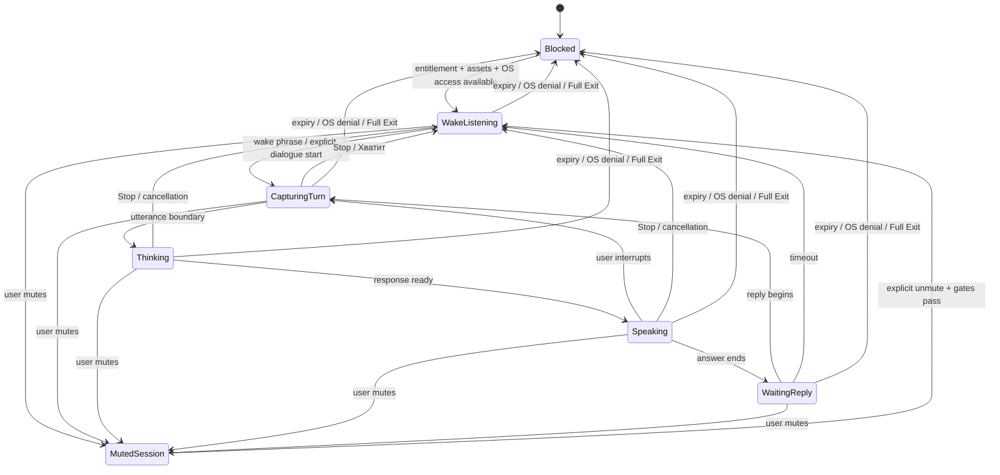

# Assistant, voice, integrations, and Windows capabilities

[Русская версия](ASSISTANT_DESIGN.ru.md) · [Component plan](COMPONENT_PLAN.md) · [Product requirements](../PRODUCT.md) · [Planner core](PLANNER_CORE.md) · [Remaining design work](REMAINING_PLAN.md) · [Approved decisions](DECISIONS.md)

Date: 2026-11-03. Status: detailed design proposal for CP08–CP14. This document turns existing product requirements into reviewable contracts and workflows. It does not approve application code, specific runtimes, APIs, provider SDKs, model assets, or Windows implementation details.

## 1. Approval boundary and design register

The confirmed product boundary is local-only language-model inference, local user data, no own remote application backend, offline local planner/voice/conversation when entitlement and resources permit, and network access for external search, live weather, connected providers and approved resource downloads. Expired access or missing/denied microphone prerequisites stop capture and proactive speech. The exact character/voice assets requested by the owner remain subject to commercial rights review.

The following AD records are technical recommendations for review, not approved architecture decisions. They do not select implementation technologies or versions.

| ID | Proposed design direction | Still unselected |
| --- | --- | --- |
| AD01 | A local model coordinator sends bounded requests through a `LocalModelPort`; only a typed tool registry may translate a validated model proposal into a core command. | Runtime/API, transport, context limits, cancellation details, model profile and decoding parameters. |
| AD02 | Build a read-only, query-scoped context bundle from authorized local reads; persist no inferred long-term memory. | Ranking, size limits, summary strategy, transient-buffer policy and retention implementation. |
| AD03 | Drive wake listening, dialogue, mute and speech through one guarded audio state machine; microphone capture is owned by one session service. | ASR/KWS/VAD/echo-control implementations, audio device policy and runtime measurements. |
| AD04 | Treat character persona text, TTS rendering, voice assets and rights evidence as separate records; block release use until required rights are documented. | Voice-production route, actor/language version, formats, runtime and licensing terms. |
| AD05 | Store reminder occurrences and delivery keys durably; treat timers and OS notifications as adapters over persisted due work. | Job implementation, retry/cooldown values, notification API and retention. |
| AD06 | Use provider adapters, a synchronized base and a durable local outbox; keep external acknowledgement separate from local commit. | OAuth flow details, SDKs, provider projection/edit mappings and retry policy by operation. |
| AD07 | Expose narrowly typed Windows capabilities backed by user-selected app/path grants and explicit per-action policy checks. | App identity, path-selection APIs, argument validation, device-action list and OS API bindings. |
| AD08 | Separate typed search/weather adapters with evaluated commercial paths and explicit query/city disclosure. | Provider agreement, credential/cost model, geocoding, coverage and limits; browser handoff alone is not the full feature. |

## 2. CP08 — Local model orchestration, tools, context, and memory

### Contract

The Python host owns a `ConversationCoordinator`. It accepts a user turn and returns a structured `TurnResult`; it never accepts a model-generated SQL statement, shell command, arbitrary URL, filesystem path, or raw provider request as an executable instruction.

Recommended boundary types:

| Type | Fields / rule |
| --- | --- |
| `UserTurn` | `turn_id`, text or local transcript, locale, reference instant, active dialogue ID. |
| `ContextBundle` | Requested local facts with source IDs/revisions, provenance, access scope and freshness; no credentials or unrelated records. |
| `ToolProposal` | Registry tool ID, schema-versioned JSON arguments, optional explanation; untrusted until validated. |
| `ValidatedIntent` | Typed domain command plus clarification or confirmation requirements, produced only after validation and policy checks. |
| `TurnResult` | Answer, clarification, pending confirmation, local commit result, provider state, or explicit unavailable/error state. |

### Workflow

1. Confirm entitlement, required model assets and local service readiness. If unavailable, expose manual planner functions where allowed and return a clear assistant-unavailable result.
2. Resolve the user turn against current time, locale and dialogue state. Ask for clarification when target, date, or meaning is ambiguous; do not ask the model to invent missing required values.
   For a user-entered local time in a daylight-saving gap, offer the valid nearest time; for a fold with two valid instants, show both choices and require confirmation. This is a confirmed interaction rule. The exact time-zone database/API and stored representation remain proposed; do not apply this prompt implicitly to external meetings or retime historical records.
3. Query only the local data needed for this intent. The context builder returns a bounded, read-only `ContextBundle`; it does not send user data to a cloud model.
4. Ask the local model for ordinary text or a proposal from the registered typed tools. Structured/JSON-constrained output can reduce malformed responses, but it is not a trust boundary: parse, validate schema and domain invariants independently. [llama.cpp server documentation](https://github.com/ggml-org/llama.cpp/tree/master/tools/server) describes structured output and tool-call interfaces; this is a candidate capability reference, not a runtime selection.
5. The registry maps only known tool IDs to application commands. Re-resolve targets and revisions, then apply clarification, confirmation, remembered grant, and per-operation permission rules from the core. A model call alone never mutates state or executes a provider/file/device action.
   A day-plan request delegates ranking and placement to the planner domain. The model does not rank tasks itself: the confirmed policy considers deadline first, then priority; tasks without a deadline use priority.
6. If a local mutation is accepted, submit the typed command to the core. Return only its committed result. If a network action is needed, create the permitted provider intent and report `queued` separately from `confirmed`.
7. Model output is treated as content, not policy. Email bodies, event descriptions, imported documents and web pages may contain hostile instructions; they must never add tools or expand granted scope.

### Memory boundary

Persistent profile memory is limited to the user's stored name/nickname and the city/location choice already specified by product requirements. Conversation history is a separate local record with configurable retention, 30-day default, disable and delete controls. When history is disabled, do not persist message transcripts; keep only the minimum active turn data needed to finish a current request, then discard it under a policy still to be designed. Do not silently extract durable preferences, habits, relationships or facts from conversation. Any future memory feature requires a separate product decision.

Conversation summaries may be proposed as a technical way to fit context, but must remain local, derived from permitted history, replaceable from the original records, and subject to the same retention/deletion behavior. Summary format, pruning, token limits, tool round limits, model timeout and cancellation semantics are unselected.

### Failure behavior

| Condition | Proposed behavior |
| --- | --- |
| Model unavailable, invalid output, or timeout | Return a bounded assistant error; preserve planner data and allow authorized manual operation. Do not fallback to cloud inference. |
| Unknown tool or schema mismatch | Reject the proposal, log minimal technical metadata, and ask the user to rephrase or retry. |
| Stale target/revision | Re-read and clarify or return a conflict; never apply a stale generated proposal. |
| Context lookup denied or unavailable | Omit that context and state the limitation; do not substitute broader access. |
| Model attempts a prohibited action | Do not invoke it; route through normal permission/confirmation checks or refuse. |

Future acceptance cases (not run): malformed tool JSON never mutates data; a valid tool proposal still passes core validation; no cloud endpoint is called when local inference fails; history-off retains no durable transcript; unrelated data is absent from context; stale revisions produce clarification/conflict; imported hostile text cannot expand tool permissions.

## 3. CP09 — Microphone, wake phrase, recognition, and dialogue

### Audio ownership and states

Recommend one `AudioSession` owner for microphone capture, wake detection, turn recognition and the handoff to dialogue. UI and tray display its state; they do not open competing capture streams. The owner-facing mute control must stop capture for both wake detection and active dialogue.

| State | Capture / output | Entry and exit conditions |
| --- | --- | --- |
| `Blocked` | No microphone capture; no proactive speech. | Startup guard fails: expired access, OS denial, Full Exit, missing required local audio resources, or unavailable audio device. Re-evaluate only on a permitted lifecycle/permission change. |
| `MutedSession` | No microphone capture and no wake detection. | User mutes; lasts for the current app session. Unmute is explicit. A genuine app/Windows restart resets manual mute only if entitlement/resources are valid and Windows permits access. |
| `WakeListening` | Local wake detection only. | Entitlement, resources and OS permission pass; no active dialogue. Wake phrase is the selected character name (user may change it). |
| `CapturingTurn` | Capture active speech for recognition. | Wake detected or user explicitly starts a dialogue. Stop capture at turn boundary, then return to wake detection unless dialogue continues. |
| `Thinking` | No continuous capture unless the implementation needs a bounded barge-in detector; that detail requires review. | A recognized utterance is being interpreted locally and checked against typed tools. |
| `Speaking` | TTS output. | Local response audio is playing. New user speech interrupts output as required; cancel playback and move to `CapturingTurn`. |
| `WaitingReply` | Wake/turn input available according to the selected local audio strategy. | Assistant answer completed; wait 30 seconds by default for next reply, configurable. On timeout return to `WakeListening`. |

Product behavior: after activation, do not require the wake phrase for every dialogue turn. «Хватит» / “Stop” ends the dialogue and returns to wake listening unless muted, blocked or Full Exit. The post-answer wait is not a cap on active user speech, inference or TTS. Barge-in starts a new user utterance and interrupts TTS; it does not itself grant a command.

The diagram is a proposed control model. Exact event ordering, capture permissions and audio framework remain unselected. At every capture start, recheck entitlement, resources and OS permission; OS permission can be revoked while the app is running. [Windows capability guidance](https://learn.microsoft.com/en-us/windows/apps/develop/app-capabilities) notes microphone permission and denial cases. Do not claim listening when capture is actually blocked, or indicate mute only through color.

### Recognition boundary and errors

`RecognitionResult` should carry transcript, language, final/partial status, timing and a confidence/quality signal if the chosen engine supplies one. Confidence is advisory: low quality or competing interpretations trigger a clarification, never a guessed high-impact action. Approved policy: original microphone audio stays only in RAM for current recognition and is never recorded to disk, including diagnostics. This is separate from permitted local text history. Wake phrase and ASR resources remain local; their languages, false-trigger rates, CPU use, audio device switching and licensing need evaluation. [sherpa-onnx keyword spotting](https://k2-fsa.github.io/sherpa/onnx/kws/index.html) and [public API reference](https://k2-fsa.github.io/sherpa/onnx/c-api/html/) document candidate local KWS/ASR capabilities, not approved assets.

| Failure | Recovery |
| --- | --- |
| OS permission denied/revoked | Stop capture immediately, enter `Blocked`, show a state and settings route. |
| No audio device or model resource | Do not claim wake availability; offer text interaction if permitted. |
| Recognition uncertain | Ask the user to repeat or clarify; do not execute. |
| TTS is interrupted | Cancel queued audio and prioritize the new user utterance; guard against recognizing assistant playback as user speech. |
| Host restart | Reconstruct state from access/OS/resource gates; manual mute resets only on a genuine app/Windows restart as required. |

Future acceptance cases (not run): all startup gates prevent capture; mute stops wake and dialogue capture immediately; window reopen is not treated as restart; app/Windows restart resumes only if all gates pass; Stop returns to wake listening but is not global mute; configurable 30-second default applies only after answer; speaking user interrupts TTS; OS permission revocation stops capture; audio is not persisted when history is off.

## 4. CP10 — Speech output, personas, voice assets, and rights

### Separation of content and voice

Propose `PersonaProfile` as presentation data (`persona_id`, character label, permitted style guidance, selected language/voice asset reference). It does not grant the model extra tools or authority. A `SpeechRequest` contains approved response text, locale, persona and cancellation token; a `SpeechResult` contains playback state and an asset/runtime identifier, not a claim about legal rights.

The owner explicitly wants the named characters Jarvis, Rick Sanchez and Sebastian from *Black Butler*, with recognizable voices; an original substitute is not the target. The identified Sebastian reference is inferred from the named series; exact dub/actor and language remain unconfirmed. The supplied MP3 stays local. Product design must separate (a) runtime/model license, (b) character and trademark permissions, (c) actor/voice performance or voice-synthesis rights, and (d) the local MP3's source and usage rights. None of these commercial permissions has been verified. WIPO material is background for later review, not legal advice: [WIPO copyright overview](https://www.wipo.int/documents/d/copyright/docs-en-wo_inf_108.pdf).

Recommended asset manifest fields: stable asset ID, character/persona, language/locale, format, checksum, source/provenance, license evidence reference, territory/use/term restrictions, and status (`candidate`, `reviewed`, `approved-for-release`, `blocked`). This is an internal design proposal; no rights database or asset pipeline is approved. A release build should select only assets whose usage scope has been documented for the intended product and territory. If no eligible recognizable voice is available, report the unresolved product/rights constraint to the owner; do not silently substitute an unrelated voice.

### Playback flow

1. The local answer is finalized or streamed in cancellable text chunks; do not speak unvalidated tool arguments or hidden reasoning.
2. Resolve persona and language from explicit user settings; if an asset is unavailable or disallowed, show/surface text and a clear voice-unavailable state.
3. Render locally using an eligible local voice resource. The renderer cannot upload text/audio for cloud synthesis under the current local-only AI requirement.
4. Stream audio to a single playback owner. User barge-in cancels remaining audio and returns control to CP09 capture; Stop cancels speech and ends dialogue.
5. Record only minimal operational outcome (completed/interrupted/failed) unless history settings explicitly allow a conversation record. Do not store generated audio by default.

| Failure | Proposed response |
| --- | --- |
| Voice model/asset absent | Keep text response available; do not claim the requested recognizable voice played. |
| Asset license status blocked/unknown | Do not use it in a commercial release path pending rights review. |
| TTS failure or playback device loss | End playback cleanly, preserve text, and expose retry/accessibility path. |
| Interrupted output | Cancel queued chunks so stale speech does not continue after the user's new request. |

Future acceptance cases (not run): each persona maps to the selected character and language; asset manifest provenance and rights status is reviewed; unsupported voice never silently changes character; local-only synthesis performs no cloud inference call; barge-in cancels audio; output failure preserves text; no audio recording is retained by default.

## 5. CP11 — Durable reminders, catch-up, and proactive speech

### Reminder records and scheduler

The core remains authoritative for reminder targets and task/habit state. Propose a durable `ReminderDefinition` and `DeliveryOccurrence` keyed by target ID/revision, trigger occurrence and channel. A `DueWork` read model is rebuilt from persisted rows after app start, resume, timezone/settings edits and target changes. A timer is only a wake-up optimization; losing it must not lose the reminder.

Recommended lifecycle: `scheduled → due → awaiting-policy → dispatched → delivered/failed/unknown/cancelled`. Persist the transition and logical delivery key before invoking an OS notification or TTS adapter. After invocation, record the adapter's response separately; a process crash between those steps may produce `unknown`, which must be reconciled or surfaced rather than replayed blindly. Acknowledging/dismissing a notification and completing its task are separate actions.

Policy is evaluated at delivery time: valid entitlement, target still relevant, notification permission, proactive setting, quiet-hours state, call/game/manual quiet state, current user context, and microphone/session state when speech is used. If proactive voice is suppressed, use an ordinary OS notification when permitted. Do not mute the microphone or change a user-requested active conversation merely because proactive speech is suppressed.

After sleep/restart, make one aggregated catch-up summary of missed reminders, excluding obsolete/cancelled/completed targets. Speech remains subject to initiative consent/settings, quiet hours, call/game/manual quiet, current context, access and OS permission. Maximum frequency, exact aggregation window, delivery cooldowns and duplicate behavior remain proposals requiring review; no arbitrary values are introduced here. No guaranteed alarm is promised while the app/OS/computer is unavailable.

### Delivery boundary

`ReminderNotice` includes target identity/type, due occurrence, short safe display text, urgency/presentation hint and deep-link target. TTS and Windows notification adapters consume this value but cannot complete, move, delete, or reschedule the underlying item. Activation of a notice routes to a current read model and revalidates that the target still exists. Windows desktop toast setup has an AppUserModelID/shortcut requirement; implementation feasibility is a packaging task, not a claim of current capability. [Windows desktop toast quickstart](https://learn.microsoft.com/en-us/windows/win32/shell/quickstart-sending-desktop-toast).

| Failure | Proposed recovery |
| --- | --- |
| Host stopped/asleep | Persist due state; evaluate the one-summary catch-up policy at next eligible resume. |
| Notification permission denied | Do not claim delivered; retain visible in-app state where the app is available. |
| Target changed/completed/cancelled | Cancel stale delivery occurrence and rebuild. |
| Crash after dispatch with uncertain result | Mark/reconcile `unknown`; do not flood by blind replay. |
| Expired entitlement | Stop paid assistant jobs, speech and microphone capture; preserve user data. Only renewal/import, user-requested deletion and backup maintenance remain available. |

Future acceptance cases (not run): reminder survives host restart; duplicate scheduler wakeups yield one logical delivery; stale targets are removed; a quiet/call/game state routes to ordinary notification when allowed; catch-up produces one summary; disabled initiative never produces proactive speech; OS permission denial is visible; expiry stops assistant jobs while backup maintenance remains usable.

## 6. CP12 — Google Calendar, Outlook, Gmail, and the local outbox

### Local and provider records

The application's calendar, notes and projects work independently. Provider adapters are optional boundaries, not the source of all product data. A provider mapping stores local ID, provider/calendar ID, provider item ID, recurrence-instance identity where relevant, last-seen provider revision/ETag or delta cursor, a last-synchronized base representation, and current sync status. Credential material and provider caches are separate from content records and ordinary backups.

The approved calendar scope is bidirectional sync of user-selected Google Calendar and Outlook calendar events and task time blocks. Habit sync is separate opt-in and defaults off. Do not expand this to Google Tasks, all calendars, notes/projects/attachments/mail sync, or an implicit task/habit deletion. F1 projection and edit mappings remain open. A task block maps to a task occurrence and placement; removing the exported block does not delete that occurrence.

### Sync transaction and conflict workflow

1. Pull provider changes into a staged batch with cursor/page state; validate and normalize before changing local records.
2. Compare incoming revisions with the last-synchronized base and local revision. If only the provider changed, apply a safe mapped update. If only local changed, enqueue an outbound update. If both changed, persist both versions and require the user to choose; do not use last-write-wins.
3. If the provider deleted an event and the local copy is unchanged since last sync, ask before local removal. If the local item changed too, use the conflict-choice path. Do not treat removal of an exported time block as deletion of its task or habit.
4. When the user completes a split task occurrence, release only that occurrence's future planned blocks and preserve completed/progress history. Do not complete other recurrence occurrences. Exact reconciliation of a provider's already-exported blocks remains part of the mapping contract.
5. Commit local mapping, cursor and outbox transition atomically in PostgreSQL. Network calls occur outside that transaction. A local queued intent is not provider success.
6. Apply outbound work only after rechecking current permission, target revision and exact payload. Provider acknowledgement updates the mapping/base; uncertain outcomes become `unknown` and reconcile before any retry that could duplicate an effect.

Google Calendar sync tokens support incremental sync and may be invalidated, requiring a full sync; preserve the old local state and user choices rather than wiping local content as a recovery shortcut. [Google Calendar incremental sync](https://developers.google.com/workspace/calendar/api/guides/sync). Microsoft Graph delta is also a change-tracking mechanism for local synchronization. [Microsoft Graph delta query](https://learn.microsoft.com/graph/delta-query-overview). Exact provider semantics and projection remain provider-specific.

### Gmail action boundary

One general user-controlled Gmail permission toggle bundles read/search, drafts and sending. This does not allow silent full-mailbox mirroring or broad mailbox administration. Keep retrieved content local and bounded to the user request; do not create persistent copies beyond the cache/history rules still to be designed. Use the narrowest feasible authorization scopes and complete provider verification where required; exact scopes/SDK/cache policy are unselected. Google's scope guidance distinguishes access levels and verification requirements. [Gmail API scopes](https://developers.google.com/workspace/gmail/api/auth/scopes).

Draft creation/update is a provider operation with a visible local result. Every send requires a fresh confirmation bound to exact recipients, body and attachments. A changed payload or recipients invalidates that confirmation. After dispatch timeout, mark outcome unknown and reconcile or ask; never blindly resend and never announce success/failure as certain until known. The Gmail API exposes distinct draft/send operations; its existence does not provide a generic exactly-once guarantee. [Gmail send workflow](https://developers.google.com/workspace/gmail/api/guides/sending).

Recommended outbox fields: stable action ID, operation type, exact target/payload hash, permission snapshot, confirmation reference, created revision, state, attempt metadata, provider response/correlation identifiers and next reconciliation step. These are proposed fields, not approved SQL. Do not store access tokens in outbox payloads.

| Failure | Proposed response |
| --- | --- |
| Network unavailable | Preserve local data; mark provider work queued/offline. Do not call it synchronized. |
| Cursor expired | Start a provider-specific resync while preserving local records and conflicts; do not erase local user data. |
| Both sides changed | Preserve both versions and request explicit resolution. |
| Provider deletion, local unchanged | Ask before local removal. |
| Provider deletion, local changed | Show a conflict; do not silently delete. |
| Send timeout after dispatch | Reconcile; if still uncertain, disclose uncertainty and ask. No automatic resend. |
| Permission revoked | Stop new provider requests and mark adapter disconnected; internal calendar/projects/notes remain available. |

Future acceptance cases (not run): only selected calendars/events and task blocks sync; habit sync requires opt-in; prohibited categories remain local; external delete of unchanged event asks; dual edits require user choice; draft action never sends; exact send confirmation is invalidated by payload change; timeout cannot cause blind resend; reconnect status distinguishes queued, applied and unknown.

## 7. CP13 — Internet search, weather, and data disclosure

### Provider boundary

Internet search and live weather are network capabilities separate from the local language model. Define typed requests such as `SearchRequest(query, locale)` and `WeatherRequest(city, locale, units)` and typed responses containing provider identity, result title/snippet, source URL, retrieval time, and freshness/status. Do not send the conversation transcript or unrelated profile/task data. Weather requires only the user-selected city; precise GPS is not required. Automatic city detection remains optional and permission-gated.

The local model may summarize returned provider material, but each answer should distinguish retrieved facts from generated explanation and expose source links near claims where the provider returns them. Unavailable network means no live result; cached output, if later approved, must be clearly marked with its retrieval time. Never label stale data as current. Treat pages and search snippets as untrusted input, not tool instructions.

Provider choice depends on terms, availability, attribution, cost, regional coverage and key distribution. A commercial secret must not be embedded in the client. No own proxy or remote application backend is implied. Options such as a no-secret public endpoint, user-supplied credential protected locally, or separately approved provider arrangement remain proposals; do not choose a provider or add account/API-key UI without a decision. Provider selection and its secret-handling model require a separate review.

Propose distinct `SearchPort`, `WeatherPort` and mediated `SourceReadPort`. Source reads accept handles returned by a validated search result, not arbitrary model-supplied network requests. If full-page retrieval is supported, a network policy validates schemes, public destinations and each redirect/resolution, rejects local/private services, bounds response size/time and returns text plus provenance. It must not expose the local host/database or execute page scripts. Parsing/runtime and exact limits remain technical review items. Cancellation discards a pending answer; a failed fetch never becomes a fabricated citation.

### Evaluated provider paths, not selected providers

| Candidate | Concrete fit | Unresolved condition |
| --- | --- | --- |
| MET Norway Locationforecast | Public forecast with attribution and identifying User-Agent; city coordinates from a separately reviewed local catalog or geocoder | Confirm direct desktop use and expected traffic; no SLA/anonymity promise. Direct calls disclose IP/coordinates. [MET terms](https://api.met.no/doc/TermsOfService), [forecast FAQ](https://docs.api.met.no/doc/locationforecast/FAQ.html) |
| Open-Meteo commercial endpoint | Forecast and documented city geocoding | Free service excludes commercial subscription apps. Review a paid direct-client arrangement or suitable user-owned credential; never bundle a vendor secret. [Commercial terms](https://open-meteo.com/en/terms), [geocoding](https://open-meteo.com/en/docs/geocoding-api) |
| Brave standard Search API | Structured results for local answers and source links | Standard authentication uses a confidential token; user-owned accounts/keys are candidates after terms review. No shared secret in the distribution. Other payment protocols are not evaluated here. [Authentication](https://api-dashboard.search.brave.com/documentation/guides/authentication), [terms](https://api-dashboard.search.brave.com/documentation/resources/terms-of-service) |
| Search in the user's browser | Optional handoff without a bundled API secret | Returns no structured results to Djarvis and alone does not satisfy automatic in-app research. No scraping or browser reading is implied. |

Inference from these constraints: a zero-configuration commercial search/weather feature is not yet established under the no-own-backend rule. Preserve the requested functionality as unresolved, rather than replacing it with browser handoff. The owner chooses acceptable external-account/cost constraints; then verify provider terms, attribution, regions, privacy and limits. Public geocoders are not unlimited: [Nominatim policy](https://operations.osmfoundation.org/policies/nominatim/) restricts rate and autocomplete. No provider account or API action was created.

### Failure and privacy table

| Condition | Behavior |
| --- | --- |
| Offline/provider unavailable | State that live search/weather is unavailable; local planner and conversation remain local. |
| Provider returns empty/partial data | Explain the limitation; do not invent a result. |
| Cache is present but stale | Show timestamp and stale status; do not imply it is live. |
| Provider payload includes instructions | Treat as quoted/untrusted content; no change to tool registry or permissions. |
| Location permission absent | Use manually entered city only; no precise location request. |
| Secret or attribution terms unclear | Do not ship a client integration until reviewed. |

Future acceptance cases (not run): local prompt is not sent to a cloud LLM; search receives only the explicit query; weather receives only the configured city; precise GPS is never required; source and retrieval time remain visible; stale cache is labeled; provider output cannot trigger tools; no commercial secret appears in client distribution; own proxy is not silently added.

## 8. CP14 — Windows programs, files, and device actions

### Typed capability surface

The model and conversational parser may propose a capability request, but a fixed Windows adapter registry decides whether it exists and the core decides whether it is allowed. Avoid a generic shell, scripting, SQL, arbitrary process-argument, or unrestricted filesystem tool.

| Request type | Scope and guard |
| --- | --- |
| `LaunchSelectedApplication` | User-selected app allowlist; revocable grant can suppress repeat confirmation for that list. Resolve a stable app identity and safe launch target; reject arbitrary executable paths/arguments. Identity and validation API remain proposals. |
| `ReadSelectedFile` | Only a user-selected file/path scope and requested read purpose. Revalidate access and file identity at use time; disclose what will be read. Broader path grant design remains open. |
| `DeleteUserFile` | Always confirm exact path/name and the destructive effect immediately before action. A task-delete grant never covers files. |
| `OverwriteUserFile` | Always confirm exact destination and proposed replacement; verify destination again immediately before writing. Preserve a recoverable temporary copy where practical, but exact recovery policy remains open. |
| `WindowsShutdown`, `WindowsRestart`, `WindowsLogout` | Confirm every individual action. Task permissions and Gmail toggle do not bypass confirmation. These actions differ from app Full Exit and dialogue Stop. |
| Other device action | No generic grant; exact supported action list and confirmation policy remain unselected. |

Application-launch grant is limited to launching items explicitly selected by the user; it is not permission to run scripts or arbitrary command-line arguments. Keep the allowlist revocable and recheck it at execution. Windows application identity and launch APIs need investigation; [ShellExecuteEx](https://learn.microsoft.com/en-us/windows/win32/api/shellapi/nf-shellapi-shellexecuteexw) is an OS operation interface, not a safe authorization policy by itself.

### File operation workflow

1. Resolve a user request to one exact item. If multiple targets match, ask which one; never infer a broad folder from ambiguous phrasing.
2. Read metadata needed for the operation within granted scope. Do not follow a link, archive entry or document instruction into another path automatically.
3. For a read, show/source the selected document and use only the relevant requested content in local context. For deletion or overwrite, present the precise path and effect and require an immediate fresh confirmation regardless of remembered task permissions.
4. Revalidate path, identity, grant and revision after confirmation. If the target changed or moved, ask again. Stage writes and verify completion before reporting success.
5. For uncertain completion, inspect the target state; do not retry destructive effects blindly.

### Error behavior and evidence

| Failure | Response |
| --- | --- |
| App identity cannot be resolved or target is not allowlisted | Refuse launch and let the user choose/configure the app. |
| OS blocks launch/access | Report the OS result; do not bypass consent or elevate privileges. |
| File changed after confirmation | Cancel and re-present the changed action. |
| Delete/overwrite result is unknown | Reconcile exact target state; do not repeat without a safe determination. |
| Device action is not in the reviewed registry | Ask for product design; do not synthesize a command. |

Future acceptance cases (not run): only allowlisted app launches use a remembered grant; changing the target invalidates it; no generic shell or arbitrary arguments; reads stay within selected scope; every file delete/overwrite shows exact target and requires confirmation; task deletion grant cannot delete files; shutdown/restart/logout each confirm; other device capabilities remain unavailable until explicitly designed; OS denial is respected.

## 9. Cross-component transaction and lifecycle checks

These checks join CP08–CP14 to the already approved core and product rules:

- No capture, proactive speech, model work or paid assistant job starts without valid entitlement and required local resources. Microphone use also checks Windows permission. At expiry, data remains; renewal/import, user-requested deletion and automatic backup maintenance stay available.
- Model, speech recognition and synthesis are local for the current release. External providers require network; local queue state never means remote success, and a network failure never invokes cloud-model fallback.
- User intent is parsed into typed values, validated, and then checked by existing confirmation/grant rules. Ambiguous targets always require clarification. Email sending and file delete/overwrite always confirm their exact payload/target.
- Core transactions remain short and local. Never hold a PostgreSQL transaction while waiting for user confirmation, model generation, audio, OS UI, or a provider response.
- Background jobs persist due state and stable delivery/action keys. On restart, reconcile before repeating operations with uncertain external effects.
- User-visible status distinguishes local saved, queued, provider confirmed, conflict, outcome unknown, blocked, and failed states. Narration must not claim success before the responsible boundary confirms it.

## 10. Design review and future verification

Before implementation, review each AD record, API boundary, state transition, error path, permission check and data-retention effect with the owner. Product choices are limited to user-facing and commercial tradeoffs; component interfaces, schema details, SDKs, internal retries and process mechanics remain technical proposals until the final architecture and implementation plan are separately approved.

Future end-to-end verification should include model offline/failure paths; no tool execution from malformed or hostile text; history disabled/deleted behavior; wake/mute/expiry/OS permission transitions; 30-second post-answer wait and barge-in; requested voice rights gate; restart-safe reminders and one catch-up summary; selected-calendar sync conflicts; Gmail toggle and exact per-send confirmation; unknown send result without resend; network-disabled search/weather; allowlisted launch; confirmed file deletion/overwrite; and shutdown/restart/logout confirmations. These are future cases only; no application tests or performance measurements have been run.

### Technical sources

- [llama.cpp server interfaces](https://github.com/ggml-org/llama.cpp/tree/master/tools/server) and [structured grammar notes](https://github.com/ggml-org/llama.cpp/blob/master/grammars/README.md): candidate local inference/tool/structured-output capabilities.
- [sherpa-onnx keyword spotting](https://k2-fsa.github.io/sherpa/onnx/kws/index.html) and [public speech API](https://k2-fsa.github.io/sherpa/onnx/c-api/html/): candidate offline KWS/ASR/TTS surface.
- [Windows microphone capability](https://learn.microsoft.com/en-us/windows/apps/develop/app-capabilities) and [desktop toast](https://learn.microsoft.com/en-us/windows/win32/shell/quickstart-sending-desktop-toast): OS permission and notification constraints.
- [Google Calendar incremental sync](https://developers.google.com/workspace/calendar/api/guides/sync), [Microsoft Graph delta query](https://learn.microsoft.com/en-us/graph/delta-query-overview), [Gmail scopes](https://developers.google.com/workspace/gmail/api/auth/scopes), and [Gmail sending](https://developers.google.com/workspace/gmail/api/guides/sending): provider contracts and authorization constraints.
- [Windows ShellExecuteEx](https://learn.microsoft.com/en-us/windows/win32/api/shellapi/nf-shellapi-shellexecuteexw): launch primitive; it does not define Djarvis permissions.
- [WIPO copyright overview](https://www.wipo.int/documents/d/copyright/docs-en-wo_inf_108.pdf): background for voice/character rights review, not a legal conclusion.
