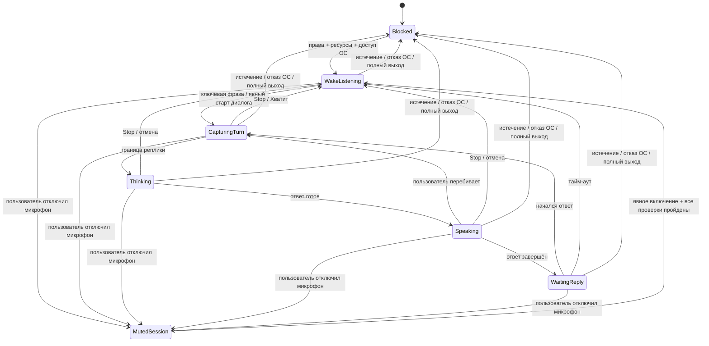

# Проектирование ассистента, речи, интеграций и возможностей Windows

[English version](ASSISTANT_DESIGN.md) · [План компонентов](COMPONENT_PLAN.ru.md) · [Требования продукта](../PRODUCT.ru.md) · [Ядро планировщика](PLANNER_CORE.ru.md) · [Оставшиеся проектные вопросы](REMAINING_PLAN.ru.md) · [Утверждённые решения](DECISIONS.ru.md)

Дата: 2026-11-03. Статус: подробное проектное предложение для CP08–CP14. Документ превращает существующие требования продукта в проверяемые контракты и сценарии. Он не утверждает код приложения, конкретные среды выполнения, API, SDK провайдеров, ресурсы моделей или детали реализации для Windows.

## 1. Границы утверждения и реестр предложений

Подтверждённая граница продукта: локальный вывод языковой модели, локальные данные пользователя, отсутствие собственного удалённого сервера приложения, офлайн-работа локального планировщика/голоса/разговора при наличии прав доступа и ресурсов; сеть нужна для внешнего поиска, актуальной погоды, подключённых провайдеров и согласованных загрузок ресурсов. Истёкший доступ, отсутствие обязательных ресурсов или отказ ОС останавливают захват звука и инициативную речь. Точные запрошенные владельцем персонажи и голосовые ресурсы ещё требуют проверки коммерческих прав.

Следующие записи AD — технические рекомендации на рассмотрение, а не утверждённые архитектурные решения. Они не выбирают технологии и их версии.

| ID | Предлагаемое направление | Что ещё не выбрано |
| --- | --- | --- |
| AD01 | Локальный координатор модели передаёт ограниченные запросы через `LocalModelPort`; только типизированный реестр инструментов может преобразовать проверенное предложение модели в команду ядра. | Среда выполнения/API, транспорт, лимиты контекста, детали отмены, профиль модели и параметры генерации. |
| AD02 | Формировать доступный только для чтения контекст по конкретному запросу из разрешённых локальных чтений; не сохранять выведенную моделью долгосрочную память. | Ранжирование, ограничения размера, стратегия сводок, политика временных буферов и реализация хранения. |
| AD03 | Управлять ожиданием ключевой фразы, диалогом, отключением микрофона и озвучиванием через одну защищённую машину состояний; захватом звука владеет одна сессия. | Реализации ASR/KWS/VAD/эхоподавления, выбор аудиоустройства и измерения производительности. |
| AD04 | Разделить текст персоны, синтез речи, голосовые ресурсы и подтверждения прав; не использовать ресурс в релизе, пока необходимые права не задокументированы. | Путь производства голосов, актёр/языковая версия, форматы, среда выполнения и условия лицензий. |
| AD05 | Хранить в базе события напоминаний и ключи доставки; таймеры и системные уведомления считать адаптерами над сохранённой работой. | Реализация заданий, значения повторов/паузы, API уведомлений и сроки хранения. |
| AD06 | Использовать адаптеры провайдеров, синхронизированную базовую версию и локальную очередь исходящих операций; отделять подтверждение провайдера от локальной фиксации. | Детали OAuth, SDK, проекции данных провайдера, сопоставления правок и политика повторов для операций. |
| AD07 | Предоставлять узкие типизированные возможности Windows с грантами на выбранные пользователем приложения/пути и явными проверками политики на каждое действие. | Идентификация приложений, API выбора путей, проверка аргументов, перечень действий устройства и привязки к API ОС. |
| AD08 | Отдельные типизированные адаптеры поиска/погоды с рассмотренными коммерческими вариантами и явным раскрытием запроса/города. | Договорённость с поставщиком, ключи/стоимость, геокодирование, покрытие и лимиты; один переход в браузер не выполняет всю функцию. |

## 2. CP08 — Оркестрация локальной модели, инструменты, контекст и память

### Контракт

Хост Python владеет `ConversationCoordinator`. Он принимает ход пользователя и возвращает структурированный `TurnResult`; он не принимает сгенерированный моделью SQL, команду оболочки, произвольный URL, путь к файлу или сырой запрос провайдера как исполняемую инструкцию.

Рекомендуемые типы границы:

| Тип | Поля / правило |
| --- | --- |
| `UserTurn` | `turn_id`, текст или локальная расшифровка речи, язык/регион, опорный момент времени, активный ID диалога. |
| `ContextBundle` | Запрошенные локальные факты с исходными ID/ревизиями, происхождением, областью доступа и актуальностью; без учётных данных и посторонних записей. |
| `ToolProposal` | ID инструмента из реестра, аргументы JSON с версией схемы, необязательное пояснение; недоверенный до проверки. |
| `ValidatedIntent` | Типизированная команда предметной области, а также требования уточнить или подтвердить; создаётся только после проверки и политики. |
| `TurnResult` | Ответ, уточнение, ожидающее подтверждения действие, результат локальной фиксации, статус провайдера либо явное состояние недоступности/ошибки. |

### Сценарий работы

1. Проверить право доступа, обязательные ресурсы модели и готовность локальных служб. Если что-то недоступно, предоставить разрешённые ручные функции планировщика и сообщить, что ассистент недоступен.
2. Разобрать ход с учётом текущего времени, языка/региона и состояния диалога. Если цель, дата или смысл неоднозначны, уточнить; не просить модель выдумывать обязательные значения.
   Для введённого пользователем местного времени в разрыве перехода на летнее/зимнее время предложить ближайшее допустимое время; при повторе времени с двумя допустимыми моментами показать оба варианта и потребовать подтверждение. Это подтверждённое правило взаимодействия. Точная база/API часовых поясов и формат хранения остаются предложением; не применять это уточнение автоматически к внешним встречам и не менять исторические записи.
3. Запросить только локальные данные, необходимые для намерения. Построитель контекста возвращает ограниченный доступный только для чтения `ContextBundle`; данные пользователя не передаются облачной модели.
4. Запросить у локальной модели обычный текст либо предложение из зарегистрированных типизированных инструментов. Ограничение формата JSON может сократить число некорректных ответов, но не является границей доверия: результат отдельно разбирается, проверяется по схеме и правилам предметной области. [Документация сервера llama.cpp](https://github.com/ggml-org/llama.cpp/tree/master/tools/server) описывает структурированный вывод и вызовы инструментов; это справка о возможностях-кандидатах, а не выбор среды выполнения.
5. Реестр сопоставляет только известные ID инструментов с командами приложения. Повторно разрешить цели и ревизии, затем применить правила уточнения, подтверждения, запомненных грантов и разрешений на операцию из ядра. Вызов модели сам по себе никогда не изменяет состояние и не выполняет действия провайдера/файла/устройства.
   Запрос плана дня передаёт ранжирование и размещение предметной области планировщика. Модель не ранжирует задачи сама: подтверждённая политика учитывает сначала срок, затем приоритет; задачи без срока упорядочиваются по приоритету.
6. Если разрешено локальное изменение, передать типизированную команду ядру. Возвращать только зафиксированный результат. Если требуется сеть, создать разрешённое намерение для провайдера и отдельно показать `queued` и `confirmed`.
7. Вывод модели считается содержимым, а не политикой. Тексты писем, описания событий, импортированные документы и веб-страницы могут содержать вредоносные инструкции; они не должны добавлять инструменты или расширять гранты.

### Границы памяти

Долговременная память профиля ограничена уже заданными требованиями: сохранённое имя/обращение пользователя и выбранный город/местоположение. История разговора — отдельная локальная запись с настраиваемым сроком, по умолчанию 30 дней, отключением и удалением. Если история отключена, расшифровки сообщений не сохраняются; остаются только минимальные активные данные, нужные для выполнения текущего запроса, после чего их следует удалить по ещё проектируемой политике. Не извлекать автоматически постоянные предпочтения, привычки, связи или факты из разговора. Для любой будущей функции памяти нужно отдельное продуктовое решение.

Сводки разговора можно предложить как технический способ уместить контекст, но они должны оставаться локальными, строиться только из разрешённой истории, заменяться пересозданием из исходных записей и подчиняться тем же правилам хранения/удаления. Формат сводок, очистка, лимиты токенов, число итераций инструментов, тайм-аут модели и семантика отмены не выбраны.

### Ошибки

| Условие | Предлагаемое поведение |
| --- | --- |
| Модель недоступна, вернула неверный результат или не ответила вовремя | Вернуть ограниченную ошибку ассистента; сохранить данные планировщика и разрешить ручную работу. Не переключаться на облачный вывод. |
| Неизвестный инструмент или несовпадение схемы | Отклонить предложение, записать минимум технических метаданных и попросить переформулировать или повторить. |
| Устаревшая цель/ревизия | Повторно прочитать данные и уточнить либо вернуть конфликт; не применять устаревшее предложение. |
| Нет доступа к контексту или чтение недоступно | Исключить контекст и сообщить ограничение; не расширять область доступа взамен. |
| Модель предлагает запрещённое действие | Не выполнять его; направить запрос через обычные проверки разрешений/подтверждения либо отказать. |

Будущие приёмочные случаи (не запускались): некорректный JSON инструмента не меняет данные; валидное предложение всё равно проверяется ядром; при сбое локальной модели облачная точка не вызывается; отключённая история не сохраняет расшифровку; посторонние данные отсутствуют в контексте; устаревшие ревизии вызывают уточнение/конфликт; вредоносный импортированный текст не расширяет разрешения.

## 3. CP09 — Микрофон, ключевая фраза, распознавание и диалог

### Владение аудио и состояния

Рекомендуется один владелец `AudioSession` для захвата микрофона, детекции ключевой фразы, распознавания ходов и передачи управления диалогу. UI и значок в области уведомлений показывают состояние, но не открывают конкурирующие потоки записи. Кнопка отключения микрофона должна прекращать захват звука и для ожидания ключевой фразы, и для активного диалога.

| Состояние | Захват / вывод | Условия входа и выхода |
| --- | --- | --- |
| `Blocked` | Захвата микрофона нет; инициативной речи нет. | Не пройдена стартовая проверка: истёк доступ, отказ ОС, полный выход, отсутствуют нужные локальные аудиоресурсы или аудиоустройство. Повторно проверить только при допустимом изменении состояния/разрешения. |
| `MutedSession` | Нет захвата микрофона и детекции ключевой фразы. | Пользователь отключил микрофон; состояние действует до конца сессии приложения. Включение — явное. Настоящий перезапуск приложения/Windows сбрасывает ручное отключение лишь при действительных правах/ресурсах и разрешении Windows. |
| `WakeListening` | Только локальная детекция ключевой фразы. | Доступ, ресурсы и разрешение ОС проверены; активного диалога нет. Ключевая фраза — имя выбранного персонажа, пользователь может её изменить. |
| `CapturingTurn` | Захват активной речи для распознавания. | Обнаружена ключевая фраза или пользователь явно начал диалог. На границе хода захват прекращается, затем возвращается ожидание фразы, если диалог не продолжается. |
| `Thinking` | Нет непрерывного захвата, кроме возможного ограниченного детектора перебивания; детали требуют рассмотрения. | Распознанная реплика обрабатывается локально и проверяется на соответствие типизированным инструментам. |
| `Speaking` | Вывод TTS. | Воспроизводится локальный ответ. Новая речь пользователя прерывает вывод по требованию; воспроизведение отменяется и состояние переходит в `CapturingTurn`. |
| `WaitingReply` | Приём следующего хода согласно выбранной локальной стратегии аудио. | Ответ ассистента завершён; по умолчанию ожидать следующий ответ 30 секунд, настройка доступна. По тайм-ауту перейти в `WakeListening`. |

Поведение продукта: после активации не требовать повторения ключевой фразы в каждом ходе. «Хватит» / “Stop” завершает диалог и возвращает ожидание ключевой фразы, если микрофон не отключён, доступ не заблокирован и не выполнен полный выход. Ожидание после ответа не ограничивает активную речь пользователя, вывод модели или TTS. Перебивание начинает новый пользовательский ход и останавливает TTS; само по себе оно не разрешает выполнение команды.

Диаграмма — предлагаемая модель управления. Точный порядок событий, разрешения захвата и аудиофреймворк не выбраны. Перед каждым началом захвата повторно проверять доступ, ресурсы и разрешение ОС; разрешение Windows может быть отозвано при работающем приложении. [Рекомендации Windows по возможностям приложений](https://learn.microsoft.com/en-us/windows/apps/develop/app-capabilities) описывают разрешение на микрофон и отказ. Нельзя показывать, будто прослушивание работает, если захват заблокирован, и нельзя обозначать отключение только цветом.

### Граница распознавания и ошибки

`RecognitionResult` должен содержать расшифровку, язык, признак промежуточного/финального результата, временные отметки и сигнал уверенности/качества, если выбранный движок его предоставляет. Уверенность — только подсказка: низкое качество или несколько возможных трактовок требуют уточнения, а не угадывания важного действия. Принятое правило: исходный звук микрофона остаётся только в RAM для текущего распознавания и не записывается на диск, включая диагностику. Это отдельно от разрешённой текстовой истории. Ресурсы ключевой фразы и ASR остаются локальными; их языки, частота ложных срабатываний, загрузка CPU, переключение устройства и лицензирование требуют оценки. [Документация sherpa-onnx по ключевым фразам](https://k2-fsa.github.io/sherpa/onnx/kws/index.html) и [публичный API](https://k2-fsa.github.io/sherpa/onnx/c-api/html/) описывают кандидаты на локальный KWS/ASR, но не утверждают ресурсы.

| Сбой | Восстановление |
| --- | --- |
| Разрешение ОС отсутствует/отозвано | Немедленно прекратить захват, перейти в `Blocked`, показать состояние и путь к настройкам. |
| Нет аудиоустройства или модели | Не заявлять доступность фразы пробуждения; предложить текстовый ввод, если он разрешён. |
| Распознавание неуверенное | Попросить повторить или уточнить; ничего не выполнять. |
| TTS прерван | Отменить очередь аудио и обработать новую реплику; не распознавать воспроизведение ассистента как речь пользователя. |
| Перезапуск хоста | Восстановить состояние по проверкам доступа/ОС/ресурсов; ручное отключение сбрасывается только при настоящем перезапуске приложения/Windows согласно требованиям. |

Будущие приёмочные случаи (не запускались): стартовые проверки блокируют захват; отключение немедленно останавливает захват для ожидания фразы и диалога; повторное открытие окна не считается перезапуском; после перезапуска прослушивание включается только при всех пройденных проверках; Stop возвращает ожидание фразы, но не является глобальным отключением; настраиваемое ожидание по умолчанию 30 секунд применяется только после ответа; речь пользователя прерывает TTS; отзыв разрешения ОС прекращает захват; при выключенной истории аудио не сохраняется.

## 4. CP10 — Озвучивание, персонажи, голосовые ресурсы и права

### Разделение содержания и голоса

Предлагается `PersonaProfile` как данные представления (`persona_id`, подпись персонажа, разрешённые стилистические указания, ссылка на выбранный языковой/голосовой ресурс). Это не даёт модели дополнительных инструментов или полномочий. `SpeechRequest` содержит утверждённый текст ответа, язык/регион, персону и токен отмены; `SpeechResult` — состояние воспроизведения и ID ресурса/среды, а не утверждение о наличии юридических прав.

Владелец явно хочет персонажей Джарвис, Рик Санчез и Себастьян из *Black Butler* с узнаваемыми голосами; оригинальная замена не подходит. Определение Себастьяна выведено из названного владельцем сериала; точный дубляж/актёр и язык не подтверждены. Предоставленный MP3 остаётся локальным. Проект должен разделять (а) лицензию среды выполнения/модели, (б) права на персонажа и товарные знаки, (в) права на исполнение актёра или синтезированный голос и (г) источник MP3 и права его использования. Ни одно из этих коммерческих разрешений пока не проверено. Материал WIPO — справочная основа для последующей проверки, не юридический вывод: [Обзор авторского права WIPO](https://www.wipo.int/documents/d/copyright/docs-en-wo_inf_108.pdf).

Рекомендуемые поля манифеста ресурса: постоянный ID ресурса, персонаж/персона, язык/локаль, формат, контрольная сумма, источник/происхождение, ссылка на подтверждение лицензии, ограничения по территории/использованию/сроку и статус (`candidate`, `reviewed`, `approved-for-release`, `blocked`). Это внутреннее проектное предложение; база прав или конвейер ресурсов не утверждены. Сборка релиза должна выбирать только ресурсы с задокументированной областью использования для предполагаемого продукта и региона. Если подходящего узнаваемого голоса нет, сообщить владельцу о продуктовом ограничении/правах; не подменять его молча посторонним голосом.

### Сценарий озвучивания

1. Локальный ответ завершается или передаётся отменяемыми текстовыми фрагментами; не озвучивать непроверенные аргументы инструментов или скрытые рассуждения.
2. Выбрать персону и язык из явных настроек пользователя; если ресурс отсутствует или запрещён, показать текст и ясный статус недоступности голоса.
3. Выполнить синтез локально с разрешённым локальным ресурсом. При текущем требовании локального AI синтезатор не загружает текст/аудио для облачного синтеза.
4. Передавать аудио единственному владельцу воспроизведения. Перебивание отменяет оставшееся аудио и возвращает управление захвату CP09; Stop отменяет речь и завершает диалог.
5. Записывать только минимум результата работы (завершено/прервано/ошибка), если только настройки истории явно не разрешают запись разговора. По умолчанию не сохранять сгенерированное аудио.

| Сбой | Предлагаемая реакция |
| --- | --- |
| Нет модели/голосового ресурса | Сохранить текстовый ответ; не утверждать, что прозвучал нужный узнаваемый голос. |
| Статус лицензии ресурса запрещён/неизвестен | Не использовать его в коммерческом релизе до проверки прав. |
| Сбой TTS или потеря устройства вывода | Корректно завершить воспроизведение, сохранить текст, показать путь повторной попытки/доступности. |
| Воспроизведение прервано | Отменить очередь фрагментов, чтобы устаревшая речь не продолжилась после нового запроса пользователя. |

Будущие приёмочные случаи (не запускались): каждая персона связана с выбранным персонажем и языком; проверены происхождение и статус прав в манифесте; неподдерживаемый голос не подменяется молча; локальный синтез не вызывает облачный AI; перебивание отменяет аудио; ошибка сохраняет текст; сгенерированная речь по умолчанию не записывается.

## 5. CP11 — Надёжные напоминания, пропущенные события и инициативная речь

### Записи напоминаний и планировщик фоновых задач

Ядро остаётся источником истины для целей напоминаний и состояний задач/привычек. Предлагается сохранять `ReminderDefinition` и `DeliveryOccurrence` с ключом по ID/ревизии цели, событию срабатывания и каналу. Представление `DueWork` пересобирается из сохранённых записей после запуска, возобновления, изменения часового пояса/настроек и правки цели. Таймер — лишь оптимизация пробуждения; его потеря не должна терять напоминание.

Рекомендуемый цикл: `scheduled → due → awaiting-policy → dispatched → delivered/failed/unknown/cancelled`. Сохранять переход и логический ключ доставки до вызова адаптера уведомления Windows или TTS. После вызова отдельно записывать ответ адаптера; сбой процесса между этими шагами может оставить `unknown`, который нужно сверить или показать, а не слепо воспроизводить повторно. Подтверждение/закрытие уведомления и завершение задачи — разные действия.

Политику оценивать на момент доставки: действителен ли доступ, актуальна ли цель, есть ли разрешение уведомлений, включена ли инициатива, тихие ли часы, активны ли звонок/игра/ручная тишина, каков контекст пользователя и доступна ли сессия микрофона для речи. Если инициативная речь подавлена, при разрешении использовать обычное системное уведомление. Не отключать микрофон и не менять активный пользовательский диалог только из-за подавления инициативной речи.

После сна/перезапуска выдать одну сводку пропущенных напоминаний, исключив устаревшие/отменённые/завершённые цели. Речь зависит от согласия/настроек инициативы, тихих часов, звонка/игры/ручной тишины, контекста, доступа и разрешения ОС. Максимальная частота, точное окно агрегации, паузы доставки и поведение при дублях остаются предложениями для рассмотрения; здесь не вводятся произвольные значения. Гарантированное будильниковое срабатывание при недоступном приложении/ОС/компьютере не обещается.

### Граница доставки

`ReminderNotice` содержит ID и тип цели, событие срабатывания, короткий безопасный текст, подсказку важности/представления и целевую ссылку. Адаптеры TTS и уведомлений Windows используют эту запись, но не могут завершить, переместить, удалить или перенести исходный элемент. Активация уведомления открывает актуальное чтение и повторно проверяет наличие цели. Настройка уведомлений Windows для настольного приложения требует AppUserModelID/ярлыка; реализуемость относится к проектированию установщика, а не является действующей возможностью. [Инструкция по настольным уведомлениям Windows](https://learn.microsoft.com/en-us/windows/win32/shell/quickstart-sending-desktop-toast).

| Сбой | Предлагаемое восстановление |
| --- | --- |
| Хост остановлен/компьютер спал | Сохранить состояние наступившей задачи; оценить политику единой сводки при следующем допустимом возобновлении. |
| Разрешение уведомлений отсутствует | Не заявлять о доставке; сохранять видимое состояние внутри приложения, если оно доступно. |
| Цель изменена/завершена/отменена | Отменить устаревшее событие доставки и пересобрать очередь. |
| Сбой после отправки при неизвестном результате | Пометить/сверить `unknown`; не создавать поток дублей слепым повтором. |
| Доступ истёк | Остановить платные задания ассистента, речь и захват микрофона; сохранить данные. Доступны только продление/импорт, удаление по запросу пользователя и обслуживание автоматических копий. |

Будущие приёмочные случаи (не запускались): напоминание переживает перезапуск хоста; повторные пробуждения планировщика дают одну логическую доставку; устаревшие цели исключаются; тишина/звонок/игра направляют к обычному уведомлению при наличии разрешения; пропущенные события образуют одну сводку; выключенная инициатива не говорит первой; отказ в разрешении ОС виден; после истечения доступа фоновые задания ассистента остановлены, обслуживание копий остаётся доступно.

## 6. CP12 — Google Calendar, Outlook, Gmail и локальная очередь исходящих действий

### Локальные записи и записи провайдеров

Календарь, заметки и проекты приложения работают независимо. Адаптеры провайдеров — необязательные границы, а не источник всех данных продукта. Сопоставление провайдера хранит локальный ID, ID провайдера/календаря, ID элемента провайдера, идентификатор повторяющегося экземпляра при необходимости, последнюю замеченную ревизию/ETag или курсор изменений, базовую версию на момент синхронизации и текущий статус. Учётные данные и кэши провайдера отделены от записей данных и обычных копий.

Утверждённый охват календаря: двусторонняя синхронизация событий и блоков времени задач в выбранных пользователем календарях Google Calendar и Outlook. Синхронизация привычек — отдельное подключение, по умолчанию выключена. Не расширять охват на Google Tasks, все календари, заметки/проекты/вложения/почту или неявное удаление задачи/привычки. Проекции F1 и сопоставления изменений остаются открытыми. Блок задачи связывается с вхождением задачи и размещением; удаление экспортированного блока не удаляет это вхождение.

### Синхронизация и конфликты

1. Получить изменения провайдера во временную партию с состоянием курсора/страницы; проверить и нормализовать до изменения локальных записей.
2. Сравнить входящую ревизию с последней синхронизированной базой и локальной ревизией. Если изменилась только сторона провайдера, применить безопасное сопоставленное изменение. Если изменилась только локальная сторона, поставить исходящее изменение в очередь. Если изменились обе стороны, сохранить обе версии и запросить выбор пользователя; не применять правило «последняя запись побеждает».
3. Если провайдер удалил событие, а локальная копия не менялась с последней синхронизации, спросить перед удалением локального события. Если локальная запись тоже изменилась, использовать путь разрешения конфликта. Не считать удаление экспортированного блока удалением задачи или привычки.
4. При завершении пользователем выбранного разделённого вхождения освободить только его будущие запланированные блоки и сохранить историю завершения/прогресса. Не завершать другие повторные вхождения. Точное согласование уже экспортированных блоков провайдера остаётся частью контракта сопоставления.
5. Зафиксировать сопоставление, курсор и переход очереди в одной транзакции PostgreSQL. Сетевые вызовы выполнять вне транзакции. Локальное намерение со статусом «в очереди» не означает успех у провайдера.
6. Выполнять исходящую операцию только после повторной проверки разрешения, ревизии цели и точного содержимого. Подтверждение провайдера обновляет сопоставление/базу; неизвестный исход сверяется до повторов, способных создать дубль.

Токены синхронизации Google Calendar поддерживают инкрементальные изменения и могут стать недействительными; тогда требуется полная синхронизация. Сохранять прежние локальные данные и выбор пользователя, не использовать очистку локального содержимого как короткий путь восстановления. [Инкрементальная синхронизация Google Calendar](https://developers.google.com/workspace/calendar/api/guides/sync). Microsoft Graph также предоставляет отслеживание изменений для локальной синхронизации. [Delta query Microsoft Graph](https://learn.microsoft.com/graph/delta-query-overview). Точная семантика и проекция зависят от провайдера.

### Граница действий Gmail

Один общий управляемый пользователем переключатель Gmail объединяет чтение/поиск, черновики и отправку. Он не разрешает скрыто копировать весь почтовый ящик или выполнять широкое администрирование. Полученное содержимое остаётся локальным и ограниченным запросом; постоянные копии не создаются помимо пока не разработанных правил истории/кэша. Запрашивать минимально необходимые разрешения и пройти проверку провайдера, если она требуется; точные области доступа/SDK/политика кэша не выбраны. Руководство Google по областям Gmail различает уровни доступа и требования к проверке. [Области Gmail API](https://developers.google.com/workspace/gmail/api/auth/scopes).

Создание/обновление черновика — операция провайдера с видимым локальным результатом. Для каждой отправки требуется новое подтверждение точных получателей, текста и вложений. Изменение содержимого или адресатов отменяет это подтверждение. После тайм-аута отправки пометить исход как неизвестный и сверить либо спросить; никогда не повторять слепо и не объявлять успех/сбой достоверным до выяснения. Gmail API предоставляет отдельные операции для черновика и отправки; сам факт их наличия не обеспечивает гарантию «ровно один раз». [Сценарий отправки Gmail](https://developers.google.com/workspace/gmail/api/guides/sending).

Рекомендуемые поля очереди: стабильный ID действия, тип операции, точная цель/хеш содержимого, снимок разрешения, ссылка на подтверждение, ревизия создания, статус, метаданные попытки, ответ/идентификаторы провайдера и следующий шаг сверки. Это предлагаемые поля, не утверждённая SQL-схема. Не хранить токены доступа в записи очереди.

| Сбой | Предлагаемое поведение |
| --- | --- |
| Нет сети | Сохранить локальные данные; пометить работу провайдера как ожидающую/офлайн. Не называть синхронизированной. |
| Курсор истёк | Запустить специфичную для провайдера повторную синхронизацию, сохраняя локальные записи и конфликты; не удалять локальные данные. |
| Изменены обе стороны | Сохранить обе версии и запросить явный выбор. |
| Провайдер удалил событие, локально не менялось | Спросить перед локальным удалением. |
| Провайдер удалил событие, локально были правки | Показать конфликт; не удалять молча. |
| Тайм-аут отправки после передачи | Сверить; если результат всё ещё неизвестен, сообщить об этом и спросить. Не отправлять автоматически повторно. |
| Разрешение отозвано | Прекратить новые запросы провайдера и отметить интеграцию отключённой; внутренние календарь/проекты/заметки остаются доступными. |

Будущие приёмочные случаи (не запускались): синхронизируются только выбранные календари/события и блоки задач; привычки требуют отдельного согласия; исключённые категории остаются локальными; внешнее удаление неизменённого локально события вызывает вопрос; двусторонние правки требуют выбора; действие черновика не отправляет письмо; изменение содержимого отменяет точное подтверждение отправки; тайм-аут не вызывает слепую повторную отправку; при повторном подключении статусы различают очередь, применение и неизвестный исход.

## 7. CP13 — Интернет-поиск, погода и раскрытие данных

### Граница провайдера

Интернет-поиск и актуальная погода — сетевые возможности отдельно от локальной языковой модели. Определить типизированные запросы вроде `SearchRequest(query, locale)` и `WeatherRequest(city, locale, units)`, а также типизированные ответы с провайдером, заголовком/фрагментом результата, исходным URL, временем получения и актуальностью/статусом. Не передавать расшифровку разговора или посторонние сведения профиля/задач. Погоде нужен лишь выбранный пользователем город; точный GPS не требуется. Автоматическое определение города остаётся необязательным и требует разрешения.

Локальная модель может обобщить полученные материалы, но ответ должен отличать найденные факты от сгенерированного пояснения и показывать ссылки на источники рядом с утверждениями, если провайдер их возвращает. При отсутствии сети нет актуальных результатов; кэш, если его впоследствии утвердят, должен явно показывать время получения. Устаревшие сведения нельзя выдавать за текущие. Страницы и фрагменты поиска — недоверенный ввод, а не инструкции инструментам.

Выбор провайдера зависит от условий, доступности, атрибуции, стоимости, регионального охвата и распространения ключей. Коммерческий секрет нельзя встраивать в клиент. Собственный прокси или удалённый сервер приложения не подразумеваются. Варианты вроде публичного сервиса без секрета, учётных данных пользователя с локальной защитой или отдельно утверждённой схемы доступа остаются предложениями; нельзя выбирать провайдера или добавлять UI аккаунта/API-ключа без решения. Провайдера и способ работы с секретами нужно рассмотреть отдельно.

Предлагаются отдельные `SearchPort`, `WeatherPort` и контролируемый `SourceReadPort`. Чтение источника получает ID проверенного результата поиска, а не произвольный сетевой запрос модели. При чтении полной страницы политика проверяет схему, публичный адрес и каждое перенаправление/разрешение имени, запрещает локальные/частные службы, ограничивает объём/время ответа и возвращает текст с происхождением. Нельзя открывать доступ к хосту/БД или выполнять скрипты страницы. Разбор, среда и точные лимиты требуют рассмотрения. Отмена отбрасывает ожидающий ответ; ошибка загрузки не превращается в выдуманную ссылку.

### Рассмотренные пути поставщиков без выбора поставщика

| Кандидат | Конкретное соответствие | Нерешённое условие |
| --- | --- | --- |
| MET Norway Locationforecast | Публичный прогноз с атрибуцией и идентифицирующим User-Agent; координаты города из отдельно проверенного локального справочника или геокодера | Проверить прямой настольный доступ и нагрузку; без обещаний SLA/анонимности. Прямые вызовы раскрывают IP/координаты. [Условия MET](https://api.met.no/doc/TermsOfService), [FAQ прогноза](https://docs.api.met.no/doc/locationforecast/FAQ.html) |
| Коммерческий Open-Meteo | Прогноз и документированный поиск города | Бесплатный сервис исключает коммерческое приложение с подпиской. Проверить платную схему прямого клиента или подходящий личный ключ; общий секрет не встраивается. [Коммерческие условия](https://open-meteo.com/en/terms), [геокодирование](https://open-meteo.com/en/docs/geocoding-api) |
| Стандартный Brave Search API | Структурированные результаты для локального ответа со ссылками | Стандартная авторизация использует конфиденциальный токен; личные аккаунты/ключи — кандидаты после проверки условий. Общего секрета в сборке нет. Другие платёжные протоколы здесь не оценивались. [Авторизация](https://api-dashboard.search.brave.com/documentation/guides/authentication), [условия](https://api-dashboard.search.brave.com/documentation/resources/terms-of-service) |
| Поиск в браузере пользователя | Необязательный переход без встроенного API-секрета | Не возвращает результаты Djarvis и сам по себе не выполняет автоматический поиск внутри приложения. Скрейпинг и чтение браузера не подразумеваются. |

Вывод из ограничений: коммерческие поиск/погода без настройки ещё не обеспечены при запрете собственного бэкенда. Полный объём сохраняется открытым, а не заменяется браузером. Владелец выбирает допустимость внешних аккаунтов/расходов; затем проверяются условия, атрибуция, регионы, приватность и лимиты. Публичный геокодер не безлимитен: [политика Nominatim](https://operations.osmfoundation.org/policies/nominatim/) ограничивает частоту и автодополнение. Аккаунты/вызовы API не создавались.

### Ошибки и конфиденциальность

| Условие | Поведение |
| --- | --- |
| Нет сети/провайдер недоступен | Сообщить, что актуальный поиск/погода недоступны; планировщик и разговор остаются локальными. |
| Провайдер вернул пустые/частичные данные | Объяснить ограничение; не выдумывать результат. |
| Есть кэш, но он устарел | Показать время и статус; не выдавать за актуальный результат. |
| В ответе провайдера есть инструкции | Считать их цитируемым/недоверенным содержимым; права и реестр инструментов не меняются. |
| Нет разрешения на местоположение | Использовать только введённый вручную город; не запрашивать точное местоположение. |
| Секрет или условия атрибуции неясны | Не включать интеграцию в релиз до проверки. |

Будущие приёмочные случаи (не запускались): локальный запрос не отправляется облачной LLM; поиск получает только явно заданный запрос; погода — только настроенный город; точный GPS никогда не требуется; источник и время получения видны; устаревший кэш помечен; ответ провайдера не запускает инструменты; коммерческого секрета нет в клиентской поставке; собственный прокси не добавлен молча.

## 8. CP14 — Программы, файлы и действия устройства в Windows

### Типизированные возможности

Модель и диалоговый разбор могут предложить запрос возможности, но фиксированный реестр адаптеров Windows решает, существует ли она, а ядро определяет, разрешена ли она. Не предоставлять универсальную оболочку, выполнение скриптов/SQL, произвольные аргументы процесса или неограниченный доступ к файловой системе.

| Тип запроса | Область и проверка |
| --- | --- |
| `LaunchSelectedApplication` | Список приложений, выбранных пользователем; отзывный грант может убрать повторные подтверждения для этого списка. Разрешить стабильную идентичность приложения и безопасную цель запуска; отклонять произвольный путь/аргументы исполняемого файла. Способ идентификации/проверки остаётся предложением. |
| `ReadSelectedFile` | Только выбранный пользователем файл/область путей и запрошенная цель чтения. Повторно проверять доступ и идентичность файла при использовании; объяснять, что будет прочитано. Проектирование более широкой области путей открыто. |
| `DeleteUserFile` | Всегда непосредственно перед действием подтверждать точный путь/имя и разрушительный эффект. Грант на удаление задачи не распространяется на файлы. |
| `OverwriteUserFile` | Всегда подтверждать точный адрес назначения и предлагаемую замену; повторно проверять его непосредственно перед записью. Где возможно сохранять временную восстанавливаемую копию; детали восстановления открыты. |
| `WindowsShutdown`, `WindowsRestart`, `WindowsLogout` | Каждое действие подтверждается отдельно. Разрешения задач и переключатель Gmail не обходят подтверждение. Это не полный выход из приложения и не Stop диалога. |
| Другое действие устройства | Универсального гранта нет; точный перечень и политика подтверждений не выбраны. |

Грант на запуск приложений ограничен явно выбранными пользователем программами; он не разрешает запуск скриптов или произвольных аргументов командной строки. Список приложений должен быть отзывным и повторно проверяться при исполнении. Идентификатор приложения и API запуска Windows требуют изучения; [ShellExecuteEx](https://learn.microsoft.com/en-us/windows/win32/api/shellapi/nf-shellapi-shellexecuteexw) — интерфейс операции ОС, а не самостоятельная политика безопасности.

### Сценарий работы с файлом

1. Разрешить запрос пользователя до одного точного элемента. Если подходят несколько целей, спросить какую; не угадывать папку по неоднозначной фразе.
2. Прочитать необходимые метаданные в пределах разрешённой области. Не переходить автоматически по ссылке, содержимому архива или инструкции документа к другому пути.
3. Для чтения показать/указать выбранный документ и включить в локальный контекст только относящееся к запросу содержимое. Для удаления/перезаписи показать точный путь и эффект и получить новое непосредственное подтверждение независимо от разрешений на задачи.
4. После подтверждения повторно проверить путь, идентичность, грант и ревизию. Если цель изменилась или переместилась, спросить снова. Записи выполнять через промежуточный файл и проверять завершение до сообщения об успехе.
5. При неизвестном результате проверить состояние точной цели; не повторять разрушительное действие вслепую.

### Ошибки и будущие свидетельства

| Сбой | Реакция |
| --- | --- |
| Невозможно определить приложение или его нет в разрешённом списке | Отказать в запуске и предложить выбрать/настроить приложение. |
| ОС блокирует запуск/доступ | Сообщить результат ОС; не обходить согласие и не повышать привилегии. |
| Файл изменён после подтверждения | Отменить действие и повторно показать изменённый запрос. |
| Результат удаления/перезаписи неизвестен | Проверить состояние точной цели; не повторять без безопасного выяснения. |
| Действие устройства не зарегистрировано | Запросить проектное решение; не синтезировать команду. |

Будущие приёмочные случаи (не запускались): запомненный грант запускает только приложения из списка; изменение цели отменяет его; нет универсальной оболочки/произвольных аргументов; чтение остаётся в выбранной области; удаление/перезапись файла всегда показывает точную цель и требует подтверждения; грант удаления задачи не удаляет файл; выключение/перезапуск/выход из учётной записи Windows всегда подтверждаются; другие возможности устройства недоступны до отдельного проектирования; отказ ОС соблюдается.

## 9. Межкомпонентные проверки транзакций и жизненного цикла

Эти проверки связывают CP08–CP14 с уже утверждёнными правилами ядра и продукта:

- Захват микрофона, инициативная речь, работа модели и платные фоновые задания не запускаются без действительного доступа и нужных локальных ресурсов. Использование микрофона также проверяет разрешение Windows. При истечении данные сохраняются; остаются продление/импорт, удаление по запросу и обслуживание автоматических копий.
- Модель, распознавание и синтез речи в текущей версии локальны. Внешним провайдерам нужна сеть; локальная очередь не означает сетевой успех, сбой сети не вызывает переключение на облачную модель.
- Намерение пользователя разбирается в типизированные значения, проходит проверку и только затем — правила подтверждения/грантов. Неоднозначные цели всегда требуют уточнения. Отправка почты и удаление/перезапись файла всегда требуют подтверждения точного содержимого/цели.
- Транзакции ядра остаются короткими и локальными. Нельзя держать транзакцию PostgreSQL при ожидании пользователя, генерации модели, аудио, UI ОС или ответа провайдера.
- Фоновые задания сохраняют наступившее состояние и стабильные ключи доставки/действия. После перезапуска сначала сверять операции с неизвестным внешним исходом, затем повторять.
- Состояние для пользователя различает «сохранено локально», «в очереди», «подтверждено провайдером», «конфликт», «исход неизвестен», «заблокировано» и «ошибка». Озвучивание не должно объявлять успех до подтверждения соответствующей границей.

## 10. Рассмотрение проекта и будущая проверка

До реализации следует рассмотреть каждую запись AD, API-границу, переход состояния, путь ошибки, проверку разрешения и последствия для хранения. Продуктовые решения касаются поведения для пользователя и коммерческих границ; интерфейсы компонентов, детали схемы, SDK, внутренние повторы и процессы остаются техническими предложениями до отдельного утверждения конечной архитектуры и плана реализации.

Будущая сквозная проверка должна охватывать офлайн/сбои модели; запрет исполнения инструмента по некорректному или вредоносному тексту; отключение/удаление истории; переходы пробуждения/отключения микрофона/истечения доступа/разрешения ОС; ожидание 30 секунд и перебивание; проверку прав на запрошенные голоса; устойчивые после перезапуска напоминания и одну сводку; конфликты выбранных календарей; переключатель Gmail и точное подтверждение каждой отправки; неизвестный результат отправки без повтора; поиск/погоду без сети; запуск по списку разрешённых приложений; подтверждённое удаление/перезапись файла; подтверждение выключения/перезапуска/выхода из учётной записи. Это будущие случаи; тесты приложения и измерения производительности не проводились.

### Технические источники

- [Интерфейсы сервера llama.cpp](https://github.com/ggml-org/llama.cpp/tree/master/tools/server) и [заметки о структурированных грамматиках](https://github.com/ggml-org/llama.cpp/blob/master/grammars/README.md): возможные функции локального вывода/инструментов/структурированного результата.
- [Распознавание ключевых фраз sherpa-onnx](https://k2-fsa.github.io/sherpa/onnx/kws/index.html) и [публичный речевой API](https://k2-fsa.github.io/sherpa/onnx/c-api/html/): возможный интерфейс локального KWS/ASR/TTS.
- [Возможности микрофона Windows](https://learn.microsoft.com/en-us/windows/apps/develop/app-capabilities) и [настольные уведомления](https://learn.microsoft.com/en-us/windows/win32/shell/quickstart-sending-desktop-toast): ограничения ОС на разрешения и уведомления.
- [Инкрементальная синхронизация Google Calendar](https://developers.google.com/workspace/calendar/api/guides/sync), [Delta query Microsoft Graph](https://learn.microsoft.com/en-us/graph/delta-query-overview), [области Gmail](https://developers.google.com/workspace/gmail/api/auth/scopes) и [отправка Gmail](https://developers.google.com/workspace/gmail/api/guides/sending): контракты провайдеров и ограничения авторизации.
- [Windows ShellExecuteEx](https://learn.microsoft.com/en-us/windows/win32/api/shellapi/nf-shellapi-shellexecuteexw): примитив запуска; он не задаёт разрешения приложения.
- [Обзор авторского права WIPO](https://www.wipo.int/documents/d/copyright/docs-en-wo_inf_108.pdf): основа для проверки прав на голос/персонажа, не юридическое заключение.
