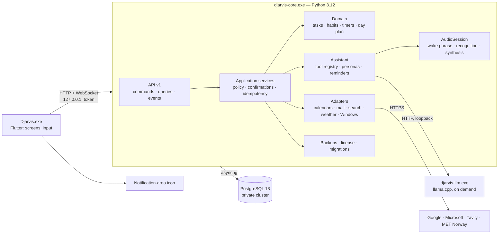

# Final architecture and implementation plan — for approval

[Русская версия](IMPLEMENTATION_PLAN.ru.md) · [Technical details](TECHNICAL_DESIGN.md) · [Decisions](DECISIONS.md) · [Component plan](COMPONENT_PLAN.md) · [Feasibility](FEASIBILITY.md) · [Status](../STATUS.md)

Status: proposal by agent-02 (PLAN-022), 2026-11-04. **P0–P7 phases and acceptance criteria approved (ADR-018); architecture and repository structure remain under owner review. P0 is not authorized** (PLAN-028). Technical decisions T1–T6 are approved (ADR-015). Owner's condition: programming does not start until the structure is fully worked out and the owner has received a full programming-readiness report. Real checks (voice assistant, microphone, task tracking, etc.) happen after programming; checks that need no code also come later. No application code is written until approval. Approval of this plan and separate authorization of P0 permit work by its phases; each phase ends with a demonstration and owner acceptance, and significant deviations are agreed in advance (rules 2 and 3).

## 1. Architecture at a glance



Main properties (from the ADRs and CP01–CP20):

- Only the core makes decisions. The interface and the model merely propose; the core checks the target, permissions, confirmation and invariants, then commits the change in one short transaction.
- Everything is local: data, model, recognition and synthesis. The network is needed only by integrations chosen by the user.
- The scheduler is deterministic and works without the model. The assistant is an add-on, not a dependency of the scheduler.
- Raw audio exists only in RAM; emails, file deletion and overwriting, and PC shutdown always require confirmation.
- Resource profiles: "8 GB" and "16 GB+" ([technical details §5](TECHNICAL_DESIGN.md#5-profile-for-8-gib)).

## 2. Repository structure

```text
core/                    Python core (package djarvis_core)
  djarvis_core/
    api/                 HTTP/WebSocket, envelope, authentication, versions
    contract/            Pydantic models — the contract source
    app/                 commands, queries, policy, confirmations, idempotency
    domain/              tasks, recurrences, habits, timers, day plan (no I/O)
    storage/             asyncpg, repositories, migration runner
    db/                  private PostgreSQL lifecycle
    assistant/           model orchestration, tools, personas, dialogue memory
    audio/               AudioSession, wake phrase, recognition, synthesis, text normalization
    reminders/           reliable reminders and proactive speech
    integrations/        google, microsoft, tavily, met_norway, windows
    safety/              DJB1 backups, DPAPI, Ed25519 license, trial
    host/                startup, mutex, resources, memory profiles, diagnostics
  migrations/            NNNN_*.sql and *.py
  tests/                 unit, property, integration (real PostgreSQL), contract
ui/                      Flutter application, including the tray icon (ADR-015)
  lib/{app,design,features/<screen>,data,generated}
  test/                  widget and golden tests
packaging/               Inno Setup, embedded Python build, trimmed PostgreSQL, resource manifest
scripts/                 contract generation, checks, build (development only)
docs/, Plan/             as they are now
```

Module ownership: one agent per module at a time; files in use are recorded in the log (rules 6 and 7).

## 3. Phases

The order is set by dependencies, not by cutting capabilities. The first testable software build covers everything mandatory from PRODUCT. Payment activation follows software implementation and manual tests (ADR-017); license issuance and the date of public paid distribution remain open.

| Phase | Contents | Done when (acceptance) |
| --- | --- | --- |
| **P0. Skeleton** | Repository structure; linters and formatters (ruff, mypy strict, dart analyze); tests and checks in CI; Pydantic → Dart contract generation; build of embedded Python and trimmed PostgreSQL | The empty core starts from the embedded Python, brings up and stops its own PostgreSQL; the interface connects by token and shows the core version; CI is green |
| **P1. Core and data** | Core and database lifecycle (CP01, CP04); API v1, envelope, events, reconnection; command pipeline with idempotency and revisions (CP02); migration runner; schema v1 (CP03) | Integration tests: a repeated `action_id` does not duplicate a record; revision conflict; core crash after commit; a wrong token, `Host` or `Origin` is rejected; a corrupted migration checksum yields `RecoveryRequired` |
| **P2. Scheduler** | Tasks and multi-level subtasks, recurrences and exceptions, deadlines and overdue handling, habits in all measurement modes, timers across sleep and midnight, day plan construction (CP05–CP07, ADR-007–009) | Property tests for plan determinism and DST; all ADR-007–009 scenarios covered by tests; performance: day plan on 500 tasks < 200 ms |
| **P3. Interface** | Midnight Electric + Glass design system; screens Today, Tasks, Calendar, Habits, Projects, Notes, Settings; top bar; assistant circle and floating microphone button (DESIGN, CP17) | Golden tests of screens; keyboard-only operation; the owner accepts the look against briefs v2.1 and layout v1.0; interface memory measurement |
| **P4. Data protection and access** | DJB1 backups on schedule and before migrations, restore with preview, 30-day history (CP15, ADR-006); signed license and 7-day trial, device and clock rules (CP16, ADR-005, ADR-010) | Encryption reference vectors; rejection of a truncated, reordered and substituted archive; a full "backup → restore" cycle on real data; trial and expiry on all ADR-005 branches |
| **P5. Voice and assistant** | AudioSession and state machine (CP09); Vosk small: wake phrase with decoys and utterance; llama.cpp on demand; typed tool registry (CP08); Vosk TTS 0.7 and Kokoro synthesis via misaki without espeak-ng with text normalization (CP10); personas; reminders and proactivity (CP11) | CP09 acceptance scenarios from COMPONENT_PLAN; live microphone test by the owner; false wake-ups in an hour of ordinary speech ≤ 1; from end of utterance to start of reply ≤ 3 s on the test machine after the required models are loaded; cold startup measured separately on a target PC, with its threshold set after measurement (ADR-017); a synthesis error does not stop the dialogue |
| **P6. Integrations** | MET Norway weather; Tavily search with the user's key; Google Calendar, Outlook, Gmail via OAuth and a local queue (CP12–CP13); Windows actions with confirmations (CP14, ADR-013) | Adapter tests on recorded responses; the offline queue survives a restart; an email is sent only after confirmation; a sync conflict is shown, not overwritten |
| **P7. Delivery** | Inno Setup installer; first-run model download by a signed manifest; update notifications; local diagnostics without telemetry; signing (CP18, CP20) | Clean Windows with no terminal and no administrator rights; Cyrillic in the path; busy port; network drop during download; reboot in the middle of a migration; **acceptance on a real 8 GiB CPU-only machine** |

P2 and P3 can run in parallel after P1 (the contract is already fixed), with separate owner acceptance of each phase. A dependent phase starts after its prerequisites are accepted. P4 relies on P1; P5 relies on P1 and P2; P6 relies on P5 for voice commands.

## 4. Quality and checks throughout

- Python: ruff, mypy in strict mode, pytest, hypothesis; integration tests only against a real private PostgreSQL, with no database mocks.
- Dart: `dart analyze` with no warnings, widget and golden tests.
- Contract: CI fails if the generated Dart code is out of date or the schema changed without a new protocol version.
- Each phase updates the bilingual documentation and the log; a commit after each completed task (rule 9).
- Before publication: a check of file contents and metadata for secrets, personal data and mentions of development tools.
- Dependencies are pinned by version and hash; licenses are consolidated into `THIRD_PARTY_NOTICES` at build time. GPL components are not shipped.

## 5. Risks and how to handle them

| Risk | Mitigation |
| --- | --- |
| Memory on 8 GiB | The profile from technical details §5; acceptance in P7 on a real machine; a smaller fallback model |
| Wake-phrase quality on a live voice | A live test by the owner before P5 (`cache/feasibility/mic_wake_test.py`); if the result is poor — change the default name to one less similar to common words, or train a separate detector |
| Model speed on a weak CPU | Sentence-by-sentence synthesis; short tool answers without generating long text; context limit |
| Slow loading of Vosk TTS 0.9 | 0.9 is not used in the 8 GB profile; revisit if a fix is released |
| SmartScreen warnings | A signing certificate before the first public distribution |
| Changes in the Google and Microsoft APIs | Adapters behind a single interface and recorded contract tests |

## 6. What the owner approves

1. The architecture from §1 and the repository structure from §2.
2. T1–T6 are already approved in ADR-015; they are context for this review, not a new approval request.
3. The composition and order of phases P0–P7 and their acceptance criteria are approved (ADR-018).
4. Separate permission to begin programming with P0; each later phase starts after acceptance of its prerequisites, including parallel P2/P3.

The live microphone test and other real checks happen after programming (owner's condition). The code-signing certificate comes before public release (ADR-015); payment activation follows implementation and manual tests; commercial launch details remain open (ADR-017).
