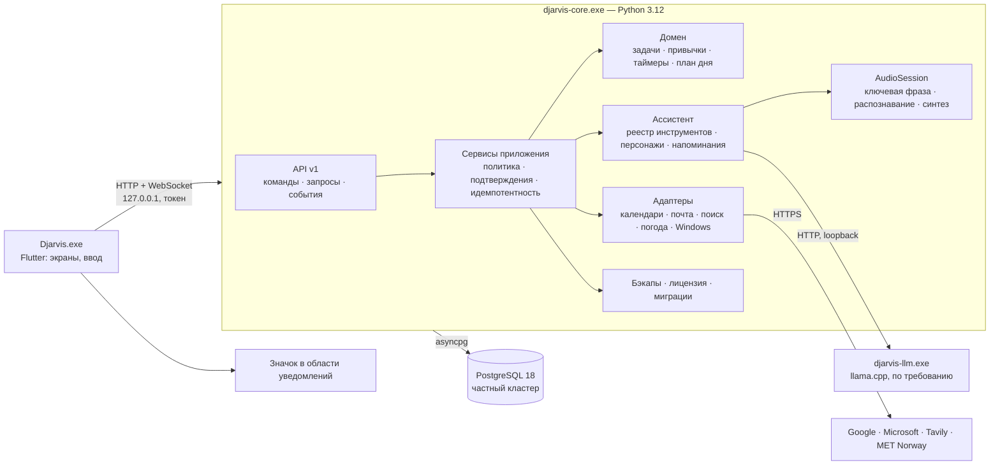

# Финальная архитектура и план реализации — на утверждение

[English version](IMPLEMENTATION_PLAN.md) · [Технические детали](TECHNICAL_DESIGN.ru.md) · [Решения](DECISIONS.ru.md) · [План компонентов](COMPONENT_PLAN.ru.md) · [Выполнимость](FEASIBILITY.ru.md) · [Статус](../STATUS.ru.md)

Статус: предложение agent-02 (PLAN-022), 2026-11-04. **Фазы Ф0–Ф7 и критерии приёмки утверждены (ADR-018); архитектура и структура репозитория §§1–2 утверждены (ADR-022); схема и состав архива утверждены (ADR-024); API утверждён (ADR-025); модули утверждены (ADR-026). Ф0 не разрешена** (PLAN-028). Технические решения T1–T6 утверждены (ADR-015). Условие владельца: программирование не начинается, пока структура не проработана полностью и владелец не получил полный отчёт о готовности к программированию. Реальные проверки (голосовой помощник, микрофон, отслеживание задач и т. д.) проводятся после программирования; проверки без кода — тоже позже. До утверждения код приложения не пишется. Отдельное разрешение Ф0 после обсуждения его [плана](P0_PLAN.ru.md) позволит начать работу по фазам; каждая фаза заканчивается демонстрацией и приёмкой владельцем, а существенные отклонения согласуются заранее (правила 2 и 3).

## 1. Архитектура одним взглядом



Главные свойства (из ADR и CP01–CP20):

- Решения принимает только ядро. Интерфейс и модель лишь предлагают; ядро проверяет цель, права, подтверждение и инварианты, затем фиксирует изменение одной короткой транзакцией.
- Всё локально: данные, модель, распознавание и синтез. Сеть нужна только интеграциям, выбранным пользователем.
- Планировщик детерминирован и работает без модели. Ассистент — надстройка, а не зависимость планировщика.
- Сырой звук только в оперативной памяти; письма, удаление и перезапись файлов, выключение ПК — всегда с подтверждением.
- Профили ресурсов: «8 ГБ» и «16 ГБ+» ([технические детали §5](TECHNICAL_DESIGN.ru.md#5-профиль-для-8-гиб)).

## 2. Структура репозитория

```text
core/                    Python-ядро (пакет djarvis_core)
  djarvis_core/
    api/                 HTTP/WebSocket, конверт, аутентификация, версии
    contract/            модели Pydantic — источник контракта
    app/                 команды, запросы, политика, подтверждения, идемпотентность
    domain/              задачи, повторения, привычки, таймеры, план дня (без ввода-вывода)
    storage/             asyncpg, репозитории, исполнитель миграций
    db/                  жизненный цикл частного PostgreSQL
    assistant/           оркестрация модели, инструменты, персонажи, память диалога
    audio/               AudioSession, ключевая фраза, распознавание, синтез, нормализация текста
    reminders/           надёжные напоминания и проактивная речь
    integrations/        google, microsoft, tavily, met_norway, windows
    safety/              бэкапы DJB1, DPAPI, лицензия Ed25519, триал
    host/                запуск, мьютекс, ресурсы, профили памяти, диагностика
  migrations/            NNNN_*.sql и *.py
  tests/                 unit, property, integration (реальный PostgreSQL), contract
ui/                      Flutter-приложение, включая значок трея (ADR-015)
  lib/{app,design,features/<экран>,data,generated}
  test/                  widget- и golden-тесты
packaging/               Inno Setup, сборка встроенного Python, урезанный PostgreSQL, манифест ресурсов
scripts/                 генерация контракта, проверки, сборка (только для разработки)
docs/, Plan/             как сейчас
```

Владение модулями: один агент на модуль в один момент времени; занятые файлы записываются в журнал (правила 6 и 7).

## 3. Фазы

Порядок задан зависимостями, а не урезанием возможностей. Первая проверяемая программная сборка охватывает всё обязательное из PRODUCT. Работа над оплатой начинается после программной реализации и ручных проверок (ADR-017); выдача лицензий и дата публичной платной раздачи остаются открытыми.

| Фаза | Содержание | Готово, когда (приёмка) |
| --- | --- | --- |
| **Ф0. Каркас** | Структура репозитория; линтеры и форматтеры (ruff, mypy strict, dart analyze); тесты и проверки в CI; генерация контракта Pydantic → Dart; сборка встроенного Python и урезанного PostgreSQL | Пустое ядро стартует из встроенного Python, поднимает и останавливает свой PostgreSQL; интерфейс подключается по токену и показывает версию ядра; CI зелёный |
| **Ф1. Ядро и данные** | Жизненный цикл ядра и базы (CP01, CP04); API v1, конверт, события, переподключение; конвейер команд с идемпотентностью и ревизиями (CP02); исполнитель миграций; схема v1 (CP03) | Интеграционные тесты: повтор `action_id` не дублирует запись; конфликт ревизий; падение ядра после фиксации; неверный токен, `Host` или `Origin` отклоняются; повреждённая контрольная сумма миграции даёт `RecoveryRequired` |
| **Ф2. Планировщик** | Задачи и многоуровневые подзадачи, повторения и исключения, дедлайны и просрочка, привычки во всех режимах измерения, таймеры через сон и полночь, построение плана дня (CP05–CP07, ADR-007–009) | Property-тесты на детерминированность плана и DST; все сценарии ADR-007–009 покрыты тестами; производительность: план дня на 500 задачах < 200 мс |
| **Ф3. Интерфейс** | Дизайн-система Midnight Electric + Glass; экраны Сегодня, Задачи, Календарь, Привычки, Проекты, Заметки, Настройки; верхняя строка; круг ассистента и плавающая кнопка микрофона (DESIGN, CP17) | Golden-тесты экранов; ручная работа без мыши; владелец принимает внешний вид по брифам v2.1 и компоновки v1.0; замер памяти интерфейса |
| **Ф4. Защита данных и доступ** | Бэкапы DJB1 по расписанию и перед миграциями, восстановление с предпросмотром, история 30 дней (CP15, ADR-006); подписанная лицензия и триал 7 дней, правила устройств и часов (CP16, ADR-005, ADR-010) | Эталонные векторы шифрования; отказ на обрезанном, переставленном и подменённом архиве; полный цикл «бэкап → восстановление» на реальных данных; триал и истечение по всем веткам ADR-005 |
| **Ф5. Голос и ассистент** | AudioSession и машина состояний (CP09); Vosk small: ключевая фраза с приманками и реплика; llama.cpp по требованию; реестр типизированных инструментов (CP08); синтез Vosk TTS 0.7 и Kokoro через misaki без espeak-ng с нормализацией текста (CP10); персонажи; напоминания и проактивность (CP11) | Сценарии приёмки CP09 из COMPONENT_PLAN; живой тест микрофона владельцем; ложные пробуждения за час обычной речи ≤ 1; от конца реплики до начала ответа ≤ 3 с на тестовой машине после загрузки необходимых моделей; холодный запуск измеряется отдельно на целевом ПК, а его предел задаётся после замера (ADR-017); ошибка синтеза не останавливает диалог |
| **Ф6. Интеграции** | Погода MET Norway; поиск Tavily с ключом пользователя; Google Calendar, Outlook, Gmail через OAuth и локальную очередь (CP12–CP13); действия Windows с подтверждениями (CP14, ADR-013) | Тесты адаптеров на записанных ответах; офлайн-очередь переживает перезапуск; письмо уходит только после подтверждения; конфликт синхронизации показывается, а не перезаписывается |
| **Ф7. Поставка** | Установщик Inno Setup; первая загрузка моделей по подписанному манифесту; уведомления об обновлениях; локальная диагностика без телеметрии; подпись (CP18, CP20) | Чистая Windows без терминала и прав администратора; кириллица в пути; занятый порт; обрыв сети при загрузке; перезагрузка посреди миграции; **приёмка на реальной машине 8 ГиБ только с CPU** |

Ф2 и Ф3 можно вести параллельно после Ф1 (контракт уже зафиксирован), с отдельной приёмкой владельцем каждой фазы. Зависимая фаза начинается после приёмки нужных ей предшественников. Ф4 опирается на Ф1; Ф5 — на Ф1 и Ф2; Ф6 — на Ф5 в части голосовых команд.

## 4. Качество и проверки на всём протяжении

- Python: ruff, mypy в строгом режиме, pytest, hypothesis; интеграционные тесты только на реальном частном PostgreSQL, без моков базы.
- Dart: `dart analyze` без предупреждений, widget- и golden-тесты.
- Контракт: CI падает, если сгенерированный Dart-код устарел или изменилась схема без новой версии протокола.
- Каждая фаза обновляет двуязычную документацию и журнал; коммит после каждой законченной задачи (правило 9).
- Перед публикацией: проверка состава файлов и метаданных на секреты, личные данные и упоминания инструментов разработки.
- Зависимости закрепляются версиями и хешами; лицензии сводятся в `THIRD_PARTY_NOTICES` при сборке. GPL-компоненты не поставляются.

## 5. Риски и как с ними работать

| Риск | Мера |
| --- | --- |
| Память на 8 ГиБ | Профиль из технических деталей §5; приёмка в Ф7 на реальной машине; запасная меньшая модель |
| Качество ключевой фразы на живом голосе | Живой тест владельцем до Ф5 (`cache/feasibility/mic_wake_test.py`); при плохом результате — сменить имя по умолчанию на менее похожее на частые слова или обучить отдельный детектор |
| Скорость модели на слабом CPU | Синтез по предложениям; короткие ответы инструментов без генерации длинного текста; ограничение контекста |
| Медленная загрузка Vosk TTS 0.9 | 0.9 не используется в профиле 8 ГБ; вернуться, если выйдет исправление |
| Предупреждения SmartScreen | Сертификат подписи до первой публичной раздачи |
| Изменения в API Google и Microsoft | Адаптеры за единым интерфейсом и записанные контрактные тесты |

## 6. Что владелец утверждает

1. Архитектура из §1 и структура репозитория из §2 уже утверждены (ADR-022).
2. T1–T6 уже утверждены в ADR-015; это контекст данного рассмотрения, а не повторный запрос на согласование.
3. Состав и порядок фаз Ф0–Ф7 и их критерии приёмки утверждены (ADR-018).
4. Отдельное разрешение начать программирование с Ф0; каждая следующая фаза начинается после приёмки нужных предшественников, включая параллельные Ф2/Ф3.

Живой тест микрофона и другие реальные проверки проводятся после программирования (условие владельца). Сертификат подписи — перед публичным выпуском (ADR-015); запуск оплаты следует после реализации и ручных проверок; детали коммерческого запуска остаются открытыми (ADR-017).
