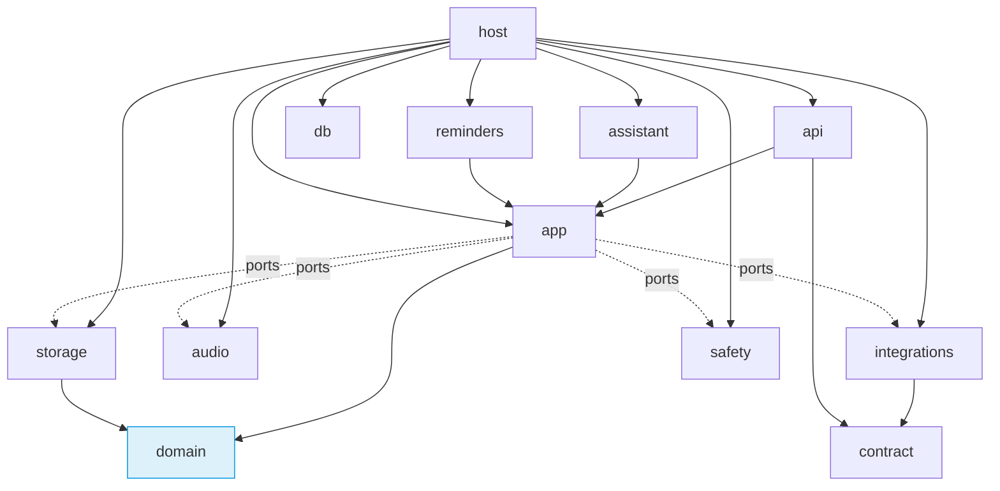

# Modules: responsibilities, boundaries, dependencies

[Русская версия](MODULES.ru.md) · [Implementation plan](IMPLEMENTATION_PLAN.md) · [Technical design](TECHNICAL_DESIGN.md) · [Database schema](SCHEMA.md) · [API](API.md)

Status: proposal by agent-02 (PLAN-024), 2026-11-04. Under owner review. This document defines what each module is responsible for, what it may import, and through which interfaces it communicates with the others. The folder structure is in the [implementation plan](IMPLEMENTATION_PLAN.md) §2. No code is written until approval.

## 1. Dependency rule of the core



1. `domain` is pure logic: it imports nothing from the project except itself, and nothing involving input/output (no database, network, files, clock). The current time is passed as an argument.
2. `app` depends on `domain` and on **ports** — abstract interfaces implemented by `storage`, `integrations`, `audio`, `safety`. `app` knows nothing about asyncpg, HTTP or Windows.
3. `api`, `assistant`, `reminders` are entry points into the system: they turn an HTTP request, a spoken turn or a fired timer into an `app` command. Bypassing `app` and writing to the database directly is forbidden for them.
4. `host` is the only place where everything is assembled (dependency composition): it creates the port implementations and starts processes and jobs.
5. The rules are checked automatically in CI (import-linter). A violation means a red build.

## 2. Core modules

| Module | Responsible for | Does not do |
| --- | --- | --- |
| `contract` | Pydantic models of all commands, queries, results, events and errors from the [API](API.md); JSON Schema export for Dart | Logic and business-rule validation |
| `domain.tasks` | Task, occurrence, subtasks (cycles, suggesting parent fields, deleting and moving a branch per Q1/Q4, copies into occurrences of a recurring parent per Q2), completion and "Close / Finish", trimming the current block and releasing future ones (Q3) | Persistence |
| `domain.recurrence` | Expanding rules with the original anchor, a missing day of the month, exceptions, series edit scopes | Creating rows in the database |
| `domain.time` | Local intents and instants, the 06:00–22:00 window, daylight-saving transitions (candidates for confirmation), "tomorrow" relative to the reference time | Reading the system clock |
| `domain.planner` | Deterministic day-plan construction (CP05): constraints, "deadline → priority" order, splitting by consent, breaks per settings, reasons for non-placement | Applying the plan |
| `domain.habits` | Periods, goals by version, pauses, streaks, pause weeks, quantity modes, splitting the timer at midnights | Real-time timers |
| `domain.policy` | Which commands require confirmation, which are covered by permissions, what is forbidden when access has expired | Storing permissions |
| `app.commands` | The command pipeline (CP02): validation → target → revisions → access and permissions → invariants → one transaction (data + `processed_action` + audit + `outbox` + planning revision) → event after commit | Long operations inside a transaction |
| `app.queries` | Read models for screens and the assistant (`GetDayView`, etc.); read only | Changes |
| `app.approvals` | Confirmations tied to the exact content and revisions; expiry | — |
| `app.ports` | Interfaces: `UnitOfWork`, repositories per aggregate, `Clock`, `SecretStore`, `FileStore`, `CalendarProvider`, `MailProvider`, `SearchProvider`, `WeatherProvider`, `WindowsActions`, `SpeechOut`, `Notifier`, `BackupArchiver`, `EntitlementStore` | Implementations |
| `storage` | Implementation of repositories and `UnitOfWork` on asyncpg; SQL by area; the migration runner; the attachment store `files/<sha256>` | Business rules |
| `db` | Lifecycle of the private PostgreSQL (CP04): `initdb`, folder ACL, start with the log going to a file, readiness check, stop, the `RecoveryRequired`/`IncompatibleVersion` states | Data queries |
| `api` | aiohttp: routes `/v1/commands`, `/v1/queries`, `/v1/events`; token, `Host`, `Origin`; translating errors into codes; protocol version | Logic |
| `assistant` | Dialogue orchestration: context (persona, history within the retention period, day information), calling the model, parsing the proposed tool, passing the command to `app`, reply text sentence by sentence; personas; dialogue history | Access decisions (made by `app`) |
| `assistant.llm` | Managing the `djarvis-llm.exe` process: start on demand, memory check, unload on idle (ADR-015), HTTP client to it | — |
| `audio` | `AudioSession` (CP09): the sole owner of the microphone; state machine; wake phrase (Vosk with decoys, only at the start of a turn); turn recognition; synthesis (Vosk TTS / misaki → Kokoro) with text normalization; barge-in; mute | Writing audio to disk (forbidden) |
| `reminders` | The `scheduled_job` scheduler: selecting ready jobs, execution, retry, summary of what was missed, quiet hours and suppression during calls/games | The reminder text itself (taken from `app.queries`) |
| `integrations.google` / `.microsoft` | OAuth (system browser, PKCE), calendars, Gmail; the `outbox` dispatcher; comparison with `base_snapshot` and conflicts | Resolving conflicts without the user |
| `integrations.tavily` / `.met_norway` | Search and weather; weather cache for 30 minutes | Sending profile data beyond the query |
| `integrations.windows` | Launching programs from the list (sha256 check), volume, brightness, lock, sleep, shutdown, file selection; Windows notifications; call/game detection; input idle | Arbitrary shell commands |
| `safety.backup` | DJB1 format, DPAPI, backup on schedule and before a migration, retention period, preview and restore through an intermediate database | — |
| `safety.entitlement` | Ed25519 signature verification, per-device trial, the 48-hour rule for the clock, storage outside the database | Payment (deferred) |
| `host` | Entry point of `djarvis-core.exe`: mutex, connection file, dependency assembly, starting the database and API, memory profile, resource download by manifest, local diagnostics without content, exit order | — |

## 3. How the core works at runtime

- One process, one `asyncio` loop. Everything that waits for the network or the database is asynchronous.
- Heavy computation is outside the loop: recognition and the wake phrase run in a separate thread with an audio queue; synthesis in a separate thread; the language model in a separate process, `djarvis-llm.exe`. The loop is never blocked for longer than 50 ms; this is checked by a watchdog timer in the debug build.
- Transactions are short and do not wait for the user, the model or the network.
- A failure of a worker thread or of the model process does not bring down the core: the audio state becomes "unavailable" with a reason, and the scheduler and the interface keep working.
- Shutdown: `RequestExit` → stop capture → wait for or cancel jobs → close the connection pool → stop the model → stop PostgreSQL → delete the connection file.

## 4. Background jobs

| Job | When | What it does |
| --- | --- | --- |
| `recurrence_generation` | at startup and once a day | creates occurrences up to a 60-day horizon |
| `reminder` | at the reminder time | notification and/or speech, if settings allow |
| `placement_missed` | end of a block, if the occurrence is not completed | always a highlight; an aloud announcement unless `announce_missed` is turned off for the task ([Q5](SCHEMA.md#12-owner-decisions-plan-024)) |
| `morning_plan` / `evening_review` | time from settings or the first activity of the day | spoken plan or review based on `GetDayView` |
| `proactive_check` | once a minute while the core is running | meeting soon, habit missed, return after absence |
| `catch_up_summary` | after sleep or startup | one summary of what was missed |
| `outbox_dispatch` | there are ready `outbox` records | sending to external services with retries; a message with an unknown outcome is not retried |
| `calendar_sync` | every 15 minutes and on `SyncNow` | two-way synchronization of the selected calendars |
| `backup` | daily at the configured time and before a migration | DJB1 backup, deleting expired ones |
| `history_expiry` | once a day | deleting history older than the retention period |

Windows sleep and shutdown interrupt jobs; on the next start the core finds overdue ones and handles them by the rules (a summary instead of repeats).

## 5. Interface (Flutter)

```text
ui/lib/
  app/          startup, core check, connection, tray, routing, ru/en localization
  design/       palette and Glass/Solid tokens, typography, components (cards, buttons, fields, assistant circle)
  data/         ApiClient (HTTP), EventStream (WebSocket with reconnection), read-model cache
  generated/    contract classes from JSON Schema (not edited by hand)
  features/
    today/      main screen: assistant circle, top row, grid of day cards
    tasks/      lists, subtask tree, task card, creation wizard
    calendar/   day, week, month; events and blocks
    habits/     habits, marks, timers, statistics
    projects/   projects and their tasks
    notes/      notes, Markdown editor
    settings/   all settings sections, "Connections and capabilities", backups, license
    assistant/  dialogue overlay, microphone button, confirmations
    first_run/  first-time setup and resource download
```

- State is Riverpod (MIT). Each screen subscribes to the read models of its resources; a `changed` event with that resource triggers a re-read.
- The interface makes no business decisions: it shows the command result and the core's questions (`NeedsInput`, `NeedsClarification`, `NeedsConfirmation`) as dialogs.
- Tray (ADR-015): an icon showing the microphone state, items "Open", "Turn microphone off", "Exit". Closing the window hides it.
- Accessibility: keyboard, visible focus, reduced motion, AA contrast, state not conveyed by color alone (DESIGN).

## 6. Errors, logs, diagnostics

- Each layer translates its exceptions into codes from [API](API.md) §16; stack traces stay in the core's local log.
- Logs: `%LOCALAPPDATA%\Djarvis\logs`, rotation of 7 files of 5 MB. The log never contains texts of tasks, notes, mail, turns, tokens or passwords — only identifiers, codes and time.
- `ExportDiagnostics` gathers logs, versions and resource state into an archive for the user; nothing is sent automatically (no telemetry).

## 7. Tests by module

| Module | Kind of tests |
| --- | --- |
| `domain.*` | unit and property (hypothesis): the plan is deterministic, anchored repetitions, daylight saving, habit streaks |
| `app` + `storage` | integration on a real private PostgreSQL: idempotency, revision conflicts, transactions, migrations |
| `api` | contract: every command from the catalog, token/`Host`/`Origin`, protocol version |
| `audio`, `assistant` | on recorded fragments and a model stub; live checks — after programming |
| `integrations` | on recorded provider responses |
| `safety` | reference encryption vectors, corrupted archives, the backup → restore cycle |
| `ui` | widget and golden tests of screens in all six combinations of palette and Glass/Solid |

## 8. Modules by phase

| Phase | Modules |
| --- | --- |
| P0 | `host` (skeleton), `db`, `api` (skeleton), `contract`, `ui/app`, `ui/data`, CI |
| P1 | `app.commands`, `app.queries`, `app.ports`, `storage`, migration `0001_initial` |
| P2 | `domain.tasks`, `domain.recurrence`, `domain.time`, `domain.planner`, `domain.habits`, `domain.policy` |
| P3 | `ui/design`, `ui/features/*` |
| P4 | `safety.backup`, `safety.entitlement` |
| P5 | `audio`, `assistant`, `assistant.llm`, `reminders` |
| P6 | `integrations.*` |
| P7 | `packaging/`, resources and updates in `host` |
