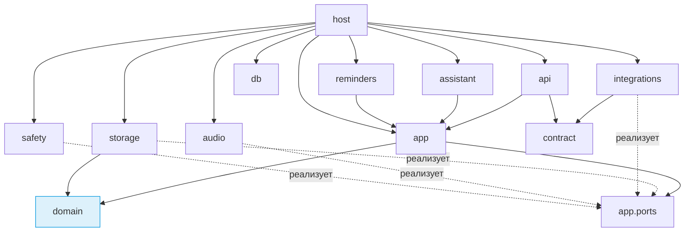

# Модули: обязанности, границы, зависимости

[English version](MODULES.md) · [План реализации](IMPLEMENTATION_PLAN.ru.md) · [Технические детали](TECHNICAL_DESIGN.ru.md) · [Схема базы](SCHEMA.ru.md) · [API](API.ru.md)

Статус: модульная структура утверждена владельцем (ADR-026), 2026-11-05. Документ задаёт ответственность, допустимые зависимости и интерфейсы между модулями. Структура папок — [план реализации](IMPLEMENTATION_PLAN.ru.md) §2. Программирование Ф0 требует отдельного разрешения; владелец попросил пока не писать код.

## 1. Правило зависимостей ядра



1. `domain` — чистая логика: не импортирует ничего из проекта, кроме себя, и ничего из ввода-вывода (нет базы, сети, файлов, часов). Текущее время передаётся аргументом.
2. `app` зависит от `domain` и от **портов** — абстрактных интерфейсов, которые реализуют `storage`, `integrations`, `audio`, `safety`. `app` не знает про asyncpg, HTTP или Windows.
3. `api`, `assistant`, `reminders` — входы в систему: превращают HTTP-запрос, реплику или сработавший таймер в команду `app`. Обходить `app` и писать в базу напрямую им запрещено.
4. `host` — единственное место, где всё собирается вместе (композиция зависимостей): создаёт реализации портов, запускает процессы и задания.
5. Правила проверяются автоматически в CI (import-linter). Нарушение — красная сборка.

## 2. Модули ядра

| Модуль | Отвечает за | Не делает |
| --- | --- | --- |
| `contract` | Модели Pydantic всех команд, запросов, результатов, событий и ошибок из [API](API.ru.md); выгрузка JSON Schema для Dart | Логику и проверку бизнес-правил |
| `domain.tasks` | Задача, вхождение, подзадачи (циклы, предложение полей родителя, удаление и перенос ветки по В1/В4, копии в вхождения повторяющегося родителя по В2), завершение и «Закрыть / Доделать», обрезка текущего блока и освобождение будущих (В3) | Сохранение |
| `domain.recurrence` | Разворачивание правил с исходным якорем, отсутствующий день месяца, исключения, области правки серии | Создание строк в базе |
| `domain.time` | Локальные намерения и мгновения, окно 06:00–22:00, переходы на летнее время (кандидаты для подтверждения), «завтра» относительно опорного времени | Чтение системных часов |
| `domain.planner` | Детерминированное построение плана дня (CP05): ограничения, порядок «срок → приоритет», дробление по согласию, перерывы по настройке, причины неразмещения | Применение плана |
| `domain.habits` | Периоды, цели по версиям, паузы, серии, недели паузы, режимы количества, деление отрезков таймера по полуночам в исходном поясе, расчёт для проверки и учёт после подтверждения | Таймеры в реальном времени |
| `domain.policy` | Какие команды требуют подтверждения, какие покрываются разрешениями, что запрещено при истёкшем доступе | Хранение разрешений |
| `app.commands` | Конвейер команды (CP02): проверка → цель → ревизии → доступ и разрешения → инварианты → одна транзакция (данные + `processed_action` + аудит + `outbox` + ревизия планирования) → событие после фиксации | Долгие операции внутри транзакции |
| `app.queries` | Модели чтения для экранов и ассистента (`GetDayView` и др.); только чтение | Изменения |
| `app.approvals` | Подтверждения, привязанные к действию, вызывающему процессу, точному содержимому и ревизиям; истечение и защита от повторного исполнения | — |
| `app.ports` | Интерфейсы: `UnitOfWork`, репозитории по агрегатам, `Clock`, `SecretStore`, `FileStore`, `CalendarProvider`, `MailProvider`, `SearchProvider`, `WeatherProvider`, `WindowsActions`, `SpeechOut`, `Notifier`, `BackupArchiver`, `EntitlementStore` | Реализации |
| `storage` | Реализация репозиториев и `UnitOfWork` на asyncpg; SQL по областям; исполнитель миграций; хранилище вложений `files/<sha256>` | Бизнес-правила |
| `db` | Жизненный цикл частного PostgreSQL (CP04): `initdb`, ACL папки, запуск с журналом в файл, проверка готовности, остановка, состояния `RecoveryRequired`/`IncompatibleVersion` | Запросы данных |
| `api` | aiohttp: маршруты `/v1/commands`, `/v1/queries`, `/v1/events`; токен, `Host`, проверка HTTP `Origin`; назначение источника команды по вызывающему процессу; перевод ошибок в коды; версия протокола | Логику |
| `assistant` | Оркестрация диалога: контекст (персонаж, история в пределах срока, сведения дня), вызов модели, разбор предложенного инструмента, передача команды в `app`, текст ответа по предложениям; персонажи; история диалогов через команды/порты `app` | Решения о доступе (их принимает `app`) |
| `assistant.llm` | Управление процессом `djarvis-llm.exe`: запуск по требованию, проверка памяти, выгрузка по простою (ADR-015), HTTP-клиент к нему | — |
| `audio` | `AudioSession` (CP09): единственный владелец микрофона; машина состояний; ключевая фраза (Vosk с приманками, только в начале реплики); распознавание реплики; синтез (Vosk TTS / misaki → Kokoro) с нормализацией текста; перебивание; mute | Запись звука на диск (запрещена) |
| `reminders` | Планировщик заданий `scheduled_job`: выбор готовых через порт, выполнение через `app`, повтор, сводка пропущенного, тихие часы и подавление при звонках/играх | Сам текст напоминания (берёт из `app.queries`) |
| `integrations.google` / `.microsoft` | OAuth (системный браузер, PKCE), календари обеих служб и Gmail только у Google; диспетчер `outbox`; сравнение с `base_snapshot` и конфликты | Решение конфликтов без пользователя |
| `integrations.tavily` / `.met_norway` | Поиск и погода; кэш погоды на 30 минут | Отправку данных профиля сверх запроса |
| `integrations.windows` | Запуск программ из списка (проверка sha256), громкость, яркость, блокировка, сон, выключение, выбор файлов; уведомления Windows; определение звонка/игры; простой ввода | Произвольные команды оболочки |
| `safety.backup` | Формат DJB1, DPAPI, выгрузка по утверждённому списку таблиц (SCHEMA §13), бэкап по расписанию и перед миграцией, срок хранения, предпросмотр и восстановление через промежуточную базу без старых разрешений/очередей | — |
| `safety.entitlement` | Проверка подписи Ed25519, триал по устройству, правило 48 часов для часов, хранение вне базы | Оплату (отложена) |
| `host` | Точка входа `djarvis-core.exe`: мьютекс, файл подключения, сборка зависимостей, запуск базы и API, профиль памяти, загрузка ресурсов по манифесту, локальная диагностика без содержимого, порядок выхода | — |

## 3. Как работает ядро во времени выполнения

- Один процесс, один цикл `asyncio`. Всё, что ждёт сети или базы, — асинхронно.
- Тяжёлые вычисления — вне цикла: распознавание и ключевая фраза — отдельный поток с очередью звука; синтез — отдельный поток; языковая модель — отдельный процесс `djarvis-llm.exe`. Цель — не блокировать цикл дольше 50 мс; сторожевой таймер в отладочной сборке фиксирует нарушения.
- Транзакции короткие и не ждут пользователя, модель или сеть.
- Сбой рабочего потока или процесса модели не роняет ядро: состояние звука становится «недоступно» с причиной, планировщик и интерфейс продолжают работать.
- Остановка: `RequestExit` → прекратить захват → дождаться или отменить задания → закрыть пул соединений → остановить модель → остановить PostgreSQL → удалить файл подключения.

## 4. Фоновые задания

| Задание | Когда | Что делает |
| --- | --- | --- |
| `recurrence_generation` | при запуске и раз в сутки | создаёт вхождения до горизонта 60 дней |
| `reminder` | по времени напоминания | уведомление и/или речь, если позволяют настройки |
| `placement_missed` | конец блока, если вхождение не выполнено | подсветка всегда; объявление вслух, если у задачи не выключено `announce_missed` ([В5](SCHEMA.ru.md#12-решения-владельца-plan-024)) |
| `morning_plan` / `evening_review` | время из настроек или первая активность дня | устный план или обзор по `GetDayView` |
| `proactive_check` | раз в минуту, пока ядро работает | встреча скоро, привычка пропущена, возвращение после отсутствия |
| `catch_up_summary` | после сна или запуска | одна сводка пропущенного |
| `outbox_dispatch` | есть готовые записи `outbox` | отправка во внешние сервисы с повторами; письмо с неизвестным итогом не повторяется автоматически, ручной повтор требует нового точного подтверждения (ADR-025) |
| `calendar_sync` | каждые 15 минут и по `SyncNow` | двусторонняя синхронизация выбранных календарей |
| `backup` | ежедневно в настроенное время и перед миграцией | бэкап DJB1, удаление устаревших |
| `history_expiry` | раз в сутки | удаление истории старше срока |

Сон Windows и выключение прерывают задания; при следующем запуске ядро находит просроченные и обрабатывает по правилам (сводка вместо повторов).

## 5. Интерфейс (Flutter)

```text
ui/lib/
  app/          запуск, проверка ядра, подключение, трей, маршрутизация, локализация ru/en
  design/       токены палитр и Glass/Solid, типографика, компоненты (карточки, кнопки, поля, круг ассистента)
  data/         ApiClient (HTTP), EventStream (WebSocket с переподключением), кэш моделей чтения
  generated/    классы контракта из JSON Schema (не редактируются вручную)
  features/
    today/      главный экран: круг ассистента, верхняя строка, сетка карточек дня
    tasks/      списки, дерево подзадач, карточка задачи, мастер создания
    calendar/   день, неделя, месяц; события и блоки
    habits/     привычки, отметки, таймеры, статистика
    projects/   проекты и их задачи
    notes/      заметки, редактор Markdown
    settings/   все разделы настроек, «Подключения и возможности», бэкапы, лицензия
    assistant/  оверлей диалога, кнопка микрофона, подтверждения
    first_run/  первая настройка и загрузка ресурсов
```

- Состояние — Riverpod (MIT). Каждый экран подписан на модели чтения своих ресурсов; событие `changed` с этим ресурсом вызывает перечитывание.
- Интерфейс не принимает бизнес-решений: он показывает результат команды и вопросы ядра (`NeedsInput`, `NeedsClarification`, `NeedsConfirmation`) как диалоги.
- Трей (ADR-015): значок с состоянием микрофона, пункты «Открыть», «Выключить микрофон», «Выход». Закрытие окна прячет его.
- Доступность: клавиатура, видимый фокус, уменьшение анимации, контраст AA, состояние не только цветом (DESIGN).

## 6. Ошибки, журналы, диагностика

- Каждый слой переводит свои исключения в коды из [API](API.ru.md) §16; трассировки остаются в локальном журнале ядра.
- Журналы: `%LOCALAPPDATA%\Djarvis\logs`, ротация 7 файлов по 5 МБ. В журнал не пишутся тексты задач, заметок, писем, реплик, токены и пароли — только идентификаторы, коды и время.
- `ExportDiagnostics` собирает журналы, версии и состояние ресурсов в архив для пользователя; ничего не отправляется автоматически (без телеметрии).

## 7. Тесты по модулям

| Модуль | Вид тестов |
| --- | --- |
| `domain.*` | unit и property (hypothesis): план детерминирован, повторения с якорем, летнее время, серии привычек |
| `app` + `storage` | интеграционные на реальном частном PostgreSQL: идемпотентность, конфликты ревизий, транзакции, миграции |
| `api` | контрактные: каждая команда из каталога, токен/`Host`/`Origin`, версия протокола |
| `audio`, `assistant` | на записанных фрагментах и заглушке модели; живые проверки — после программирования |
| `integrations` | на записанных ответах провайдеров |
| `safety` | эталонные векторы шифрования, повреждённые архивы, цикл бэкап → восстановление |
| `ui` | widget- и golden-тесты экранов во всех шести сочетаниях палитры и Glass/Solid |

## 8. Модули по фазам

| Фаза | Модули |
| --- | --- |
| Ф0 | `host` (каркас), `db`, `api` (каркас), `contract`, `ui/app`, `ui/data`, CI |
| Ф1 | `app.commands`, `app.queries`, `app.ports`, `storage`, миграция `0001_initial` |
| Ф2 | `domain.tasks`, `domain.recurrence`, `domain.time`, `domain.planner`, `domain.habits`, `domain.policy` |
| Ф3 | `ui/design`, `ui/features/*` |
| Ф4 | `safety.backup`, `safety.entitlement` |
| Ф5 | `audio`, `assistant`, `assistant.llm`, `reminders` |
| Ф6 | `integrations.*` |
| Ф7 | `packaging/`, ресурсы и обновления в `host` |
