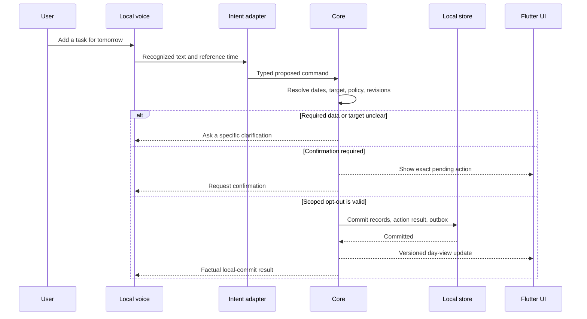

# Planner core, data, and component interactions

[Русская версия](PLANNER_CORE.ru.md) · [Product](../PRODUCT.md) · [Architecture](PROPOSAL.md) · [Approved decisions](DECISIONS.md)

Date: 2026-11-03. Status: detailed design PROPOSAL. Flutter UI is approved in ADR-001; that does not approve this entire core, a database driver, an independent Dart host, or application programming. Rules explicitly confirmed by the owner are identified below. Entity fields, internal contracts, and defaults not already confirmed remain proposals for review. No schema has been applied and no application tests have been run.

## 1. What the core owns

The core is the single authority for planner state: tasks, concrete task occurrences, habits, schedules, calendar data, constraints, permissions, accepted changes, reminders, and integration intent records. UI, voice, and AI submit requests to the same entry points. A widget or model cannot bypass rules by writing directly to storage.

Propose framework-independent domain/application packages, with storage, clocks, speech, notifications, licensing, and external services behind interfaces. Dart is the natural candidate alongside Flutter, but the language and process packaging of the background core still need approval. Planner queries and manual actions should not depend on a loaded language model; offline operation of local planner features is proposed explicitly, subject to valid trial/subscription entitlement.

| Component | Owns | Does not own |
| --- | --- | --- |
| Flutter UI | Required design, input, read models, presentation of questions/confirmations | Business-state mutation or direct provider credentials |
| Command service | Validation, target resolution, policy, revisions, transactions | Model inference or drawing |
| Planner | Constraints, feasible placements, unplaced reasons, plan proposals | Committing its own unreviewed proposal |
| Recurrence/habit services | Occurrence identity, period generation, progress and statistics | Silent goal changes |
| Repositories / unit of work | Durable records, constraints, transaction boundaries | Permission decisions from raw model text |
| Background scheduler | Due work, recovery after restart, delivery deduplication | Assuming the application runs while the computer is off |
| Integration workers | Provider calls, cursors, reconciliation, sync results | Resolving two-sided conflicts without the user |

## 2. Separate task, occurrence, and placement

Use three concepts instead of one overloaded task row:

- **Task** describes what needs doing: title, description, project, priority, estimated duration, and recurrence definition if present.
- **TaskOccurrence** is the executable instance. A one-off task has one occurrence; a recurring task has distinct occurrences with their own deadline, completion, cancellation, and debt.
- **SchedulePlacement** records when an occurrence is planned. Moving a placement does not change its deadline or completion. The task's visible "planned time" is read from this record, not maintained as a second independent scheduling field.

Example of the confirmed distinction: a task scheduled for 10:00–11:00 with a deadline of 18:00 can miss its scheduled window at 11:00 and become deadline-overdue only after 18:00. Both indicators can later be present. Elapsed time never marks completion. A spoken completion request changes state only through a validated core command.

Proposed occurrence states are `open`, `completed`, and `cancelled`; deadline-overdue and missed-placement indicators are derived from current time and records rather than a permanently stored "overdue" state. Record `completed_at` separately so statistics can distinguish completion before/after a deadline.

## 3. Logical records and fields

This is a logical model for review, not final SQL or a committed migration.

| Record | Main proposed fields and relationships |
| --- | --- |
| Profile / Settings | Local ID, name/nickname, locale, timezone, city/source, appearance, quiet hours, availability, history retention |
| Project / Note | Stable ID, title/content, local revision, timestamps; independent of external connections |
| Task | ID, title, description, optional project, priority, optional duration estimate, optional recurrence reference, revision, archive marker |
| TaskOccurrence | ID, task ID, stable original recurrence key, deadline specification, optional per-occurrence overrides, state, completed-at, revision |
| RecurrenceRule / Exception | Task relation, fixed/calendar or completion-relative mode, interval, local anchor, timezone, exclusions, effective version and edit scope |
| SchedulePlacement | ID, target occurrence/habit period, start, positive allocated duration, local timezone, manual/automatic source, lock policy, revision |
| CalendarEvent | ID, calendar/source, title, date/time specification, busy/free status, optional attendees, revision |
| Habit / HabitSchedule | ID, measurement type, unit, goal, fixed days or flexible frequency, period/timezone, effective settings version |
| HabitPeriod / HabitLog | Stable period identity, bounds and goal snapshot; measurement/check-in, timestamp, correction metadata |
| DayPlanProposal | ID, target date/timezone, input-version snapshot, proposed changes, constraints, unplaced/missing-input reasons, status |
| Reminder / ScheduledJob | Target, trigger rule, logical delivery key, due time, state, retry/catch-up metadata |
| PendingAction / CapabilityGrant | Exact operation, targets/revisions, intent origin, permission scope, confirmation or clarification state, expiry |
| AuditEntry / DomainOutbox | Action ID, minimal result/change metadata and durable follow-up work, without raw conversations by default |
| ExternalMapping / SyncCursor / SyncConflict | Local/provider IDs, original recurrence identity, provider revision, last synchronized base, cursor, unresolved versions |
| Conversation / Message | Local history with retention rules; separate from profile preferences and planner records |

Use stable locally generated IDs, record revisions, and unique keys for recurrence periods, processed action IDs, and queued delivery operations. Do not use a task title, current scheduled time, or list position as identity. A moved recurring instance retains its original identity.

## 4. Creation, priorities, time, and duration

Confirmed: four priorities — low, normal, high, urgent. Confirmed: a task without a duration can be saved; the planner asks for duration before scheduling it. It must not invent an estimate or silently substitute 30 minutes.

Propose title as the only mandatory field for basic task creation; project, deadline, duration, and planned time can be absent. Proposed default priority is normal. Advanced subtasks, checklists, tags, and attachments remain user-enabled; global versus per-task switches need a decision.

Distinguish date-only deadlines, local wall-clock times with a timezone, and absolute instants. A date-only deadline is a local calendar date, not midnight UTC. Exactly when a date-only deadline expires still needs an explicit rule. Preserve original scheduling intent and timezone when serializing recurrence. The iCalendar standard distinguishes DATE, DATE-TIME, timezone-linked recurrence, and original recurrence-instance identity. [RFC 5545](https://www.rfc-editor.org/rfc/rfc5545).

For automatic planning, request missing duration or ask the user to exclude the item from that planning attempt; never invent a busy interval or treat an unknown end as known free time. Whether manual entry may save a start-time-only marker outside automatic planning is a separate open UX decision, not approved by this proposal. Until that decision is made, distinguish a requested time in a pending draft from an actual validated placement. Validate allocated durations as positive; time intervals use an exclusive end so adjacent blocks can meet without overlap.

Freeze the interpretation of relative speech dates against the request's reference time and profile timezone. If a request stays pending across midnight, do not silently reinterpret "tomorrow". If the target or intended date remains ambiguous, ask; display the concrete interpreted date before a required confirmation.

## 5. Recurrence and debt

Confirmed: both calendar-fixed and completion-relative recurrence are required; missed task occurrences remain debt. They are different algorithms:

| Mode | Proposed behavior | Example |
| --- | --- | --- |
| Calendar-fixed | Materialize bounded occurrences from the schedule independently of completion; preserve unfinished past occurrences | A daily task can have separate unfinished Monday and Tuesday instances |
| Relative to completion | Keep an unfinished due occurrence; propose creating the next only from its actual completion time | Replace a filter 30 days after the previous replacement; a late replacement shifts the next due date |

The one-open-occurrence rule for completion-relative repeats is a proposal that needs owner agreement; the owner has not specified stacking semantics for that mode. Completion-relative rules are application behavior, not a direct substitute for standard RRULE.

Generate a rolling horizon and keep a durable cursor so long absence/restart does not lose old debt. Use batching and uniqueness constraints rather than building an unbounded in-memory history. The generation horizon, archival policy, and backlog display need definition.

Editing a recurring task must resolve scope: this occurrence, future occurrences, or the definition. Preserve completed historical instances and original occurrence keys; cancelled exceptions must not reappear after regeneration. Moving Friday's instance to Thursday must not create a second Friday instance on the next sync. [Original recurrence identity](https://www.rfc-editor.org/rfc/rfc5545#section-3.8.4.4).

Completion applies to the selected occurrence only. Do not clear all accumulated debt because one instance was completed. If several matching instances exist, clarification remains mandatory.

## 6. Habit measurement and periods

Confirmed: all four measurement types, fixed-day and flexible-frequency schedules, misses only in statistics, and goal/load changes only through accepted proposals. Task confirmation opt-out cannot bypass habit goal approval.

| Type | Proposed stored observation | Interpretation needing precise rules |
| --- | --- | --- |
| Yes/no | Explicit completion/check-in | Which day or frequency period the check-in counts toward |
| Quantity | Decimal amount and unit | Sum toward that period's goal; no implicit unit conversion |
| Duration | Integer elapsed seconds | Sum toward a duration target; timer UX is a separate choice |
| Abstinence | Explicit check-in and/or violation count | No recorded observation must not silently mean confirmed success |

Propose a HabitPeriod with fixed timezone boundaries and a goal/settings snapshot. Statistics use the historical target, not today's edited target. Corrections explicitly update the chosen period and its statistics; the policy for backdating still needs approval.

Flexible "three times a week" needs a counting rule: distinct successful days or sessions, with a defined week start and cutoff. Pause/illness/vacation, streaks, and whether an approved pause is excluded from statistics remain unresolved. A miss never generates a make-up task automatically.

Separate **a habit period**, **a measurement log**, and **a suggested time placement**. Moving a placement does not mark the habit complete. A recommendation to increase a goal becomes effective only after approval and an explicit effective date.

## 7. How automatic day planning works

Propose a deterministic planning service with a model-independent input snapshot:

1. Load the chosen local date/timezone, available hours, existing placements, blocking events, eligible open task occurrences, habit needs, duration estimates, and break preferences.
2. Return `NeedsInput` for selected tasks with unknown durations or ambiguous constraints. Ask rather than silently dropping them; an explicitly excluded item is different from a forgotten one.
3. Reserve hard constraints: fixed meetings, unavailable time, and manually locked placements. Busy/free semantics and all-day events must be normalized explicitly.
4. Order eligible work using a reviewable priority/deadline policy, then place it into feasible free intervals with configured breaks. The exact ranking, split-task behavior, and buffer rules remain proposed.
5. Return a proposal: additions/moves, unchanged locked items, and unplaced items with reasons such as no fitting interval or a deadline that cannot be met. Do not silently extend available hours, move meetings, change deadlines, or label an infeasible day as solved.
6. Apply only after required confirmation or a grant covering this precise task-planning operation. Revalidate the snapshot, permissions, entitlement, and time before committing.

The assistant can explain the result in character, but factual times, feasibility, counts, and changes come from structured core data. Habit goal changes remain outside an automatically accepted task plan.

## 8. Commands and queries

All entry points use the same proposed application API. Queries such as `GetDayView`, `ListTasks`, `GetHabitProgress`, and `GetCalendarRange` return versioned read models. They do not mutate data or trigger an AI call simply because a screen rebuilds.

Commands include `CreateTask`, `EditTaskOccurrence`, `CompleteOccurrence`, `CancelOccurrence`, `RecordHabitMeasurement`, `ProposeHabitGoalChange`, `AcceptHabitGoalChange`, `CreateCalendarEvent`, `MovePlacement`, `BuildDayPlan`, and `ApplyDayPlan`.

Proposed command envelope: action ID, profile, origin (UI/voice/assistant/sync), payload, expected entity revisions, reference time/timezone, and any bound approval token. A source label is not permission. Voice input is not automatically proof of the speaker's identity; confirmation-channel security needs a separate specification.

Results distinguish `AppliedLocal`, `QueuedExternal`, `NeedsClarification`, `NeedsConfirmation`, `NeedsInput`, `Conflict`, `Denied`, `Unavailable`, and `Failed`. `AppliedLocal` confirms only a committed local mutation; `QueuedExternal` confirms only durable intent for a provider call. A successful model response proves neither. Provider effects have a separate state: pending, confirmed, conflict, unknown, or failed. The UI/voice can say "saved locally, waiting to sync" while pending; it may claim a Google/Outlook update or email submission only after provider confirmation. Email submission does not prove delivery to the recipient.

## 9. Permission matrix

| Operation | Required core behavior |
| --- | --- |
| Read authorized local day/task/habit data | Respect profile scope and entitlement; provide only relevant context |
| User-requested task change | Default confirmation; a remembered, scoped opt-out may apply |
| Ambiguous target/date | Clarify regardless of confirmation preference |
| Apply a day plan | Revalidate snapshot and a grant/confirmation covering the exact operation |
| Change habit goal/load | Propose and wait for acceptance |
| Send email | Always confirm exact recipients, body, and attachments |
| Delete/overwrite a user file | Always confirm the exact affected path/action |
| Resolve two-sided calendar conflict | User chooses the version |
| Other device actions | Capability must be enabled; remaining confirmation rules require design |

Validate drafts before asking for confirmation, then revalidate after it. Bind confirmation to operation parameters and expected revisions, not a generic remembered "yes". A permission edit is itself an explicit settings/consent action, not an instruction accepted from a webpage or email body. Grants are revocable and must be checked at execution, including queued work.

## 10. Local transactions and durable events

Propose current-state tables as the source of truth, not full event sourcing. An accepted change writes domain records, an action result/deduplication record, minimal audit metadata, and required outbox work in one local transaction. Publish UI updates only after commit. If the host crashes after commit but before replying, the same action ID returns the recorded result instead of repeating the mutation.

The outbox is durable follow-up work, not a claim that external services participate in a SQLite transaction. Local commit and provider confirmation remain separate in read models, notifications, and spoken results. UI notifications can refresh from a committed read model after reconnection; integration and reminder workers resume pending work by stable keys.

An approved plan stores relevant input revisions: task occurrences, calendar events, placements, availability, timezone and planning settings. Acceptance checks them again. If an event changed, return `Conflict` and rebuild/review the proposal; do not apply a stale plan because its text was once approved. Unrelated note edits should not invalidate a plan snapshot.

## 11. Storage proposal and invariants

SQLite remains a proposed implementation, behind repository/unit-of-work interfaces. Use one serialized write owner, bounded reads, transactions, versioned migrations, and explicit failure handling. If WAL is selected, readers can coexist with a writer but there is still one writer at a time; keep the live database local, not on a network share. Foreign-key enforcement must be enabled on every connection before transactions. [Transactions](https://www.sqlite.org/lang_transaction.html), [WAL](https://www.sqlite.org/wal.html), [foreign keys](https://www.sqlite.org/foreignkeys.html).

Proposed database/domain invariants:

- Unique action IDs, original occurrence keys, habit-period keys, and logical delivery keys.
- Related records refer to valid profile/parent IDs; revisions increase only on accepted writes.
- A completed occurrence has a completion instant; an open one is not completed merely because a slot ended.
- Amount/unit/type and duration constraints are validated by the domain and, where practical, the database.
- Historical goal/recurrence snapshots are not overwritten by future template edits.
- Optional advanced-field visibility does not delete existing data when a switch is turned off.

Attachments need a separate staged-file lifecycle: verify/copy into application storage, commit the reference, and recover or clean up orphaned staged files. A database transaction alone cannot make arbitrary external file replacement atomic. Any external user-file overwrite/delete still goes through mandatory confirmation. Storage paths, encryption and attachment backup consistency require a detailed schema/recovery review.

## 12. Reminder and background scheduler

Persist reminder definitions and due-job state; in-memory timers are an optimization. Rebuild the upcoming queue after launch, resume, time/timezone changes, or target edits. A changed/deleted occurrence cancels obsolete deliveries. Delivery keys distinguish target, reminder, intended due occurrence, and channel so restart does not create a flood.

Overdue tasks are highlighted and announced according to configured triggers; their dates do not move. Quiet hours/calls/games use ordinary notifications instead of proactive speech. Acknowledgement, notification dismissal, and task completion are separate actions.

Propose an aggregated catch-up summary after sleep/absence instead of replaying every missed spoken reminder; the catch-up rule and maximum frequency need owner agreement. A closed main window leaves the host running, but full exit, sleep, shutdown, denied OS notification permission, or stopped microphone capture impose real limits. Do not claim guaranteed alarms while the application/OS is unavailable.

## 13. Calendar and email interaction

Sync adapters map provider IDs/revisions and original recurring-instance IDs to local records. Maintain a synchronized base to detect edits on both sides. Preserve conflicting versions and request user choice; do not silently use last-write-wins. Cursors, provider removals, recurrence exceptions, and which task/habit calendar projections are eligible for export need dedicated integration contracts.

Calendar creation can use provider-supported client IDs and conditional updates where available, followed by reconciliation after uncertain outcomes. Google documents client-generated IDs, resource constraints, and conditional update behavior. [Creation guide](https://developers.google.com/workspace/calendar/api/guides/create-events), [resource versioning](https://developers.google.com/workspace/calendar/api/guides/version-resources).

No remote call is atomic with the local commit. Outbox states should distinguish ready, awaiting policy, in flight, succeeded, retryable, conflict, and outcome unknown. Recheck permission and payload before dispatch; do not retain a blanket approval for materially changed recipients or attachments. Automatic retries require an operation-specific safety rule, such as no dispatch having occurred or a provider-supported idempotent/reconcilable operation; a timeout alone does not establish that retry is safe.

For a send-email timeout after dispatch, do not automatically send again: first reconcile the result or report uncertainty and ask the user. Unknown outcome must not be voiced as either successful sending or confirmed failure. The Gmail send endpoint does not document a generic exactly-once/idempotency guarantee. A durable local outbox alone cannot create that guarantee. [Gmail send](https://developers.google.com/workspace/gmail/api/reference/rest/v1/users.messages/send).

## 14. Conversation, history, and recovery

The context builder reads only authorized, relevant query results and the active conversation context. History disabled means no durable conversation-message retention; the exact policy for transient session buffers, pending drafts, audit minimization, and deletion remains to be specified. Audit records and domain objects must not become a hidden full transcript.

Automatic local snapshots must be consistent with database and attachment revisions. Use SQLite's backup facilities for a live database; preserve a restorable pre-migration version. Restore must validate schema and references, require the agreed user action, preserve offline entitlement/trial rules, and avoid silently resurrecting deleted history. Credentials and model weights are not ordinary portable planner backup content. [SQLite live backup](https://www.sqlite.org/backup.html).

After subscription expiry the data remains. Paid functionality is denied through the command/query policy, not through deleting database files. Exact renewal-screen access and retention/backup housekeeping while locked remain design items.

## 15. End-to-end example: voice task creation

After a confirmation response the core revalidates and follows the same commit path. No task is created merely because the model produced a tool call. If duration was omitted, the task can still be saved; a later `BuildDayPlan` asks for duration before scheduling it.

For competing changes, the same contract applies: if a calendar edit arrives while a day proposal waits for acceptance, acceptance returns a conflict rather than overwriting the new appointment. If a habit is missed, statistics update for that period without creating a task debt.

## 16. Failure behavior

| Situation | Proposed response |
| --- | --- |
| Model missing/crashed | Preserve local planner state; report assistant availability and allow authorized manual use |
| Host dies before commit | No success claim; recover pending work and retry by action ID |
| Host dies after commit before reply | Return the stored result for the same action ID |
| Plan snapshot stale | Conflict; rebuild/review instead of applying old placements |
| Unknown task duration | Save is allowed; planning requests input |
| Not enough day capacity | Explain unplaced items; do not silently change deadlines |
| Provider offline | Keep durable local intent and explicit sync status |
| Email outcome unknown | Reconcile/report; no blind resend |
| Backup or migration fails | Preserve recoverable original; report failure without claiming success |
| License expired | Preserve data, lock paid features, allow the agreed renewal path |

## 17. Package boundaries for Flutter

Proposed logical packages: domain models/rules; application commands and queries; planning/recurrence services; repository and clock interfaces; platform/integration adapters; UI projections; local worker protocol. Pure domain packages must not import widgets or assume a running model. The concrete package tree, state-management library, storage driver, IPC mechanism, and native bindings need selection after review.

Keep screen rebuilds separate from commands and background jobs. Reuse the same domain/API on later Android, with different platform lifecycle adapters. Do not share a live SQLite file between devices or assume a Windows host process will run unchanged on Android.

## 18. Decisions to review next

Confirmed in this discussion: Flutter UI, four priority levels, separate deadline-overdue/missed-placement indicators, and requesting missing duration before automatic scheduling. Earlier product requirements remain binding.

Proposals still needing agreement include: normal default priority/title-only creation; one open completion-relative occurrence; manual start-only markers, placement locking and task splitting; date-only deadline cutoff and timezone travel; habit frequency/session counting and pauses; recurrence edit scopes; late-reminder catch-up; exact data schema/SQLite choice; host language/packaging; and backup/history restore semantics.

Future verification should exercise one-off/recurring task creation, late completion, two overdue fixed occurrences, completion-relative late completion, missing duration, no feasible interval, stale plan acceptance, duplicate action retries, partial habit progress, explicit abstinence check-ins, goal changes preserving history, timezone/DST changes, restart catch-up, provider conflicts/unknown send outcome, and backup restoration. These are proposed checks for a later approved implementation, not tests run now.
