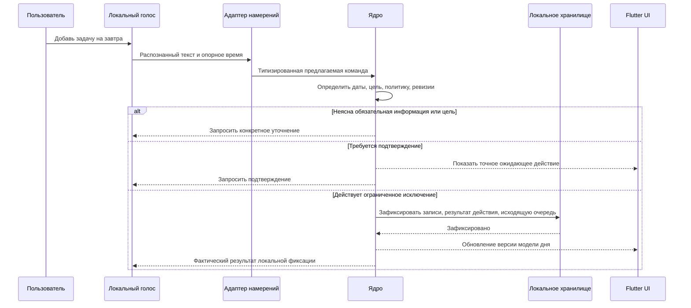

# Ядро планировщика, данные и взаимодействие компонентов

[English version](PLANNER_CORE.md) · [Описание продукта](../PRODUCT.ru.md) · [Предложение по архитектуре](PROPOSAL.ru.md) · [Реестр утверждённых решений](DECISIONS.ru.md)

Дата: 2026-11-03. Статус: подробное ПРОЕКТНОЕ ПРЕДЛОЖЕНИЕ. Flutter UI утверждён в ADR-001, локальный PostgreSQL — в ADR-002. Это не утверждает всё ядро, драйвер/схему, язык/упаковку фонового процесса или программирование приложения. Подтверждённые владельцем правила указаны отдельно; остальные поля сущностей, контракты и значения по умолчанию остаются предложениями. Схема не применялась, тесты приложения не запускались.

## 1. Ответственность ядра

Ядро — единственный источник достоверного состояния планировщика: задач, конкретных вхождений задач, привычек, расписаний, данных календаря, ограничений, разрешений, принятых изменений, напоминаний и записей о намерениях интеграций. Интерфейс, голос и ИИ передают запросы через одни и те же точки входа. Виджет или модель не могут обходить правила прямой записью в хранилище.

Предлагаются независимые от платформы пакеты предметной области/приложения, а хранилище, часы, речь, уведомления, лицензирование и внешние сервисы скрываются за интерфейсами. Dart — естественный кандидат вместе с Flutter, но язык и упаковка фонового ядра ещё требуют утверждения. Запросы к планировщику и ручные действия не должны зависеть от загруженной языковой модели; автономная работа локальных функций планировщика явно предлагается при действительном праве на пробный период/подписку.

| Компонент | Владеет | Не владеет |
| --- | --- | --- |
| Flutter UI | Обязательный дизайн, ввод, модели чтения, показ вопросов/подтверждений | Изменение бизнес-состояния или прямые учётные данные поставщика |
| Сервис команд | Проверка, определение цели, политика, ревизии, транзакции | Вывод модели или рисование |
| Планировщик | Ограничения, допустимые размещения, причины неразмещения, предложения плана | Самостоятельное применение непроверенного предложения |
| Сервисы повторений/привычек | Идентичность вхождений, генерация периодов, прогресс и статистика | Молчаливое изменение целей |
| Репозитории / единица работы | Постоянные записи, ограничения, границы транзакций | Решения о разрешениях из сырого текста модели |
| Фоновый планировщик | Сроки задач, восстановление после перезапуска, устранение дублей доставки | Предположение, что приложение работает, пока компьютер выключен |
| Рабочие процессы интеграций | Вызовы поставщика, курсоры, сверка, результаты синхронизации | Разрешение двусторонних конфликтов без пользователя |

## 2. Разделение задачи, вхождения и размещения

Использовать три понятия вместо одной перегруженной строки задачи:

- **Task** описывает, что нужно сделать: название, описание, проект, приоритет, оценочную длительность и, при наличии, правило повторения.
- **TaskOccurrence** — исполняемый экземпляр задачи. У разовой задачи одно вхождение; у повторяющейся — отдельные вхождения со своим сроком, выполнением, отменой и долгом.
- **SchedulePlacement** хранит время, на которое запланировано вхождение. Перенос размещения не меняет срок или выполнение. Видимое для задачи «запланированное время» читается из этой записи, а не поддерживается как второе независимое поле расписания.

Пример подтверждённого различия: задача запланирована с 10:00 до 11:00, срок — 18:00. В 11:00 может быть пропущено запланированное окно, а просроченной по сроку задача станет только после 18:00. Позже могут одновременно отображаться оба признака. Истечение времени не отмечает выполнение. Голосовая просьба о завершении меняет состояние только через проверенную команду ядра.

Предлагаемые состояния вхождения: `open`, `completed` и `cancelled`; просрочка срока и пропуск размещения вычисляются по текущему времени и записям, а не хранятся как постоянное состояние «overdue». Хранить `completed_at` отдельно, чтобы статистика могла различать выполнение до/после срока.

## 3. Логические записи и поля

Это логическая модель для рассмотрения, а не итоговый SQL или готовая миграция.

| Запись | Основные предлагаемые поля и связи |
| --- | --- |
| Profile / Settings | Локальный ID, имя/никнейм, локаль, часовой пояс, город/источник, оформление, тихие часы, доступное время, срок хранения истории |
| Project / Note | Стабильный ID, название/содержание, локальная ревизия, метки времени; независимо от внешних подключений |
| Task | ID, название, описание, необязательный проект, приоритет, необязательная оценка длительности, согласие на разделение этой задачи, необязательная ссылка на повторение, ревизия, признак архивирования |
| TaskOccurrence | ID, ID задачи, стабильный исходный ключ повторения, дата планирования/локальное окно размещения (06:00–22:00 по умолчанию для даты без времени), отдельный необязательный крайний срок, переопределения вхождения, состояние, completed-at, ревизия |
| RecurrenceRule / Exception | Связь с задачей, календарный или интервальный режим с исходной точкой отсчёта, интервал, локальная точка отсчёта, часовой пояс, исключения, действующая версия и область изменения |
| SchedulePlacement | ID, целевое вхождение/период привычки, начало, положительная выделенная длительность, локальный часовой пояс, ручной/автоматический источник, политика блокировки, ревизия |
| CalendarEvent | ID, календарь/источник, название, спецификация даты/времени, занято/свободно, необязательные участники, ревизия |
| Habit / HabitSchedule | ID, тип измерения, единица, цель, фиксированные дни или гибкая частота, период/часовой пояс, версия действующих настроек |
| HabitPeriod / HabitLog | Стабильная идентичность периода, границы и снимок цели; измерение/отметка, временная метка, метаданные исправления |
| DayPlanProposal | ID, целевая дата/часовой пояс, снимок версий входных данных, предлагаемые изменения, ограничения, причины неразмещения/недостающих данных, состояние |
| PlanningState | ID профиля, ревизия планирования, короткая транзакционная защита для связанных изменений; предлагаемый механизм |
| Reminder / ScheduledJob | Цель, правило срабатывания, логический ключ доставки, срок, состояние, метаданные повтора/догоняющей обработки |
| PendingAction / CapabilityGrant | Точная операция, цели/ревизии, источник намерения, область разрешения, состояние подтверждения или уточнения, срок действия |
| AuditEntry / DomainOutbox | ID действия, минимальные метаданные результата/изменения и надёжная последующая работа; без исходных разговоров по умолчанию |
| ExternalMapping / SyncCursor / SyncConflict | Локальные ID/ID поставщика, исходная идентичность вхождения повторения, ревизия поставщика, последняя синхронизированная база, курсор, неразрешённые версии |
| Conversation / Message | Локальная история со сроком хранения; отдельно от настроек профиля и записей планировщика |

Использовать стабильно сгенерированные локальные ID, ревизии записей и уникальные ключи для периодов повторений, обработанных ID действий и операций очереди доставки. Не использовать название задачи, текущее запланированное время или позицию в списке как идентичность. Перенесённый экземпляр повторяющейся задачи сохраняет исходную идентичность.

## 4. Создание, приоритеты, время и длительность

Подтверждено: четыре приоритета — `low`, `normal`, `high`, `urgent`. Подтверждено: задачу без длительности можно сохранить; планировщик запрашивает длительность до её включения в расписание. Он не должен придумывать оценку или молча подставлять 30 минут.

Подтверждено: повторение сохраняет исходный график даже при позднем выполнении. Задача со сроком 1 ноября и повторением каждые семь дней, выполненная 3 ноября, в следующий раз должна быть выполнена 8 ноября, а не 10 ноября. Пропущенные вхождения остаются отдельным долгом. Сдвиг повторения от фактического выполнения отклонён для текущего дизайна. Для задачи только с датой 06:00–22:00 — разрешённое окно размещения с учётом собственной длительности задачи; это не длительность в 16 часов и не общий рабочий день, срок отдельный. Порог для явного срока без времени остаётся открытым.

Предлагается считать название единственным обязательным полем базового создания задачи; проект, срок, длительность и запланированное время могут отсутствовать. Предлагаемый приоритет по умолчанию — `normal`. Дополнительные подзадачи, чек-листы, теги и вложения остаются включаемыми пользователем; необходимость общего или отдельного для каждой задачи переключателя требует решения.

Различать сроки только по дате, локальное настенное время с часовым поясом и абсолютные моменты времени. Срок только по дате — это локальная календарная дата, а не полночь UTC. Точное правило истечения срока только по дате ещё предстоит определить. Сохранять исходный смысл расписания и часовой пояс при сериализации повторения. Стандарт iCalendar различает DATE, DATE-TIME, повторения с привязкой к часовому поясу и исходную идентичность экземпляра повторения. [RFC 5545](https://www.rfc-editor.org/rfc/rfc5545).

В будущей схеме PostgreSQL сохранять имя часового пояса отдельно от моментов времени и локальных точек отсчёта повторений. Тип PostgreSQL `timestamp with time zone` нормализует момент времени и не хранит исходное имя часового пояса; одного этого типа недостаточно для сохранения повторяющегося локального расписания. [Типы даты и времени PostgreSQL](https://www.postgresql.org/docs/current/datatype-datetime.html).

Для автоматического планирования запросить недостающую длительность либо предложить исключить задачу из этой попытки планирования; не придумывать занятый интервал и не считать неизвестный конец известным свободным временем. Разрешение сохранять вручную маркер только времени начала вне автоматического планирования — отдельный нерешённый вопрос UX; это предложение не утверждает такую возможность. Пока решение не принято, отличать запрошенное время в черновике от фактического проверенного размещения. Проверять, что выделенная длительность положительна; использовать конец интервала, который не включается, чтобы соседние блоки могли соприкасаться без пересечения.

Фиксировать трактовку относительных дат в речи относительно опорного времени запроса и часового пояса профиля. Если запрос остаётся ожидающим после полуночи, не переинтерпретировать молча слово «завтра». Если цель или дата остаётся неоднозначной — спросить; до обязательного подтверждения показать конкретную интерпретированную дату.

## 5. Повторения и долг

Подтверждено: повторы по дням и интервалам сохраняют исходную точку графика; пропущенные вхождения остаются отдельным долгом. Позднее выполнение не сдвигает следующий срок. Сдвиг от фактического выполнения отклонён для текущего дизайна.

| Режим | Предлагаемое поведение | Пример |
| --- | --- | --- |
| Фиксированный по календарю | Создавать ограниченную последовательность вхождений независимо от выполнения; сохранять незавершённые прошлые вхождения | У ежедневной задачи могут быть отдельные незавершённые вхождения за понедельник и вторник |
| Интервал от исходной точки | Сохранять исходную точку графика и вычислять вхождения от неё независимо от времени выполнения | Задача со сроком 1 ноября и интервалом в семь дней, выполненная 3 ноября, в следующий раз должна быть выполнена 8 ноября |

Владелец отклонил сдвиг повторения по фактическому времени выполнения. Точки отсчёта интервала, исключения и область изменения требуют отдельной временной спецификации; позднее выполнение не должно трактоваться как перенос графика.

Генерировать скользящий горизонт и сохранять долговременный курсор, чтобы долгое отсутствие/перезапуск не теряли старый долг. Использовать пакетную обработку и ограничения уникальности, а не создавать в памяти неограниченную историю. Горизонт генерации, политика архивации и отображение накопленного долга требуют определения.

При изменении повторяющейся задачи уточнить область: это вхождение, будущие вхождения или правило. Сохранять завершённые исторические экземпляры и исходные ключи вхождений; отменённые исключения не должны появляться снова при повторной генерации. Перенос пятничного экземпляра на четверг не должен создавать вторую пятничную запись при следующей синхронизации. [Исходная идентичность повторения](https://www.rfc-editor.org/rfc/rfc5545#section-3.8.4.4).

Выполнение относится только к выбранному вхождению. Не очищать весь накопленный долг, потому что выполнен один экземпляр. Если найдено несколько подходящих экземпляров, уточнение остаётся обязательным.

## 6. Измерение привычек и периоды

Подтверждены: все четыре типа измерений, расписания по фиксированным дням и гибкой частоте, пропуски учитываются только в статистике, а изменение цели/нагрузки возможно только через принятое предложение. Отключение подтверждений для задач не отменяет необходимость одобрения изменения цели привычки.

| Тип | Предлагаемое хранимое наблюдение | Интерпретация, для которой нужны точные правила |
| --- | --- | --- |
| Да/нет | Явная отметка выполнения/отметка | К какому дню или периоду частоты относится отметка |
| Количество | Десятичное значение и единица | Суммировать в цель периода; без неявного преобразования единиц |
| Длительность | Целое количество прошедших секунд | Суммировать к целевой длительности; UX таймера — отдельное решение |
| Воздержание | Явная отметка и/или число нарушений | Отсутствие записи не должно молча означать подтверждённый успех |

Предлагается использовать `HabitPeriod` с фиксированными границами часового пояса и снимком цели/настроек. Статистика использует историческую цель, а не сегодняшнюю изменённую цель. Исправления явно обновляют выбранный период и его статистику; политика заднего числа ещё требует согласования.

Подтверждено: гибкая частота, например «три раза в неделю», считает разные успешные дни. Несколько записей за один день могут учитываться в измерениях, но дают не более одного успешного дня для недельной частоты. Начало недели и срок отсечения остаются нерешёнными. Пауза/болезнь/отпуск, серии выполнений и исключение утверждённой паузы из статистики остаются нерешёнными. Пропуск никогда не создаёт автоматически задачу-компенсацию.

Разделять **период привычки**, **запись измерения** и **предложенное временное размещение**. Перенос размещения не отмечает привычку выполненной. Рекомендация повысить цель вступает в силу только после одобрения и явной даты начала действия.

## 7. Как работает автоматическое планирование дня

Предлагается детерминированный сервис планирования с независимым от модели снимком входных данных:

1. Загрузить выбранные локальные дату/часовой пояс, доступное время, существующие размещения, блокирующие события, подходящие открытые вхождения задач, требования привычек, оценки длительности и предпочтения по перерывам.
2. Для выбранных задач с неизвестной длительностью или неоднозначными ограничениями вернуть `NeedsInput`. Спросить, а не пропускать молча; явное исключение задачи отличается от забытой задачи.
3. Зарезервировать жёсткие ограничения: фиксированные встречи, недоступное время и размещения задач, заданные вручную. Они остаются заблокированы, пока пользователь явно не разрешит изменения. Для задачи только с датой использовать подтверждённое окно размещения 06:00–22:00 с собственной длительностью задачи. Семантику «занято/свободно» и событий на весь день нужно нормализовать явно.
4. Расположить подходящую работу по проверяемой политике приоритетов/сроков, затем разместить её в допустимых свободных интервалах с настроенными перерывами. Разделение задачи допускается только после явного согласия пользователя для этой задачи; у одного вхождения задачи может быть несколько сегментов `SchedulePlacement`. Число сегментов, проверка общей длительности и связь выполнения с завершением всех сегментов остаются открытыми. Точный рейтинг и правила буферного времени остаются предложениями.
5. Вернуть предложение: добавления/переносы, неизменённые заблокированные элементы и неразмещённые задачи с причинами, например нет подходящего интервала или срок невозможно соблюсти. Не расширять молча доступные часы, не переносить встречи, не менять сроки и не объявлять неосуществимый день решённым.
6. Применять только после обязательного подтверждения или разрешения, охватывающего именно эту операцию планирования задач. Перед записью повторно проверить снимок, разрешения, право на функции и время.

Помощник может объяснить результат в образе, но фактическое время, осуществимость, количества и изменения берутся из структурированных данных ядра. Изменения целей привычек остаются за пределами автоматически принятого плана задач.

## 8. Команды и запросы

Все точки входа используют один предлагаемый API приложения. Запросы, например `GetDayView`, `ListTasks`, `GetHabitProgress` и `GetCalendarRange`, возвращают версионируемые модели чтения. Они не меняют данные и не запускают вызов ИИ лишь потому, что перерисовался экран.

Команды включают `CreateTask`, `EditTaskOccurrence`, `CompleteOccurrence`, `CancelOccurrence`, `RecordHabitMeasurement`, `ProposeHabitGoalChange`, `AcceptHabitGoalChange`, `CreateCalendarEvent`, `MovePlacement`, `BuildDayPlan` и `ApplyDayPlan`.

Предлагаемая оболочка команды: ID действия, профиль, источник (`UI`/`voice`/`assistant`/`sync`), полезная нагрузка, ожидаемые ревизии сущностей, опорные время/часовой пояс и привязанный токен одобрения, если он есть. Метка источника сама по себе не является разрешением. Голосовой ввод автоматически не подтверждает личность говорящего; безопасность канала подтверждения требует отдельной спецификации.

Результаты различают `AppliedLocal`, `QueuedExternal`, `NeedsClarification`, `NeedsConfirmation`, `NeedsInput`, `Conflict`, `Denied`, `Unavailable` и `Failed`. `AppliedLocal` подтверждает только локально сохранённое изменение; `QueuedExternal` — только устойчиво сохранённое намерение вызвать поставщика. Успешный ответ модели не подтверждает ни того, ни другого. У результата поставщика отдельное состояние: `pending`, `confirmed`, `conflict`, `unknown` или `failed`. Пока действие ожидает обработки, интерфейс/голос могут сообщить «сохранено локально, ожидает синхронизации»; об обновлении Google/Outlook или отправке письма можно сообщать только после подтверждения поставщиком. Факт отправки письма не доказывает его доставку получателю.

## 9. Матрица разрешений

| Операция | Обязательное поведение ядра |
| --- | --- |
| Чтение разрешённых локальных данных дня/задач/привычек | Соблюдать область профиля и право на функции; передавать только релевантный контекст |
| Изменение задачи по запросу пользователя | По умолчанию подтверждать; может применяться запомненное ограниченное исключение |
| Неоднозначная цель/дата | Уточнять независимо от предпочтения по подтверждению |
| Применение плана дня | Повторно проверить снимок и разрешение/подтверждение, охватывающее точную операцию |
| Изменение цели/нагрузки привычки | Предложить и ждать принятия |
| Отправка письма | Всегда подтвердить точных получателей, текст и вложения |
| Удаление/перезапись пользовательского файла | Всегда подтвердить точный путь/действие |
| Разрешение двустороннего конфликта календаря | Пользователь выбирает версию |
| Другие действия устройства | Возможность должна быть включена; остальные правила подтверждения требуют проектирования |

Проверить черновик до запроса подтверждения, а после него — повторно. Привязывать подтверждение к параметрам операции и ожидаемым ревизиям, а не к общему запомненному «да». Изменение разрешений само является явным действием в настройках/согласии, а не инструкцией, принятой с веб-страницы или из письма. Разрешения можно отозвать; их нужно проверять при выполнении, включая действия в очереди.

## 10. Локальные транзакции и устойчивые события

Предлагается использовать таблицы текущего состояния как источник истины, а не полную событийную модель. Принятое изменение за одну локальную транзакцию записывает доменные сущности, результат/дедупликацию действия, минимальные метаданные аудита и обязательную работу исходящей очереди. Уведомления интерфейса публикуются только после фиксации транзакции. Если фоновый процесс падает после фиксации, но до ответа, повтор с тем же ID действия возвращает сохранённый результат, а не повторяет изменение.

Исходящая очередь — устойчивая последующая работа, а не заявление, что внешние сервисы участвуют в транзакции PostgreSQL. Локальная фиксация и подтверждение поставщика остаются раздельными в моделях чтения, уведомлениях и голосовых ответах. Уведомления интерфейса могут обновляться из зафиксированной модели чтения после восстановления соединения; рабочие процессы интеграций и напоминаний продолжают ожидающие операции по стабильным ключам.

Утверждённый план хранит релевантные ревизии входных данных: вхождения задач, события календаря, размещения, доступное время, часовой пояс и настройки планирования. При принятии проверить их повторно. Если событие изменилось, вернуть `Conflict` и пересобрать/пересмотреть предложение; не применять устаревший план потому, что его текст когда-то был одобрен. Несвязанные изменения заметок не должны делать снимок плана недействительным.

## 11. Предложение по хранилищу и инвариантам

PostgreSQL утверждён как локальная база бэкенда на устройстве пользователя (ADR-002). Данные пользователя остаются на устройстве; удалённого бэкенда приложения или облачных пользовательских данных нет. Драйвер, версия, модель соединений/пула, схема, миграции, локальный жизненный цикл/упаковка, настройка среды выполнения, производительность на 8 ГиБ и транзакционные детали остаются нерешёнными и требуют последующей оценки. Поведение PostgreSQL нужно проектировать по официальной документации; предположения SQLite о единственном писателе, WAL, PRAGMA и активном файле здесь не применяются. [Транзакции](https://www.postgresql.org/docs/current/tutorial-transactions.html), [MVCC](https://www.postgresql.org/docs/current/mvcc.html), [ограничения](https://www.postgresql.org/docs/current/ddl-constraints.html).

Предложение по конкурентному доступу, а не утверждённая реализация: защитить проверку и фиксацию плана от каждой параллельной записи, влияющей на планирование, включая добавление встречи. Один вариант — защита `PlanningState` на профиль: все команды и операции синхронизации, влияющие на планирование, получают одну и ту же блокировку внутри короткой транзакции. Применение плана удерживает её при проверке сохранённых ревизий и текущих ограничений, фиксации размещений и повышении ревизии планирования. Несвязанные заметки/история не повышают эту ревизию. Нельзя держать транзакцию или блокировку при ожидании пользователя, модели, загрузок или удалённого API. Это политика приложения, а не ограничение PostgreSQL на одного писателя. При недоступности локальной базы записи планировщика прекращаются и требуется восстановление; при сбое только модели ручные действия планировщика должны оставаться доступны.

Предлагаемые инварианты базы/предметной области:

- Уникальные ID действий, исходные ключи вхождений, ключи периодов привычек и логические ключи доставки.
- Связанные записи ссылаются на действительные ID профиля/родителя; ревизии увеличиваются только при принятых записях.
- У завершённого вхождения есть момент выполнения; открытое вхождение не считается завершённым лишь потому, что временной интервал закончился.
- Значение/единица/тип и ограничения длительности проверяются предметной областью и, где это практично, базой.
- Исторические снимки целей/повторений не перезаписываются будущими изменениями шаблона.
- Отключение показа дополнительных полей не удаляет имеющиеся данные.

Для вложений нужен отдельный поэтапный жизненный цикл файла: проверить/скопировать в хранилище приложения, зафиксировать ссылку и восстановить или очистить осиротевшие временные файлы. Транзакция базы сама по себе не может атомарно заменить произвольный внешний файл. Любая перезапись/удаление внешнего файла пользователя по-прежнему требует обязательного подтверждения. Пути хранения, шифрование и согласованность резервных копий вложений требуют подробного рассмотрения схемы/восстановления.

## 12. Напоминания и фоновый планировщик

Сохранять определения напоминаний и состояние задач по сроку; таймеры в памяти — только оптимизация. Пересобирать очередь ближайших событий после запуска, возобновления, изменения времени/часового пояса или редактирования цели. Изменённое/удалённое вхождение отменяет устаревшие доставки. Ключи доставки различают цель, напоминание, предполагаемое вхождение по сроку и канал, чтобы перезапуск не создавал шквал сообщений.

Просроченные задачи выделяются и объявляются в соответствии с настроенными триггерами; их даты не переносятся. В тихие часы/во время звонков/игр показываются обычные уведомления вместо инициативной речи. Подтверждение получения, закрытие уведомления и выполнение задачи — разные действия.

Предлагается сводное уведомление о пропусках после сна/отсутствия вместо повторного воспроизведения каждого пропущенного голосового напоминания; правило догоняющего уведомления и максимальную частоту должен согласовать владелец. Закрытие главного окна оставляет фоновый процесс запущенным, но явный выход, сон, выключение, запрет уведомлений ОС или отключение захвата микрофона накладывают реальные ограничения. Не обещать гарантированные сигналы, когда приложение/ОС недоступны.

## 13. Взаимодействие с календарём и почтой

Адаптеры синхронизации сопоставляют ID/ревизии поставщика и исходные ID экземпляров повторяющихся событий с локальными записями. Вести синхронизированную базу для обнаружения изменений с обеих сторон. Сохранять конфликтующие версии и просить пользователя выбрать; не использовать молча правило «последняя запись побеждает». Для курсоров, удалений у поставщика, исключений повторений и того, какие проекции задач/привычек в календаре можно экспортировать, нужны отдельные контракты интеграций.

Создание события календаря может использовать клиентские ID, поддерживаемые поставщиком, и условные обновления, если они доступны, с последующей сверкой после неопределённого результата. Google описывает клиентские ID, ограничения ресурсов и поведение условных обновлений. [Руководство по созданию](https://developers.google.com/workspace/calendar/api/guides/create-events), [версионирование ресурсов](https://developers.google.com/workspace/calendar/api/guides/version-resources).

Вызов удалённого сервиса не атомарен с локальной фиксацией. Состояния исходящей очереди должны различать готовность, ожидание политики, выполнение, успех, возможность повтора, конфликт и неизвестный результат. Перед отправкой повторно проверить разрешение и содержимое; не хранить общее согласие для существенно изменившихся получателей или вложений. Автоматический повтор требует правила безопасности конкретной операции, например подтверждения, что отправка не произошла, или наличия поддерживаемой поставщиком идемпотентной/сверяемой операции; одного тайм-аута недостаточно, чтобы признать повтор безопасным.

Если отправка письма завершилась тайм-аутом после вызова поставщика, не отправлять автоматически снова: сначала сверить результат, иначе сообщить о неопределённости и спросить пользователя. Неизвестный результат нельзя озвучивать ни как успешную отправку, ни как подтверждённую ошибку. В Gmail endpoint отправки не документирует общую гарантию «ровно один раз»/идемпотентности. Одна локальная исходящая очередь такую гарантию создать не может. [Отправка Gmail](https://developers.google.com/workspace/gmail/api/reference/rest/v1/users.messages/send).

## 14. Разговор, история и восстановление

Сборщик контекста читает только разрешённые релевантные результаты запросов и активный контекст разговора. Если история отключена, сообщения разговора не сохраняются долговременно; точные правила для временных буферов сессии, ожидающих черновиков, минимизации аудита и удаления ещё предстоит определить. Записи аудита и доменные сущности не должны превращаться в скрытую полную стенограмму.

Автоматические локальные копии должны быть согласованы с локальной базой PostgreSQL и ревизиями вложений. `pg_dump` создаёт согласованный снимок одной базы; координацию с вложениями, локальным кластером/жизненным циклом, проверкой восстановления и восстановлением до миграции нужно спроектировать. При восстановлении проверить схему и ссылки, потребовать согласованное действие пользователя, сохранить правила автономного пробного периода/лицензии и не возвращать молча удалённую историю. Учётные данные и веса моделей не входят в обычную переносимую резервную копию планировщика. [pg_dump](https://www.postgresql.org/docs/current/app-pgdump.html), [форматы резервных копий](https://www.postgresql.org/docs/current/backup-file.html).

По окончании подписки данные сохраняются. Доступ к платным функциям закрывается политикой команд/запросов, а не удалением файлов базы. Точный доступ к экрану продления и обслуживание хранения/копий во время блокировки остаются проектными вопросами.

## 15. Сквозной пример: создание задачи голосом

После ответа-подтверждения ядро повторно проверяет данные и выполняет ту же ветвь фиксации. Задача не создаётся только потому, что модель сформировала вызов инструмента. Если длительность не указана, задачу всё равно можно сохранить; последующий `BuildDayPlan` запрашивает длительность до планирования.

Для конкурирующих изменений действует тот же контракт: если изменение календаря приходит, пока предложение плана дня ожидает принятия, подтверждение возвращает конфликт вместо перезаписи новой встречи. Если привычка пропущена, обновляется статистика периода без создания долга по задачам.

## 16. Поведение при сбоях

| Ситуация | Предлагаемая реакция |
| --- | --- |
| Модель отсутствует/аварийно завершилась | Сохранить локальное состояние планировщика; сообщить о доступности помощника и разрешить авторизованное ручное использование |
| Процесс погиб до фиксации | Не сообщать об успехе; восстановить ожидающую работу и повторить по ID действия |
| Процесс погиб после фиксации, до ответа | Вернуть сохранённый результат для того же ID действия |
| Снимок плана устарел | Конфликт; пересобрать/пересмотреть вместо применения старых размещений |
| Неизвестна длительность задачи | Сохранение разрешено; планирование запросит данные |
| Недостаточно места в расписании дня | Объяснить, что не удалось разместить; не менять сроки молча |
| Поставщик недоступен | Сохранить устойчивое локальное намерение и явный статус синхронизации |
| Неизвестен результат отправки письма | Сверить/сообщить; не отправлять вслепую повторно |
| Не удалось выполнить резервное копирование или миграцию | Сохранить восстанавливаемый оригинал; сообщить об ошибке, не заявляя об успехе |
| Истекла лицензия | Сохранить данные, заблокировать платные функции, оставить согласованный путь продления доступным |

## 17. Границы пакетов для Flutter

Предлагаемые логические пакеты: модели/правила предметной области; команды/запросы приложения; сервисы планирования/повторений; интерфейсы репозитория и часов; адаптеры платформы/интеграций; проекции интерфейса; протокол локальных рабочих процессов. Чистые пакеты предметной области не должны импортировать виджеты или предполагать работающую модель. Конкретное дерево пакетов, библиотека управления состоянием, драйвер хранилища, механизм IPC и нативные связки выбираются после рассмотрения.

Перестроение экрана отделять от команд и фоновых задач. В будущем использовать те же предметную область/API на Android с другими адаптерами жизненного цикла платформы. Не разделять активные файлы базы между устройствами и не предполагать, что процесс-хост Windows без изменений запустится на Android.

## 18. Следующие решения для рассмотрения

В этом обсуждении подтверждены: Flutter UI, локальная база бэкенда PostgreSQL, четыре уровня приоритета, раздельные индикаторы просроченного срока/пропущенного размещения, запрос недостающей длительности перед автоматическим планированием, повторение от исходного графика, подсчёт гибкой частоты привычек по разным дням, блокировка ручного размещения без явного разрешения, согласие на разделение задачи отдельно для каждой задачи и окно размещения 06:00–22:00 для даты без времени. Ранее согласованные требования продукта остаются обязательными.

Предложения, требующие согласования: приоритет `normal` по умолчанию/создание только с названием; маркеры только времени начала при ручном вводе; порог явного срока без времени и поездки между часовыми поясами; начало недели/порог гибкой частоты, паузы и серии привычек; области изменения повторения и исключения; правила числа/общей длительности сегментов разделённой задачи и завершения; конкретная защита от конкурентного устаревания планов; догоняющие уведомления о поздних напоминаниях; драйвер/версия/схема/миграции PostgreSQL, локальный жизненный цикл/упаковка, пул соединений, настройка среды выполнения и производительность на 8 ГиБ; язык/упаковка фонового процесса; семантика восстановления резервной копии/истории.

Будущая проверка должна охватить создание разовых/повторяющихся задач, позднее выполнение без сдвига исходного графика, два фиксированных просроченных вхождения, отсутствие длительности, отсутствие допустимого интервала, принятие устаревшего плана, повтор дублированного действия, частичный прогресс привычки, подсчёт гибкой частоты по разным дням, явные отметки воздержания, сохранение истории при изменении цели, часовые пояса/переходы летнего времени, догоняющие уведомления после перезапуска, конфликты поставщиков/неизвестный результат отправки и восстановление резервной копии. Это предлагаемые проверки для будущей реализации после согласования; сейчас тесты не запускались.
