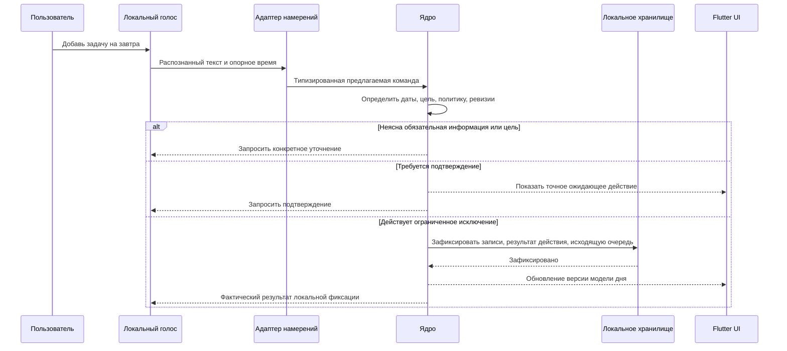

# Ядро планировщика, данные и взаимодействие компонентов

[English version](PLANNER_CORE.md) · [Описание продукта](../PRODUCT.ru.md) · [Предложение по архитектуре](PROPOSAL.ru.md) · [Реестр утверждённых решений](DECISIONS.ru.md)

Дата: 2026-11-03. Статус: подробное ПРОЕКТНОЕ ПРЕДЛОЖЕНИЕ. Flutter UI утверждён в ADR-001, локальный PostgreSQL — в ADR-002, Python для логики ядра/фонового процесса со средой выполнения под управлением приложения — в ADR-003, жизненный цикл изолированного локального экземпляра PostgreSQL под управлением приложения — в ADR-004. Это не утверждает всё ядро, точные версии, драйвер/схему, локальный транспорт, дистрибутив/упаковку среды выполнения или базы и программирование приложения. Подтверждённые владельцем правила указаны отдельно; остальные поля сущностей, контракты и значения по умолчанию остаются предложениями. Схема не применялась, тесты приложения не запускались.

## 1. Ответственность ядра

Ядро — единственный источник достоверного состояния планировщика: задач, конкретных вхождений задач, привычек, расписаний, данных календаря, ограничений, разрешений, принятых изменений, напоминаний и записей о намерениях интеграций. Интерфейс, голос и ИИ передают запросы через одни и те же точки входа. Виджет или модель не могут обходить правила прямой записью в хранилище.

Предлагаются независимые от платформы пакеты предметной области/приложения, а хранилище, часы, речь, уведомления, лицензирование и внешние сервисы скрываются за интерфейсами. Python выбран для логики ядра планировщика и фонового процесса (ADR-003), со своей упакованной средой выполнения под управлением приложения; Flutter/Dart остаётся интерфейсом. Версия Python, локальный транспорт/фреймворк и способ упаковки среды выполнения не выбраны. Запросы к планировщику и ручные действия не должны зависеть от загруженной языковой модели; при действующем пробном периоде/лицензии и наличии необходимых локальных ресурсов локальные разделы планировщика, напоминания, голос и разговор работают без интернета; поиск, актуальная погода и внешние поставщики требуют сети.

| Компонент | Владеет | Не владеет |
| --- | --- | --- |
| Flutter UI | Обязательный дизайн, ввод, модели чтения, показ вопросов/подтверждений | Изменение бизнес-состояния или прямые учётные данные поставщика |
| Сервис команд | Проверка, определение цели, политика, ревизии, транзакции | Вывод модели или рисование |
| Планировщик | Ограничения, допустимые размещения, причины неразмещения, предложения плана | Самостоятельное применение непроверенного предложения |
| Сервисы повторений/привычек | Идентичность вхождений, генерация периодов, прогресс и статистика | Молчаливое изменение целей |
| Репозитории / единица работы | Постоянные записи, ограничения, границы транзакций | Решения о разрешениях из сырого текста модели |
| Фоновый планировщик | Сроки задач, восстановление после перезапуска, устранение дублей доставки | Предположение, что приложение работает, пока компьютер выключен |
| Рабочие процессы интеграций | Вызовы поставщика, курсоры, сверка, результаты синхронизации | Разрешение двусторонних конфликтов без пользователя |

## 2. Разделение задачи, вхождения и размещения

Использовать три понятия вместо одной перегруженной строки задачи:

- **Task** описывает, что нужно сделать: название, описание, проект, приоритет, оценочную длительность и, при наличии, правило повторения.
- **TaskOccurrence** — исполняемый экземпляр задачи. У разовой задачи одно вхождение; у повторяющейся — отдельные вхождения со своим сроком, выполнением, отменой и долгом.
- **SchedulePlacement** хранит время, на которое запланировано вхождение. Перенос размещения не меняет срок или выполнение. Видимое для задачи «запланированное время» читается из этой записи, а не поддерживается как второе независимое поле расписания.

Пример подтверждённого различия: задача запланирована с 10:00 до 11:00, срок — 18:00. В 11:00 может быть пропущено запланированное окно, а просроченной по сроку задача станет только после 18:00. Позже могут одновременно отображаться оба признака. Истечение времени не отмечает выполнение. Пользовательское действие завершения задачи выполняется отдельно; в этом предложении для выбранного вхождения оно сопоставлено с `CompleteOccurrence`, но точное имя API не утверждено. Голосовой запрос завершения должен вызывать будущую проверенную команду ядра. Завершение одного вхождения не завершает другие исторические или будущие вхождения.

Предлагаемые состояния вхождения: `open`, `completed` и `cancelled`; просрочка срока и пропуск размещения вычисляются по текущему времени и записям, а не хранятся как постоянное состояние «overdue». Хранить `completed_at` отдельно, чтобы статистика могла различать выполнение до/после срока.

## 3. Логические записи и поля

Это логическая модель для рассмотрения, а не итоговый SQL или готовая миграция.

| Запись | Основные предлагаемые поля и связи |
| --- | --- |
| Profile / Settings | Локальный ID, имя/никнейм, локаль, часовой пояс, город/источник, оформление, тихие часы, доступное время, срок хранения истории |
| Project / Note | Стабильный ID, название/содержание, локальная ревизия, метки времени; независимо от внешних подключений |
| Task | ID, обязательные название и явно выбранный приоритет, необязательные описание/проект/оценка длительности, согласие на разделение этой задачи, необязательная ссылка на повторение, ревизия, признак архивирования |
| TaskOccurrence | ID, ID задачи, стабильный исходный ключ повторения, дата планирования/локальное окно размещения (06:00–22:00 по умолчанию для даты без времени), отдельный необязательный крайний срок, переопределения вхождения, состояние, completed-at, ревизия |
| RecurrenceRule / Exception | Связь с задачей, календарный или интервальный режим с исходной точкой отсчёта, интервал, локальная точка отсчёта, часовой пояс, исключения, действующая версия и область изменения |
| SchedulePlacement | ID, целевое вхождение/период привычки, начало, положительная выделенная длительность, локальный часовой пояс, ручной/автоматический источник, политика блокировки, ревизия |
| CalendarEvent | ID, календарь/источник, название, спецификация даты/времени, занято/свободно, необязательные участники, ревизия |
| Habit / HabitSchedule | ID, тип измерения, единица, цель, фиксированные дни или гибкая частота, период/часовой пояс, версия действующих настроек |
| HabitPeriod / HabitLog | Стабильная идентичность периода, границы и снимок цели; измерение/отметка, временная метка, метаданные исправления |
| DayPlanProposal | ID, целевая дата/часовой пояс, снимок версий входных данных, предлагаемые изменения, ограничения, причины неразмещения/недостающих данных, состояние |
| PlanningState | ID профиля, ревизия планирования, короткая транзакционная защита для связанных изменений; предлагаемый механизм |
| Reminder / ScheduledJob | Цель, правило срабатывания, логический ключ доставки, срок, состояние, метаданные повтора/догоняющей обработки |
| PendingAction / CapabilityGrant | Точная операция, цели/ревизии, источник намерения, область разрешения, состояние подтверждения или уточнения, срок действия |
| AuditEntry / DomainOutbox | ID действия, минимальные метаданные результата/изменения и надёжная последующая работа; без исходных разговоров по умолчанию |
| ExternalMapping / SyncCursor / SyncConflict | Локальные ID/ID поставщика, исходная идентичность вхождения повторения, ревизия поставщика, последняя синхронизированная база, курсор, неразрешённые версии |
| Conversation / Message | Локальная история со сроком хранения; отдельно от настроек профиля и записей планировщика |

Использовать стабильно сгенерированные локальные ID, ревизии записей и уникальные ключи для периодов повторений, обработанных ID действий и операций очереди доставки. Не использовать название задачи, текущее запланированное время или позицию в списке как идентичность. Перенесённый экземпляр повторяющейся задачи сохраняет исходную идентичность.

## 4. Создание, приоритеты, время и длительность

Подтверждено: задача требует названия и явно выбранного приоритета; если приоритет не указан, нужно спросить, а не молча подставлять `normal`. Четыре варианта приоритета — `low`, `normal`, `high`, `urgent`. Задачу без длительности можно сохранить; перед автоматическим планированием планировщик запрашивает длительность. Он не должен придумывать оценку или молча подставлять 30 минут. Введённое вручную время начала при неизвестной длительности — это маркер только времени начала, а не занятый интервал или `SchedulePlacement`; точное поле/представление схемы остаётся предложением.

Подтверждено: повторение сохраняет исходный график даже при позднем выполнении. Задача со сроком 1 ноября и повторением каждые семь дней, выполненная 3 ноября, в следующий раз должна быть выполнена 8 ноября, а не 10 ноября. Пропущенные вхождения остаются отдельным долгом. Сдвиг повторения от фактического выполнения отклонён для текущего дизайна. Для плановой даты без времени 06:00–22:00 — разрешённое окно размещения с учётом собственной длительности задачи; это не длительность в 16 часов и не общий рабочий день. При каждом вводе крайнего срока только с датой нужно спрашивать время; автоматически подставлять полночь или 22:00 нельзя.

При создании могут отсутствовать описание, проект, крайний срок, длительность, запланированное время, повторение и напоминания. Крайний срок только с датой неполон, пока пользователь не укажет время. Подзадачи, чек-листы, теги и вложения управляются общей настройкой отображения и могут раскрываться отдельно для каждой задачи; скрытие не удаляет их данные.

Различать плановые даты, явные сроки, локальное настенное время с часовым поясом и абсолютные моменты времени. Для плановой даты без времени интервал 06:00–22:00 служит окном размещения. При каждом вводе явного крайнего срока только с датой спрашивать время; не подставлять автоматически полночь или 22:00. Сохранять исходный смысл расписания и часовой пояс при сериализации повторения. Стандарт iCalendar различает DATE, DATE-TIME, повторения с привязкой к часовому поясу и исходную идентичность экземпляра повторения. [RFC 5545](https://www.rfc-editor.org/rfc/rfc5545).

В будущей схеме PostgreSQL сохранять имя часового пояса отдельно от моментов времени и локальных точек отсчёта повторений. Тип PostgreSQL `timestamp with time zone` нормализует момент времени и не хранит исходное имя часового пояса; одного этого типа недостаточно для сохранения повторяющегося локального расписания. [Типы даты и времени PostgreSQL](https://www.postgresql.org/docs/current/datatype-datetime.html).

Подтверждено D2: для каждой привычки и личного повтора выбирается следование местному времени или сохранение исходного фиксированного часового пояса. Если выбор не задан, при смене часового пояса пользователя нужно спросить. Не применять эту настройку автоматически к событиям из внешних календарей и не переносить исторические записи. Принята политика DST: при пропуске предложить ближайшее допустимое время и подтвердить; при повторе показать оба возможных момента и запросить выбор/подтверждение. Точная механика переходов и схемы остаётся предложением.

Для автоматического планирования запросить недостающую длительность либо предложить исключить задачу из этой попытки; не придумывать занятый интервал и не считать неизвестный конец известным свободным временем. При ручном вводе можно сохранить маркер только времени начала, если длительность неизвестна; это не фактически занятый интервал и не `SchedulePlacement`. Перед автоматическим планированием нужно запросить длительность. Такое поведение подтверждено, но точное поле/представление в схеме остаётся предложением. Проверять, что длительность размещения положительна; использовать конец интервала, который не включается, чтобы соседние блоки могли соприкасаться без пересечения.

Фиксировать трактовку относительных дат в речи относительно опорного времени запроса и часового пояса профиля. Если запрос остаётся ожидающим после полуночи, не переинтерпретировать молча слово «завтра». Если цель или дата остаётся неоднозначной — спросить; до обязательного подтверждения показать конкретную интерпретированную дату.

## 5. Повторения и долг

Подтверждено: повторы по дням и интервалам сохраняют исходную точку графика; пропущенные вхождения остаются отдельным долгом. Позднее выполнение не сдвигает следующий срок. Сдвиг от фактического выполнения отклонён для текущего дизайна.

| Режим | Предлагаемое поведение | Пример |
| --- | --- | --- |
| Фиксированный по календарю | Создавать ограниченную последовательность вхождений независимо от выполнения; сохранять незавершённые прошлые вхождения | У ежедневной задачи могут быть отдельные незавершённые вхождения за понедельник и вторник |
| Интервал от исходной точки | Сохранять исходную точку графика и вычислять вхождения от неё независимо от времени выполнения | Задача со сроком 1 ноября и интервалом в семь дней, выполненная 3 ноября, в следующий раз должна быть выполнена 8 ноября |

Владелец отклонил сдвиг повторения по фактическому времени выполнения. Для ежемесячного правила, если заданного числа нет в конкретном месяце, поведение настраивается для каждого правила: по умолчанию используется последний день месяца либо можно пропустить такое вхождение. Исходное число сохраняется: 31 января → 28 февраля → 31 марта, а не 28 марта. Точное хранение этого правила не утверждено. Точки отсчёта интервала, исключения и область изменения требуют отдельной временной спецификации; позднее выполнение не должно трактоваться как перенос графика.

Генерировать скользящий горизонт и сохранять долговременный курсор, чтобы долгое отсутствие/перезапуск не теряли старый долг. Использовать пакетную обработку и ограничения уникальности, а не создавать в памяти неограниченную историю. Горизонт генерации, политика архивации и отображение накопленного долга требуют определения.

При изменении повторяющейся задачи уточнить область: это вхождение, будущие вхождения или правило. Сохранять завершённые исторические экземпляры и исходные ключи вхождений; отменённые исключения не должны появляться снова при повторной генерации. Перенос пятничного экземпляра на четверг не должен создавать вторую пятничную запись при следующей синхронизации. [Исходная идентичность повторения](https://www.rfc-editor.org/rfc/rfc5545#section-3.8.4.4).

Выполнение относится только к выбранному вхождению. Не очищать весь накопленный долг, потому что выполнен один экземпляр. Если найдено несколько подходящих экземпляров, уточнение остаётся обязательным.

## 6. Измерение привычек и периоды

Подтверждены: все четыре типа измерений, расписания по фиксированным дням и гибкой частоте, пропуски учитываются только в статистике, а изменение цели/нагрузки возможно только через принятое предложение. Отключение подтверждений для задач не отменяет необходимость одобрения изменения цели привычки.

| Тип | Предлагаемое хранимое наблюдение | Интерпретация, для которой нужны точные правила |
| --- | --- | --- |
| Да/нет | Явная отметка выполнения/отметка | К какому дню или периоду частоты относится отметка |
| Количество | Десятичное значение и единица | Суммировать в цель периода; без неявного преобразования единиц |
| Длительность | Целое количество прошедших секунд | Суммировать к целевой длительности; UX таймера — отдельное решение |
| Воздержание | Явная отметка и/или число нарушений | Отсутствие записи не должно молча означать подтверждённый успех |

Предлагается использовать `HabitPeriod` с фиксированными границами часового пояса и снимком цели/настроек. Статистика использует историческую цель, а не сегодняшнюю изменённую цель. Подтверждено: исправление можно внести задним числом за любую прошедшую дату в период существования привычки, но не за дату до её создания и не как будущий фактический успех. История исправлений сохраняется, а историческая статистика пересчитывается с целью, действовавшей на исправленную дату. Точное представление хранения/аудита и реализация статистики остаются предложениями.

Подтверждено: неделя привычек начинается в понедельник. Дни паузы исключаются из оценки привычек; серия выполнений замораживается на время паузы. Гибкая частота, например «три раза в неделю», считает разные успешные дни. Несколько записей за один день могут учитываться в измерениях, но дают не более одного успешного дня для недельной частоты. Если из-за паузы доступных дней меньше недельной квоты гибкой привычки, неделя помечается как приостановленная: это не пропуск и не разрыв серии, автоматического снижения цели не происходит. Серия фиксированного расписания считается по успешным запланированным дням; незапланированные и приостановленные дни её не прерывают. Серия гибкого расписания считается по успешным неделям; приостановленные недели замораживаются. Пропуск никогда не создаёт автоматически задачу-компенсацию.

Разделять **период привычки**, **запись измерения** и **предложенное временное размещение**. Перенос размещения не отмечает привычку выполненной. Рекомендация повысить цель вступает в силу только после одобрения и явной даты начала действия.

## 7. Как работает автоматическое планирование дня

Предлагается детерминированный сервис планирования с независимым от модели снимком входных данных:

1. Загрузить выбранные локальные дату/часовой пояс, доступное время, существующие размещения, блокирующие события, подходящие открытые вхождения задач, требования привычек, оценки длительности и заданные пользователем настройки перерывов. Для автоматических перерывов пользователь должен указать и длительность, и частоту; пока не заданы оба значения, автоматически перерывы не добавляются.
2. Для выбранных задач с неизвестной длительностью или неоднозначными ограничениями вернуть `NeedsInput`. Спросить, а не пропускать молча; явное исключение задачи отличается от забытой задачи.
3. Зарезервировать жёсткие ограничения: фиксированные встречи, недоступное время и размещения задач, заданные вручную. Они остаются заблокированы, пока пользователь явно не разрешит изменения. Для задачи только с датой использовать подтверждённое окно размещения 06:00–22:00 с собственной длительностью задачи. Семантику «занято/свободно» и событий на весь день нужно нормализовать явно.
4. Расположить работу по принятому правилу: сначала ближайший срок, затем приоритет; задачи без срока — по приоритету; затем разместить её в допустимых свободных интервалах; автоматические перерывы включать только после настройки пользователем длительности и частоты. Разделение задачи допускается только после явного согласия пользователя для этой задачи; у одного вхождения задачи может быть несколько сегментов `SchedulePlacement`. Отметки сегментов отражают только прогресс; даже после отметки всех сегментов задача не завершается автоматически. Выбранное вхождение завершается только отдельным пользовательским действием, которое в этом предложении сопоставлено с `CompleteOccurrence`; действие можно выполнить до отметки всех сегментов. Точное имя API не утверждено, истёкшие временные блоки не доказывают выполнение. При явном завершении освободить только оставшиеся будущие размещения выбранного вхождения и сохранить историю; соседние вхождения не меняются. Размещение, уже начавшееся, но не завершившееся, и последствия для напоминаний остаются открытыми. Число сегментов, минимальная/максимальная длительность, сумма/распределение и буферы остаются открытыми; точный рейтинг — предложение.
5. Вернуть предложение: добавления/переносы, неизменённые заблокированные элементы и неразмещённые задачи с причинами, например нет подходящего интервала или срок невозможно соблюсти. Не расширять молча доступные часы, не переносить встречи, не менять сроки и не объявлять неосуществимый день решённым.
6. Применять только после обязательного подтверждения или разрешения, охватывающего именно эту операцию планирования задач. Перед записью повторно проверить снимок, разрешения, право на функции и время.

Помощник может объяснить результат в образе, но фактическое время, осуществимость, количества и изменения берутся из структурированных данных ядра. Изменения целей привычек остаются за пределами автоматически принятого плана задач.

## 8. Команды и запросы

Все точки входа используют один предлагаемый API приложения. Запросы, например `GetDayView`, `ListTasks`, `GetHabitProgress` и `GetCalendarRange`, возвращают версионируемые модели чтения. Они не меняют данные и не запускают вызов ИИ лишь потому, что перерисовался экран.

Команды включают `CreateTask`, `EditTaskOccurrence`, `CompleteOccurrence`, `CancelOccurrence`, `RecordHabitMeasurement`, `ProposeHabitGoalChange`, `AcceptHabitGoalChange`, `CreateCalendarEvent`, `MovePlacement`, `BuildDayPlan` и `ApplyDayPlan`. `CompleteOccurrence` — предлагаемое сопоставление отдельного пользовательского действия завершения; оно относится к одному выбранному вхождению. Это не утверждённое точное имя API; отметки сегментов отражают только прогресс, и не требуется отмечать все сегменты заранее.

Предлагаемая оболочка команды: ID действия, профиль, источник (`UI`/`voice`/`assistant`/`sync`), полезная нагрузка, ожидаемые ревизии сущностей, опорные время/часовой пояс и привязанный токен одобрения, если он есть. Метка источника сама по себе не является разрешением. Голосовой ввод автоматически не подтверждает личность говорящего; безопасность канала подтверждения требует отдельной спецификации.

Результаты различают `AppliedLocal`, `QueuedExternal`, `NeedsClarification`, `NeedsConfirmation`, `NeedsInput`, `Conflict`, `Denied`, `Unavailable` и `Failed`. `AppliedLocal` подтверждает только локально сохранённое изменение; `QueuedExternal` — только устойчиво сохранённое намерение вызвать поставщика. Успешный ответ модели не подтверждает ни того, ни другого. У результата поставщика отдельное состояние: `pending`, `confirmed`, `conflict`, `unknown` или `failed`. Пока действие ожидает обработки, интерфейс/голос могут сообщить «сохранено локально, ожидает синхронизации»; об обновлении Google/Outlook или отправке письма можно сообщать только после подтверждения поставщиком. Факт отправки письма не доказывает его доставку получателю.

## 9. Матрица разрешений

| Операция | Обязательное поведение ядра |
| --- | --- |
| Чтение разрешённых локальных данных дня/задач/привычек | Соблюдать область профиля и право на функции; передавать только релевантный контекст |
| Создание/изменение/перемещение/завершение/удаление задачи | По умолчанию подтверждать; пользователь может выдать отдельные запоминаемые и отзываемые разрешения не запрашивать подтверждение для каждой категории действий |
| Неоднозначная цель/дата | Всегда уточнять независимо от предпочтения или разрешения на пропуск подтверждения |
| Применение плана дня | Повторно проверить снимок и разрешение/подтверждение, охватывающее точную операцию |
| Изменение цели/нагрузки привычки | Предложить и ждать принятия |
| Отправка письма | Всегда подтвердить точных получателей, текст и вложения |
| Доступ к Gmail | Один переключатель под управлением пользователя объединяет чтение/поиск, черновики и отправку; отдельные переключатели возможностей не выбраны |
| Удаление/перезапись пользовательского файла | Всегда подтвердить точный путь/действие |
| Разрешение двустороннего конфликта календаря | Пользователь выбирает версию |
| Запуск выбранного пользователем приложения | Отзываемое разрешение позволяет запускать без повторного подтверждения; без общего доступа к SQL/оболочке/скриптам, произвольным аргументам, удалению/перезаписи файлов или обходу согласия ОС |
| Завершение работы Windows/перезапуск/выход из аккаунта | Подтверждать каждое действие; разрешения на задачи и Gmail не отменяют подтверждение |
| Остальные действия устройства | Возможность должна быть включена; правила подтверждения требуют проектирования |

Проверить черновик до запроса подтверждения, а после него — повторно. Привязывать подтверждение к параметрам операции и ожидаемым ревизиям, а не к общему запомненному «да». Изменение разрешений само является явным действием в настройках/согласии, а не инструкцией, принятой с веб-страницы или из письма. Разрешения можно отозвать; их нужно проверять при выполнении, включая действия в очереди.

Разрешение запускать приложения распространяется только на выбранный пользователем список и не даёт неограниченного выполнения команд. Точная идентификация приложения и API проверки аргументов остаются предложениями. Подтверждение каждого завершения работы Windows, перезапуска или выхода из аккаунта нельзя обойти разрешением на задачи/Gmail; эти действия отличаются от полного выхода из приложения или команды остановки диалога «Хватит»/“Stop”.

## 10. Локальные транзакции и устойчивые события

Предлагается использовать таблицы текущего состояния как источник истины, а не полную событийную модель. Принятое изменение за одну локальную транзакцию записывает доменные сущности, результат/дедупликацию действия, минимальные метаданные аудита и обязательную работу исходящей очереди. Уведомления интерфейса публикуются только после фиксации транзакции. Если фоновый процесс падает после фиксации, но до ответа, повтор с тем же ID действия возвращает сохранённый результат, а не повторяет изменение.

Исходящая очередь — устойчивая последующая работа, а не заявление, что внешние сервисы участвуют в транзакции PostgreSQL. Локальная фиксация и подтверждение поставщика остаются раздельными в моделях чтения, уведомлениях и голосовых ответах. Уведомления интерфейса могут обновляться из зафиксированной модели чтения после восстановления соединения; рабочие процессы интеграций и напоминаний продолжают ожидающие операции по стабильным ключам.

Утверждённый план хранит релевантные ревизии входных данных: вхождения задач, события календаря, размещения, доступное время, часовой пояс и настройки планирования. При принятии проверить их повторно. Если событие изменилось, вернуть `Conflict` и пересобрать/пересмотреть предложение; не применять устаревший план потому, что его текст когда-то был одобрен. Несвязанные изменения заметок не должны делать снимок плана недействительным.

## 11. Предложение по хранилищу и инвариантам

PostgreSQL утверждён как локальная база бэкенда на устройстве пользователя (ADR-002). Данные пользователя остаются на устройстве; удалённого бэкенда приложения или облачных пользовательских данных нет. Драйвер, версия, модель соединений/пула, схема, миграции, распространение/упаковка частного экземпляра, настройка среды выполнения, производительность на 8 ГиБ и транзакционные детали остаются нерешёнными и требуют последующей оценки. Поведение PostgreSQL нужно проектировать по официальной документации; предположения SQLite о единственном писателе, WAL, PRAGMA и активном файле здесь не применяются. [Транзакции](https://www.postgresql.org/docs/current/tutorial-transactions.html), [MVCC](https://www.postgresql.org/docs/current/mvcc.html), [ограничения](https://www.postgresql.org/docs/current/ddl-constraints.html).

Предложение по конкурентному доступу, а не утверждённая реализация: защитить проверку и фиксацию плана от каждой параллельной записи, влияющей на планирование, включая добавление встречи. Один вариант — защита `PlanningState` на профиль: все команды и операции синхронизации, влияющие на планирование, получают одну и ту же блокировку внутри короткой транзакции. Применение плана удерживает её при проверке сохранённых ревизий и текущих ограничений, фиксации размещений и повышении ревизии планирования. Несвязанные заметки/история не повышают эту ревизию. Нельзя держать транзакцию или блокировку при ожидании пользователя, модели, загрузок или удалённого API. Это политика приложения, а не ограничение PostgreSQL на одного писателя. При недоступности локальной базы записи планировщика прекращаются и требуется восстановление; при сбое только модели ручные действия планировщика должны оставаться доступны.

Предлагаемые инварианты базы/предметной области:

- Уникальные ID действий, исходные ключи вхождений, ключи периодов привычек и логические ключи доставки.
- Связанные записи ссылаются на действительные ID профиля/родителя; ревизии увеличиваются только при принятых записях.
- У завершённого вхождения есть момент выполнения; открытое вхождение не считается завершённым лишь потому, что временной интервал закончился.
- Значение/единица/тип и ограничения длительности проверяются предметной областью и, где это практично, базой.
- Исторические снимки целей/повторений не перезаписываются будущими изменениями шаблона.
- Отключение показа дополнительных полей не удаляет имеющиеся данные.

Для вложений нужен отдельный поэтапный жизненный цикл файла: проверить/скопировать в хранилище приложения, зафиксировать ссылку и восстановить или очистить осиротевшие временные файлы. Транзакция базы сама по себе не может атомарно заменить произвольный внешний файл. Любая перезапись/удаление внешнего файла пользователя по-прежнему требует обязательного подтверждения. Пути хранения, шифрование и согласованность резервных копий вложений требуют подробного рассмотрения схемы/восстановления.

## 12. Напоминания и фоновый планировщик

Сохранять определения напоминаний и состояние задач по сроку; таймеры в памяти — только оптимизация. Пересобирать очередь ближайших событий после запуска, возобновления, изменения времени/часового пояса или редактирования цели. Изменённое/удалённое вхождение отменяет устаревшие доставки. Ключи доставки различают цель, напоминание, предполагаемое вхождение по сроку и канал, чтобы перезапуск не создавал шквал сообщений.

Просроченные задачи выделяются и объявляются в соответствии с настроенными триггерами; их даты не переносятся. В тихие часы/во время звонков/игр показываются обычные уведомления вместо инициативной речи. Подтверждение получения, закрытие уведомления и выполнение задачи — разные действия.

После сна или перезапуска предоставить одну сводку пропущенных напоминаний при действующем доступе и разрешении уведомлений ОС. Озвучивать её только если позволяют настройки инициативной речи, тихие часы, звонки/игры и текущий контекст; иначе показать обычное уведомление. Игнорировать устаревшие, отменённые и завершённые цели. Максимальная частота и точная механика доставки остаются открытыми. Закрытие главного окна оставляет фоновый процесс запущенным, но явный выход, сон, выключение, запрет уведомлений ОС или отключение захвата микрофона накладывают реальные ограничения. Не обещать гарантированные сигналы, когда приложение/ОС недоступны.

## 13. Взаимодействие с календарём и почтой

Адаптеры синхронизации сопоставляют ID/ревизии поставщика и исходные ID экземпляров повторяющихся событий с локальными записями. Вести синхронизированную базу для обнаружения изменений с обеих сторон. Сохранять конфликтующие версии и просить пользователя выбрать; не использовать молча правило «последняя запись побеждает». Обработка курсоров, исключений повторений, сопоставление проекций/изменений и выполнение удаления ещё требуют отдельных контрактов интеграций.

Подтверждено F1: двусторонняя синхронизация включает календарные события и временные блоки задач в выбранных пользователем календарях Google Calendar/Outlook. Синхронизация привычек выключена, пока пользователь не включит её отдельно. Точный формат проекций и преобразование изменений поставщика в локальные команды остаются предложениями.

Подтверждено F2: если поставщик удалил событие, а локальная версия не менялась с последней синхронизации, перед удалением локального события нужно подтверждение. При изменениях с обеих сторон по-прежнему требуется выбор пользователя. Удаление экспортированного блока не означает удаление соответствующей задачи, привычки или пользовательского файла. Состояния ожидающего удаления и передача изменений между поставщиками требуют рассмотрения контрактов.

Подтверждено F3: Gmail использует один общий переключатель разрешения под управлением пользователя, объединяющий чтение/поиск, черновики и отправку. Для каждой отправки по-прежнему требуется подтверждение точных получателей, текста и вложений. Минимальные области OAuth, точный SDK, политика локального кэша и проверка поставщика не выбраны; переключатель не даёт широких прав администратора почты и не разрешает молча зеркалировать весь ящик.

Создание события календаря может использовать клиентские ID, поддерживаемые поставщиком, и условные обновления, если они доступны, с последующей сверкой после неопределённого результата. Google описывает клиентские ID, ограничения ресурсов и поведение условных обновлений. [Руководство по созданию](https://developers.google.com/workspace/calendar/api/guides/create-events), [версионирование ресурсов](https://developers.google.com/workspace/calendar/api/guides/version-resources).

Вызов удалённого сервиса не атомарен с локальной фиксацией. Состояния исходящей очереди должны различать готовность, ожидание политики, выполнение, успех, возможность повтора, конфликт и неизвестный результат. Перед отправкой повторно проверить разрешение и содержимое; не хранить общее согласие для существенно изменившихся получателей или вложений. Автоматический повтор требует правила безопасности конкретной операции, например подтверждения, что отправка не произошла, или наличия поддерживаемой поставщиком идемпотентной/сверяемой операции; одного тайм-аута недостаточно, чтобы признать повтор безопасным.

Если отправка письма завершилась тайм-аутом после вызова поставщика, не отправлять автоматически снова: сначала сверить результат, иначе сообщить о неопределённости и спросить пользователя. Неизвестный результат нельзя озвучивать ни как успешную отправку, ни как подтверждённую ошибку. В Gmail endpoint отправки не документирует общую гарантию «ровно один раз»/идемпотентности. Одна локальная исходящая очередь такую гарантию создать не может. [Отправка Gmail](https://developers.google.com/workspace/gmail/api/reference/rest/v1/users.messages/send).

## 14. Разговор, история и восстановление

Сборщик контекста читает только разрешённые релевантные результаты запросов и активный контекст разговора. Срок хранения локальной истории разговоров по умолчанию — 30 дней; пользователь может изменить срок, отключить историю или удалить её целиком. Если история отключена, сообщения разговора не сохраняются долговременно; точные правила для временных буферов сессии, ожидающих черновиков, минимизации аудита и удаления ещё предстоит определить. Записи аудита и доменные сущности не должны превращаться в скрытую полную стенограмму.

Автоматические локальные копии выполняются ежедневно и перед изменениями структуры данных или миграциями. По умолчанию хранить копии семь дней; расписание и срок хранения настраиваются. Использовать отдельную настраиваемую локальную папку копий приложения вне рабочей базы PostgreSQL; точный путь не выбран. История разговоров включается в автоматические копии. По ADR-006 защищать ключ копии средствами Windows без отдельного пароля и дополнительного ключа восстановления. Восстанавливать полный снимок только после предварительного просмотра и копирования текущих данных; выборочное восстановление не выбрано. Восстанавливать данные только в пределах архива, не пробный период/лицензию, учётные данные OAuth или образ Windows. `pg_dump` создаёт согласованный снимок одной базы; координацию с вложениями, локальным экземпляром под управлением приложения, проверкой восстановления и восстановлением до миграции нужно спроектировать. Истечение 30-дневной истории не переписывает архивы; она остаётся в архиве до истечения его собственного срока хранения (по умолчанию семь дней). При восстановлении применяется текущая настройка срока хранения истории. При явном удалении истории показывать затронутые копии для пересоздания или удаления с подтверждением пользователя; не удалять молча все пользовательские файлы. Различать ручное удаление и истечение срока; не утверждать физическое удаление истории из всех копий через 30 дней. Не утверждать полное стирание до обработки архивов и не возвращать историю молча. Точный шифр/KDF/API/флаги защиты/область/хранение/ротация ключа, формат архива/миграции, восстановление после ошибки, доступность архива и механика истечения/отката остаются открытыми. Учётные данные и веса моделей не входят в обычную резервную копию планировщика. Нельзя обещать переносимость/восстановление без доступа к защищённому ключу, физическое безопасное стирание или контроль внешних копий. [pg_dump](https://www.postgresql.org/docs/current/app-pgdump.html), [форматы резервных копий](https://www.postgresql.org/docs/current/backup-file.html).

Согласно ADR-005, семидневный пробный период на устройство начинается при первом использовании любой функции продукта, включая ручной планировщик; настройка и ожидание загрузки моделей его не запускают. По окончании пробного периода или подписки функции планировщика/помощника блокируются, а пользовательские данные сохраняются. Продление/импорт лицензии, удаление по инициативе пользователя и автоматические локальные копии остаются доступны; захват микрофона и инициативная речь прекращаются. Точное представление экрана остаётся деталью проектирования. Это правило доступа, а не разрешение удалять или изменять данные пользователя.

## 15. Сквозной пример: создание задачи голосом

После ответа-подтверждения ядро повторно проверяет данные и выполняет ту же ветвь фиксации. Задача не создаётся только потому, что модель сформировала вызов инструмента. Если длительность не указана, задачу всё равно можно сохранить; последующий `BuildDayPlan` запрашивает длительность до планирования.

Для конкурирующих изменений действует тот же контракт: если изменение календаря приходит, пока предложение плана дня ожидает принятия, подтверждение возвращает конфликт вместо перезаписи новой встречи. Если привычка пропущена, обновляется статистика периода без создания долга по задачам.

## 16. Поведение при сбоях

| Ситуация | Предлагаемая реакция |
| --- | --- |
| Модель отсутствует/аварийно завершилась | Сохранить локальное состояние планировщика; сообщить о доступности помощника и разрешить авторизованное ручное использование |
| Процесс погиб до фиксации | Не сообщать об успехе; восстановить ожидающую работу и повторить по ID действия |
| Процесс погиб после фиксации, до ответа | Вернуть сохранённый результат для того же ID действия |
| Снимок плана устарел | Конфликт; пересобрать/пересмотреть вместо применения старых размещений |
| Неизвестна длительность задачи | Сохранение разрешено; планирование запросит данные |
| Недостаточно места в расписании дня | Объяснить, что не удалось разместить; не менять сроки молча |
| Поставщик недоступен | Сохранить устойчивое локальное намерение и явный статус синхронизации |
| Неизвестен результат отправки письма | Сверить/сообщить; не отправлять вслепую повторно |
| Не удалось выполнить резервное копирование или миграцию | Сохранить восстанавливаемый оригинал; сообщить об ошибке, не заявляя об успехе |
| Истекла лицензия | Сохранить данные, заблокировать платные функции, оставить согласованный путь продления доступным |

## 17. Границы пакетов для Flutter

Предлагаемые логические пакеты: модели/правила предметной области; команды/запросы приложения; сервисы планирования/повторений; интерфейсы репозитория и часов; адаптеры платформы/интеграций; проекции интерфейса; протокол локальных рабочих процессов. Чистые пакеты предметной области не должны импортировать виджеты или предполагать работающую модель. Конкретное дерево пакетов, библиотека управления состоянием, драйвер хранилища, механизм IPC и нативные связки выбираются после рассмотрения.

Перестроение экрана отделять от команд и фоновых задач. В будущем использовать те же предметную область/API на Android с другими адаптерами жизненного цикла платформы. Не разделять активные файлы базы между устройствами и не предполагать, что процесс-хост Windows без изменений запустится на Android.

## 18. Следующие решения для рассмотрения

ADR-007 принимает порядок: задачи со сроком — сначала по ближайшему сроку, затем по приоритету; без срока — по приоритету; неоднозначность DST требует выбора и подтверждения; при завершении освобождаются только будущие размещения выбранного вхождения с сохранением истории. В этом обсуждении подтверждены: Flutter UI, Python для ядра/фоновой логики со средой выполнения под управлением приложения, жизненный цикл изолированного локального PostgreSQL под управлением приложения, ежедневные и предструктурные/передмиграционные локальные копии со сроком хранения по умолчанию семь дней, обязательные название задачи и явно выбранный приоритет без значения по умолчанию, маркер только времени начала, который не является занятым интервалом, четыре уровня приоритета, раздельные индикаторы просроченного срока/пропущенного размещения, запрос недостающей длительности перед автоматическим планированием, запрос времени при каждом вводе явного срока только с датой, повторение от исходного графика, включая настраиваемую обработку отсутствующего числа месяца (по умолчанию последний день, возможен пропуск), выбор следования местному времени или исходного фиксированного часового пояса для каждой привычки/личного повтора с уточнением при смене пояса, подсчёт гибкой частоты привычек по разным дням, поведение приостановленной недели, если доступных дней меньше гибкой квоты, серии фиксированных привычек по успешным запланированным дням, серии гибких — по успешным неделям, исправления задним числом в период существования привычки с сохранением истории и пересчётом статистики по действовавшей тогда цели, начало недели в понедельник, исключение дней паузы и заморозка серии, общая настройка дополнительных полей с отдельным раскрытием на задаче и без удаления скрытых данных, блокировка ручного размещения без явного разрешения, согласие на разделение задачи отдельно для каждой задачи, отдельное действие завершения выбранного вхождения (в этом предложении сопоставлено с `CompleteOccurrence`), отметки сегментов как прогресс без требования отметить все, автоматические перерывы только после настройки пользователем длительности и частоты и окно размещения 06:00–22:00 для плановой даты без времени. Ранее согласованные требования продукта остаются обязательными. Подтверждено: отдельные отзываемые разрешения не запрашивать подтверждение для создания/изменения/перемещения/завершения/удаления задач; они не разрешают удалять пользовательские файлы, а отправка писем и удаление/перезапись файлов всегда требуют подтверждения. Неоднозначную цель всегда нужно уточнить. После сна/перезапуска доступна одна сводка при действующем доступе и разрешении уведомлений ОС; озвучивание зависит от настроек инициативной речи, тихих часов, звонков/игр и контекста. Подтверждено F9: локальные разделы/напоминания/голос/разговор работают без сети при действующем доступе и наличии необходимых локальных ресурсов; поиск, актуальная погода и внешние поставщики требуют сети. Локальное намерение в очереди не означает удалённое выполнение; при неизвестном результате письма автоматический повтор не подразумевается. Подтверждено: отдельные отзываемые разрешения не запрашивать подтверждение для создания/изменения/перемещения/завершения/удаления задач; они не разрешают удалять пользовательские файлы, а отправка писем и удаление/перезапись файлов всегда требуют подтверждения. Неоднозначную цель всегда нужно уточнить. После сна/перезапуска доступна одна сводка при действующем доступе и разрешении уведомлений ОС; озвучивание зависит от настроек инициативной речи, тихих часов, звонков/игр и контекста. Подтверждено F9: локальные разделы/напоминания/голос/разговор работают без сети при действующем доступе и наличии необходимых локальных ресурсов; поиск, актуальная погода и внешние поставщики требуют сети. Локальное намерение в очереди не означает удалённое выполнение; при неизвестном результате письма автоматический повтор не подразумевается.

Предложения, требующие согласования: представление подтверждённого маркера только времени начала и выбора часового пояса в схеме; точный выбор вариантов/хранение DST, размещение, уже начавшееся, но не завершившееся при завершении, и последствия для напоминаний; представление хранения/аудита исправлений привычек и реализация статистики; области изменения повторения, исключения и формат хранения обработки отсутствующего числа месяца; число сегментов, минимальная/максимальная длительность, сумма/распределение, буферы и освобождение оставшихся будущих размещений выбранного вхождения при завершении (принято); размещение, уже начавшееся, но не завершившееся, и последствия для напоминаний остаются открытыми; точное имя/сопоставление API для действия завершения задачи; конкретная защита от конкурентного устаревания планов; максимальная частота и точная механика сводок пропущенных напоминаний; драйвер/версия/схема/миграции PostgreSQL, дистрибутив/упаковка локального экземпляра, пул соединений, настройка среды выполнения и производительность на 8 ГиБ; версия Python, границы процессов, локальный транспорт/фреймворк и способ упаковки среды выполнения; точный путь папки копий, шифр/KDF/API/флаги защиты Windows/область/хранение/ротация ключа, формат архива/миграции, восстановление после ошибки, доступность архива, точная механика истечения срока/восстановления истории и оставшиеся детали копирования вложений.

Будущая проверка должна охватить создание разовых/повторяющихся задач, позднее выполнение без сдвига исходного графика, два фиксированных просроченных вхождения, отсутствие длительности, отсутствие допустимого интервала, принятие устаревшего плана, повтор дублированного действия, частичный прогресс привычки, подсчёт гибкой частоты по разным дням, явные отметки воздержания, сохранение истории при изменении цели, часовые пояса/переходы летнего времени, догоняющие уведомления после перезапуска, конфликты поставщиков/неизвестный результат отправки, истечение истории без изменения архивов до их срока, применение текущего срока истории при восстановлении, подтверждение ручного удаления без заявления о физическом стирании из всех копий за 30 дней и восстановление резервной копии. Это предлагаемые проверки для будущей реализации после согласования; сейчас тесты не запускались.

## 19. PLAN-013 — Принятые политики планера и привычек

Просроченные задачи остаются кандидатами автоматического предложения плана без изменения исходного срока и признака просрочки; применение предложения подчиняется действующим правилам подтверждения/разрешений. Успех воздержания требует явной отметки «соблюдено»; отсутствие отметки не считается успехом. Исправления по-прежнему разрешены за любую прошедшую дату существования привычки, с историей исправлений и целью, действовавшей в тот день.

При завершении родителя с незавершёнными подзадачами показывать «Закрыть задачу» и «Закончить подзадачи». «Закончить подзадачи» возвращает к списку подзадач без завершения родителя. «Закрыть задачу» завершает только выбранное вхождение родителя; подзадачи остаются активными и связанными, их собственные сроки и размещения сохраняются. Освобождаются только будущие размещения завершённого родителя с сохранением истории. Другие вхождения повторения не меняются. Явный выбор требуется и при отключённых обычных подтверждениях изменения задач: он определяет намерение пользователя.

Точная схема, имена API, вложенность/наследование подзадач и обработка уже начавшихся размещений остаются открытыми. Эти продуктовые решения не разрешают реализацию.
