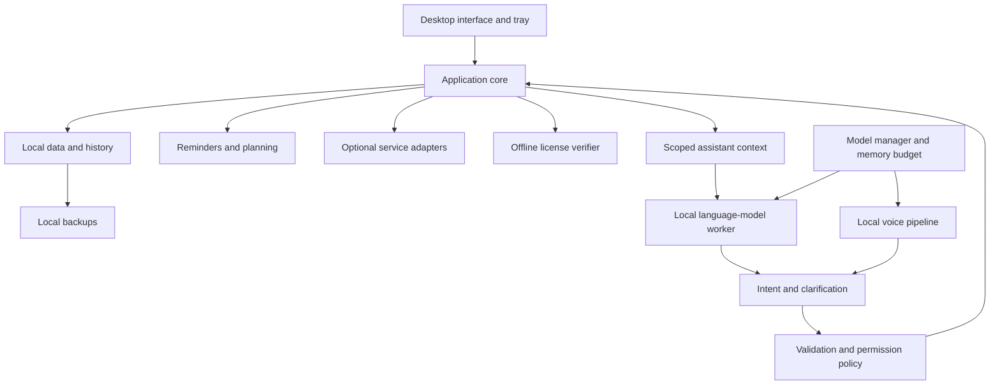

# Architecture proposal — first review

[Русская версия](PROPOSAL.ru.md) · [Product requirements](../PRODUCT.md) · [Required visual design](../DESIGN.md) · [Decision register](DECISIONS.md)

Date: 2026-11-03. Status: PROPOSED, not approved. This is a reviewable design, not permission to program or a claim that performance targets have been met. No application components, installer, or licensing mechanism have been implemented. Approved constraints come from the product discussion; every technology and implementation choice below remains proposed.

## 1. Design constraints

- Commercial, individual-user task/habit tracker with a voice assistant; English and Russian.
- Windows 10 and 11 first; target 8 GiB RAM without a discrete GPU. Exact builds, CPU instruction sets, x64/ARM64 coverage, performance, and minimum free disk space require validation.
- Current AI inference and application data stay local. Optional search, weather, Google/Microsoft integrations, and asset downloads use the internet; local inference does not make those services offline.
- Seven-day per-device trial, paid subscription, offline licensing, no entitlement server; expiry locks features while preserving data for renewal.
- Future Android and synchronization are considered at domain boundaries, without implementing a cloud backend now.
- Automatic hardware-adapted model preparation. "Hidden" is interpreted as no console or manual model commands, with an in-app preparation status; the status presentation is a proposal to review.

## 2. Logical structure

Use a modular application core with separate, replaceable local inference workers. This avoids distributing business rules across the interface, prompts, and external service adapters. Do not introduce network microservices for local business modules.

The language model proposes typed intents. Only the application core can commit changes or invoke approved service actions. Text obtained from search, messages, and attachments is data, never authority to change permissions.

## 3. Technology candidates

The owner's [visual specification](../DESIGN.md) is the required Djarvis design, not an optional style alternative. Technology candidates must implement it: Dark Glassmorphism/Bento, three exact palettes, independent Glass/Solid materials, the circular assistant above the day panel, and all six combinations. The previous technology preference is unapproved and must be evaluated against these requirements. CSS/React examples in the local brief do not independently select a production stack.

| Area | Preferred candidate for discussion | Alternative / unresolved choice |
| --- | --- | --- |
| Interface and reusable application packages | Flutter/Dart | .NET MAUI/C# with the same boundaries |
| Local language inference | Bundled llama.cpp-based worker using pinned GGUF artifacts | Exact runtime build, process protocol, and supported CPU/GPU backends |
| Voice processing | Local provider interfaces; evaluate sherpa-onnx components | Final wake, ASR, TTS, and voice assets need separate tests and licenses |
| Structured local data | SQLite with a serialized write owner and versioned migrations | Driver, attachment layout, and encryption policy |
| Windows integration | A platform adapter for microphone, tray, startup, notifications, credentials, and device actions | Concrete plugins/native bindings selected after review |

Flutter is my preferred candidate because the custom circular interface and later Android interface can share a UI framework and application packages. This is a design judgment, not a measured RAM or speed advantage over MAUI. Flutter currently lists Windows 10/11 and Android among supported deployment targets; MAUI also documents Windows and Android targets. Exact release versions must be pinned after selection. [Flutter support](https://docs.flutter.dev/reference/supported-platforms), [MAUI support](https://learn.microsoft.com/dotnet/maui/supported-platforms).

llama.cpp provides local CPU/GPU inference and uses GGUF; its runtime code has an MIT license. sherpa-onnx supplies offline speech-related components across desktop/mobile platforms. Runtime licenses do not grant rights to every model, voice, or character. [llama.cpp](https://github.com/ggml-org/llama.cpp), [runtime license](https://github.com/ggml-org/llama.cpp/blob/master/LICENSE), [speech project](https://github.com/k2-fsa/sherpa-onnx).

Windows application compatibility and the operating system's support lifecycle are separate. Standard Windows 10 Home/Pro support ended on 2025-10-14; LTSC releases follow their own lifecycles. The product's Windows 10 compatibility target remains, but exact builds/editions must be recorded and tested without promising OS maintenance. [Microsoft lifecycle](https://learn.microsoft.com/en-us/lifecycle/products/windows-10-home-and-pro).

## 4. Processes and lifecycle

Propose one per-user background application host, an on-demand interface, and worker processes for heavyweight inference. The host owns the database, scheduler, permission decisions, and worker lifecycle. The framework-specific split between UI and host is a design item to settle before implementation.

If Flutter is approved, evaluate a separately packaged native Dart host sharing pure Dart domain packages with the interface. Dart documents native executables and C API interoperability; these capabilities do not prove that a particular Flutter plugin works without its UI engine. Select headless-compatible platform bindings explicitly. [Native compilation](https://dart.dev/tools/dart-compile), [C interoperability](https://dart.dev/interop/c-interop).

- Closing the main window leaves the host and tray active. Configurable Windows startup starts the host in the user's session.
- "Fully exit" stops the host and its workers, cancels audio work, and releases microphone capture. A supervisor must not restart an intentionally exited session.
- A crashed or out-of-memory inference worker is restarted independently; it cannot own or corrupt planner transactions.
- Prefer parent-owned process handles or access-controlled local IPC with versioned messages. Do not expose an unauthenticated local control HTTP service. Any temporary OAuth callback listener is separate and narrowly scoped.
- Microphone mute stops capture for wake detection and conversation immediately. Its visible state must be consistent in the main window and tray.
- Background actions check license and permission policy, not just whether a UI button is enabled.

## 5. Models and the 8 GiB target

The existing Qwen3.5 4B installation is a development candidate tested on a 32 GiB/GPU machine; it is not the baseline customer configuration. See [local evaluation](../LOCAL_MODEL.md).

Define a signed asset catalog with immutable versions, hashes, sizes, licenses, runtime compatibility, required CPU/backend features, language support, and measured resource profiles. Select using available RAM, CPU architecture/instruction support, optional GPU/backend availability, and free disk space, all assessed locally. Model selection must not reuse a licensing fingerprint as telemetry.

| Proposed profile | Selection goal | Required evidence before offering it |
| --- | --- | --- |
| Baseline CPU / 8 GiB target | Small quantized text model, bounded context, lightweight resident wake detection, sequential heavy workloads | Real CPU-only 8 GiB tests of end-to-end quality, responsiveness, and peak memory |
| Balanced | Larger model only if remaining memory supports the complete voice pipeline | Combined LLM/ASR/TTS measurements, including other applications |
| GPU / higher resources | Optional acceleration and higher quality | Backend/driver compatibility and recovery checks |

Qwen3.5 0.8B/2B are candidates for evaluation, not approved defaults or guaranteed replacements. Their official model cards identify Apache-2.0 licensing. [0.8B card](https://huggingface.co/Qwen/Qwen3.5-0.8B), [2B card](https://huggingface.co/Qwen/Qwen3.5-2B).

Use a memory coordinator: cap context and output, permit one heavy generation at a time on baseline devices, unload idle models, bound queues, cancel obsolete requests, and back off under memory pressure. Keep a low-cost wake path separate from a full language-model invocation. If no candidate meets quality and resource requirements, report this rather than silently using cloud inference or declaring 8 GiB support complete.

## 6. First launch and asset installation

Proposed flow: launch interface → local capability check → choose compatible asset set → display preparation status → resume downloads → verify hashes/signatures/licenses → validate runtime loading → mark assistant ready.

The installer contains the application and required runtime components, not every model. Downloads use pinned HTTPS sources and resumable temporary files, check disk requirements before transfer, verify size/hash before activation, and preserve a known working asset set on failure. No console, manual model manager, global Python setup, or automatic driver replacement is required by the proposed user flow. Runtime packaging must still be validated.

Model preparation runs automatically; its progress and recoverable errors belong in the application. Proposed behavior is to keep manual planner access available while assets prepare, subject to the trial/license rules. Cancellation and retry must not reset trial eligibility. The exact trial-start moment and download UI need owner review.

## 7. Application modules

| Module | Responsibility |
| --- | --- |
| Tasks and projects | Task fields, task occurrences, projects, optional advanced fields, completion and debt |
| Habits | Four measurement types, fixed/flexible schedules, logs, statistics, missed occurrences without debt |
| Calendar and planner | Events, availability, priorities, deadlines, durations, breaks, proposals, and conflicts |
| Assistant orchestration | Session state, permitted context, typed tool proposals, cancellation, clarification |
| Permission policy | Scoped task preferences; mandatory mail/file confirmations; proposal-only habit goal/load changes |
| Voice and notifications | Wake, ASR, dialogue timeout/stop, TTS interruption, mute, quiet hours, calls/games |
| Connections | OAuth, provider mapping, bidirectional sync, retries, outbox, and explicit conflicts |
| Data and recovery | Transactions, migrations, history retention/deletion, local snapshots and restore |
| Entitlements and assets | Offline license checks, trial state, asset verification and resource profiles |

Dates, facts, counts, task states, and habit statistics come from deterministic domain logic, not invented model text. Automatic day planning uses explicit constraints; AI can explain a proposal, but cannot override conflicts or silently move overdue tasks.

## 8. Command execution contract

Proposed lifecycle: recognized text or UI command → typed intent → resolve target and dates → clarify ambiguity → validate current revisions and policy → request confirmation if required → atomic commit / queued provider action → result and audit entry.

An action includes a unique ID, target IDs/revisions, proposed changes, permission scope, and confirmation state. Retry must not duplicate a task or send a message twice. Confirmations are bound to the exact proposed operation; a changed operation needs a new review. Ambiguity is resolved even when task confirmation is disabled.

Sending email, deleting files, and overwriting files always require confirmation. Habit goal/load changes always remain proposals until accepted. The model never receives a general shell, permission-editing tool, or unrestricted database access. Device actions use explicitly configured capabilities; their remaining confirmation rules require review.

## 9. Proposed data model

Core entities: Profile, Task, TaskOccurrence, Project, Note, CalendarEvent, Habit, HabitSchedule, HabitLog, Conversation, Message, Settings, CapabilityGrant, PendingAction, AuditEntry, ExternalMapping, SyncCursor, OutboxEntry, SyncConflict, InstalledAsset, LicenseState.

Task occurrences preserve debt; habit logs preserve misses without creating debt. Maintain deadline and planned execution time separately. Preserve timezone/recurrence semantics rather than treating every calendar item as a single UTC timestamp; all-day dates, DST transitions, missed occurrences, and completion-relative repeats need a detailed temporal specification.

Use transactions for related changes and serialize writes. SQLite supports transactional changes; its Online Backup API supplies a consistent snapshot of a live database. Do not back up an active database by naively copying one file. [Transactions](https://www.sqlite.org/lang_transaction.html), [backup API](https://www.sqlite.org/backup.html).

Proposed production layout is under the current user's application-data directory, with distinct data, attachments, model cache, backups, and logs. Repository `data/` and `cache/` are development locations, not a requirement to put customer data beside an installed executable. Backup paths and retention remain configurable design items.

## 10. Conversation, voice, and proactive behavior

Proposed audio states: muted → waiting for wake phrase → listening → recognizing → resolving/clarifying → executing an accepted action → speaking → listening until timeout/stop. Mute can interrupt every capture state; a new utterance can cancel speech output. Echo handling must prevent the assistant from repeatedly recognizing its own voice.

Implement configurable wake names locally. Support custom phrases only through a validated local detection strategy; arbitrary phrases and Russian/English recognition need accuracy and false-trigger evaluation. Do not promise a particular detector can handle every phrase without tests.

Quiet hours, calls, and games suppress proactive voice and use normal notifications. User-requested responses are a separate policy. Detection must be tested across applications and allow user correction; respect Windows notification settings. Define duplicate suppression and trigger timing for first daily entry, meetings, missed habits, and return after absence.

The circular visualization reflects defined states such as listening, thinking, speaking, muted, and preparing. Persona affects presentation and voice style, never permissions, factual state, or business rules. Exact character/voice asset rights and language versions are still unverified.

The rest of the interface follows the mandatory [Djarvis visual design](../DESIGN.md): navigation, header, Bento task/habit/calendar surfaces, menus, dialogs, lists, and statistics share semantic tokens. Exact palette values and independent transparency are requirements; spacing, blur, animation timing, and derived surface colors are adaptable guidance. No background image or unrelated CRM business entities are introduced.

Store appearance preferences locally and apply changes immediately. Solid uses opaque surface fills without backdrop blur, including nested panels. Reduced-motion settings, keyboard focus, non-color status indicators, contrast targets, and the specified opaque fallback belong to the design contract. Measure effects and circular animation together with the voice/AI workload on the 8 GiB target; do not silently replace the chosen material just because a computer is in the baseline profile. Source mockup video/images were not present locally, so visual fidelity has not been verified.

## 11. Google and Microsoft connections

Use native/public-client OAuth through the system browser and provider-approved redirect/PKCE mechanisms; do not treat an embedded client secret as confidential. Store tokens in the Windows credential/protection adapter, separate from planner data and portable backups. DPAPI is a Windows candidate with user/machine binding implications; restoring on another device may require reconnecting accounts. [Google native OAuth](https://developers.google.com/identity/protocols/oauth2/native-app), [Microsoft desktop registration](https://learn.microsoft.com/entra/identity-platform/scenario-desktop-app-registration), [Windows protection API](https://learn.microsoft.com/en-us/windows/win32/api/dpapi/nf-dpapi-cryptprotectdata).

Sync uses local external-ID mapping, a durable outbox, provider change cursors, retry/backoff, and revision history. Google Calendar offers sync tokens and resource version checks; Microsoft Graph provides calendar delta tracking. Handle invalid cursors with a controlled resync. Where a conditional write is supported, use it; never use cursor arrival order as conflict resolution. [Google sync](https://developers.google.com/workspace/calendar/api/guides/sync), [Google versions](https://developers.google.com/workspace/calendar/api/guides/version-resources), [Graph delta](https://learn.microsoft.com/graph/api/event-delta?view=graph-rest-1.0).

If the same event changes on both sides, preserve both versions and ask the user. Losing connectivity must not silently discard local edits. Provider app registration, requested scopes, consent verification, deletion semantics, recurring-event mapping, and the selected synchronization window need a separate specification. Search results and remote message content remain untrusted inputs to the assistant.

Gmail is also an initial adapter, separate from calendar synchronization. Specify reading/searching, draft preparation, and sending as individually permissioned operations before implementation. Every send still requires confirmation tied to the recipient, content, and attachments. Choose the narrowest scopes needed for the agreed operations and establish local message-cache retention; do not assume a full mailbox copy is required. [Gmail authorization scopes](https://developers.google.com/workspace/gmail/api/auth/scopes).

## 12. History, backups, and recovery

History is local with user-selected retention, an off switch, and delete-all. Keep conversation history separate from approved profile preferences. Do not create new long-term memories merely because a conversation exists.

Use versioned local snapshots including database and referenced attachment metadata; exclude model weights and credentials from normal user backups. Define crash-consistent attachment handling, retention, optional encryption, restore preview, and migration compatibility. Deletion and retention policies must also govern application-managed backups and restoration; do not silently resurrect deleted conversation history. External copies cannot be promised physically erased by this application.

Before migrations and hard-to-reverse changes, make a verified recoverable snapshot. Expiry preserves data; renewal restores feature access. Exact backup schedule, destination, restore authorization, and expiry-screen behavior require owner review.

## 13. Offline trial and subscription

Propose an offline license artifact signed by a separate publisher-controlled issuer. The client contains verification material only; the signing private key never ships with it. An artifact can bind an entitlement period and edition to a device policy. Key format, signing library, hardware-change tolerance, issuance, purchase flow, and renewal are not selected.

Keep local trial eligibility distinct from user data, optional accounts, model selection, and imported backups. A new account or data restore should not intentionally reset eligibility. Device binding identifies a device, not a person. With no server, clock rollback, reinstallations, administrator control, and hardware changes limit enforcement; do not claim unbypassable seven-day protection. Strict anti-abuse guarantees would require reconsidering constraints, not hiding a server in the design.

The earlier account-for-subscription requirement and an offline verifier need a concrete purchase/identity workflow. Do not implement a nonexistent online account backend or claim automated recurring payments already exist. A renewal/activation path must remain reachable while paid features are locked; its UX requires explicit review.

## 14. Android and future synchronization

Keep domain rules, stable entity IDs, revisions, and data-format versions independent of Windows APIs and model providers. Future Android substitutes platform adapters and lifecycle management; do not assume Windows background microphone/tray behavior transfers unchanged to a phone.

Do not synchronize SQLite files directly between devices. Later synchronization needs an approved transport, identity model, conflict protocol, deletion rules, and encryption policy. These are future design work, not a current cloud-storage implementation.

## 15. Source organization proposal

Map the current scaffold to explicit modules before creating files: `src/core` for domain/application rules; `src/agents` for orchestration/personas; `src/tools` for typed actions and policy; `src/integrations` for provider/platform adapters; `src/memory` for context/history interfaces; `src/interfaces` for UI and voice entry points. A selected framework may require a revised package layout; discuss it before moving existing files.

Keep native workers, application assets, model manifests, schema migrations, and packaging configuration separate from user runtime data. No production dependencies are added by this document.

## 16. Verification and approval sequence

1. Review the already specified visual requirements and their mapping to Djarvis screens, then review component boundaries and choose the primary UI/core technology; record an approved architecture decision only after owner agreement.
2. Specify entities, commands, permission state transitions, dates/recurrence, sync conflicts, and recovery. Resolve product defaults alongside these contracts.
3. Approve isolated feasibility checks for CPU-only 8 GiB performance, voice interruption/custom wake phrases, Windows integration, and offline licensing behavior.
4. Select exact engine/model/voice versions and redistribution terms from evidence. Define measured startup, latency, memory, and accuracy acceptance targets.
5. Review the final architecture, package structure, and implementation plan; obtain owner approval before programming.

Verification must cover duplicate intents, stale confirmations, ambiguous commands, denied capabilities, trial expiry, offline clock changes, interrupted downloads, corrupt assets, low memory, inference crashes, microphone release on exit/mute, restart-safe reminders, backup restoration, history deletion, recurring debt versus habit misses, and two-sided calendar conflicts. This is a future verification plan; no such application tests have been run yet.

The required visual direction is supplied by the owner; it is not being replaced by this architecture proposal. Initial review should align Djarvis screen composition with that design, then settle the modular core/worker split and framework direction. Model quality on baseline hardware, requested production voices, offline-license assurance, account/purchase workflow, exact Windows architecture coverage, and remaining behavioral defaults stay visible as unresolved items rather than assumed approvals.
