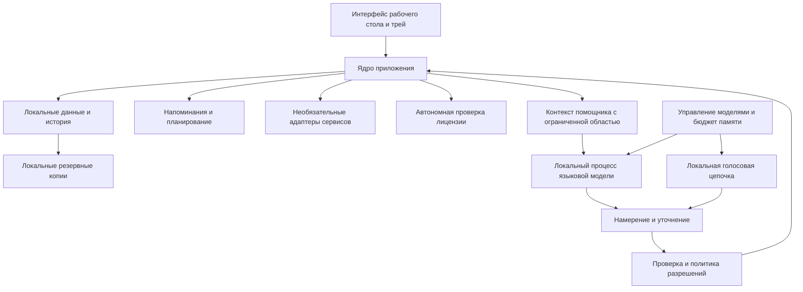

# Предложение по архитектуре — первый обзор

[English version](PROPOSAL.md) · [Требования к продукту](../PRODUCT.ru.md) · [Обязательный визуальный дизайн](../DESIGN.ru.md) · [Реестр решений](DECISIONS.ru.md) · [Проект ядра планера](PLANNER_CORE.ru.md)

Дата: 2026-11-03. Статус: ПРЕДЛОЖЕНИЕ, не утверждено, кроме узких решений по UI в ADR-001, локальной базе PostgreSQL в ADR-002, Python для ядра/фоновой логики в ADR-003, жизненного цикла изолированного PostgreSQL под управлением приложения в ADR-004 и импорта офлайн-лицензии/правил пробного периода в ADR-005. Это проект для рассмотрения, а не разрешение на программирование и не заявление о достижении целевых показателей производительности. Компоненты приложения, установщик и механизм лицензирования не реализованы. Утверждённые ограничения и эти узкие решения взяты из обсуждения продукта; все прочие технологические и реализационные решения ниже остаются предложениями.

## 1. Ограничения проектирования

- Коммерческий персональный трекер задач и привычек с голосовым помощником; русский и английский языки.
- Сначала Windows 10 и 11; целевой ориентир — 8 ГиБ оперативной памяти без дискретной видеокарты. Конкретные сборки, наборы инструкций процессора, поддержка x64/ARM64, производительность и минимальный объём свободного диска требуют проверки.
- В текущей версии ИИ выполняет выводы локально, данные приложения остаются локальными. Необязательный поиск, погода, интеграции с Google/Microsoft и загрузка ресурсов используют интернет; локальный вывод ИИ не делает эти сервисы автономными.
- Локальный профиль без обязательного аккаунта в приложении; покупатель импортирует подписанный файл лицензии, который проверяется автономно, без собственного сервера активации/регистрации прав Djarvis. Семидневный пробный период на устройство начинается при первом использовании любой функции продукта, включая ручной планировщик; настройка и ожидание загрузки моделей его не запускают. По окончании функции планировщика/помощника блокируются, данные сохраняются; продление/импорт, удаление по инициативе пользователя и автоматические локальные копии остаются доступны, а захват микрофона и инициативная речь прекращаются. Формат лицензии, алгоритм подписи/эмитент, платёжный провайдер, цена, период продления, привязка к устройству и погрешность часов остаются открытыми.
- Будущие Android и синхронизация учитываются на границах предметной области, но облачная серверная часть сейчас не реализуется.
- Автоматическая подготовка моделей с учётом оборудования. «Скрытая» установка трактуется как отсутствие консоли и ручных команд для работы с моделями с отображением статуса подготовки в приложении; отображение статуса — предложение для обсуждения.

## 2. Логическая структура

Предлагается модульное ядро приложения с отдельными заменяемыми локальными процессами вывода моделей. Это не даёт бизнес-правилам расползтись по интерфейсу, промптам и адаптерам внешних сервисов. Не следует вводить сетевые микросервисы для локальных бизнес-модулей.

Языковая модель предлагает типизированные намерения. Только ядро приложения может сохранять изменения или вызывать разрешённые действия сервисов. Текст из поиска, сообщений и вложений считается данными, а не полномочием менять разрешения.

## 3. Кандидаты технологий

[Визуальная спецификация владельца](../DESIGN.ru.md) — обязательный дизайн Djarvis, а не один из вариантов оформления. Технологии должны его реализовывать: Dark Glassmorphism/Bento, три точные палитры, независимые материалы Glass/Solid, круг помощника над панелью дня и все шесть комбинаций. Flutter/Dart для UI утверждены по ADR-001; примеры CSS/React в локальном документе не определяют дополнительные технологии выпуска.

| Область | Статус / кандидат | Альтернатива / нерешённый выбор |
| --- | --- | --- |
| Платформа UI и необходимая реализация интерфейса | Flutter/Dart (выбрано по ADR-001) | .NET MAUI/C# рассматривался, но не выбран |
| Локальный вывод языковой модели | Встроенный процесс на основе llama.cpp с закреплёнными артефактами GGUF | Точная сборка среды, протокол процесса и поддерживаемые CPU/GPU-бэкенды |
| Обработка речи | Локальные интерфейсы поставщиков; оценить компоненты sherpa-onnx | Окончательные средства распознавания ключевой фразы, ASR, TTS и речевые ресурсы требуют отдельных испытаний и проверки лицензий |
| База данных бэкенда | PostgreSQL локально на устройстве пользователя (ADR-002) | Драйвер, версия, схема, миграции, распространение/упаковка частного экземпляра и модель соединений/пула |
| Интеграция с Windows | Адаптер платформы для микрофона, области уведомлений, автозапуска, уведомлений, учётных данных и действий устройства | Конкретные плагины/связки с нативным кодом выбираются после рассмотрения |

Владелец выбрал Flutter для UI и необходимую реализацию интерфейса на Dart (ADR-001), учитывая обязательный круговой дизайн, приоритет Windows и дальнейший переход к Android. Это не измеренное преимущество по памяти или скорости перед .NET MAUI, который рассматривался в первоначальном предложении, но не является активной альтернативой для UI. В актуальном списке Flutter указаны Windows 10/11 и Android как целевые платформы развёртывания. Точные версии SDK Flutter/Dart и зависимости остаются невыбранными. [Поддерживаемые платформы Flutter](https://docs.flutter.dev/reference/supported-platforms), [историческое сравнение с MAUI](https://learn.microsoft.com/dotnet/maui/supported-platforms).

llama.cpp поддерживает локальный вывод на CPU/GPU и использует GGUF; код среды выполнения распространяется по лицензии MIT. sherpa-onnx предоставляет автономные компоненты для работы с речью на настольных и мобильных платформах. Лицензии среды выполнения не дают прав на каждую модель, голос или персонажа. [llama.cpp](https://github.com/ggml-org/llama.cpp), [лицензия среды выполнения](https://github.com/ggml-org/llama.cpp/blob/master/LICENSE), [проект обработки речи](https://github.com/k2-fsa/sherpa-onnx).

Совместимость приложения и жизненный цикл поддержки ОС различаются. Обычная поддержка Windows 10 Home/Pro завершилась 2025-10-14; выпуски LTSC имеют собственные сроки. Цель совместимости продукта с Windows 10 сохраняется, но конкретные сборки/редакции нужно зафиксировать и проверить, не обещая сопровождение самой ОС. [Жизненный цикл Microsoft](https://learn.microsoft.com/en-us/lifecycle/products/windows-10-home-and-pro).

## 4. Процессы и жизненный цикл

Предлагается один фоновый процесс приложения в пользовательском сеансе, интерфейс по требованию и рабочие процессы для ресурсоёмкого вывода моделей. Фоновый процесс владеет базой данных, планировщиком, решениями о разрешениях и жизненным циклом рабочих процессов. Python утверждён для логики ядра/фонового процесса в ADR-003; Flutter/Dart остаётся UI. ADR-004 утверждает управление приложением запуском/остановкой изолированного локального экземпляра PostgreSQL. Версия Python, драйвер, локальный транспорт/фреймворк, упаковка среды выполнения, дистрибутив/бинарные файлы базы и зависимости установщика остаются открытыми.

Среда выполнения Python должна упаковываться и управляться приложением так, чтобы пользовательский сценарий не требовал терминала, глобальной установки Python или ручной установки пакетов. Способ упаковки и фреймворк процесса/IPC не выбраны. Это требование не определяет версию Python, драйвер, способ заморозки/встраивания среды или зависимости установщика.

- Закрытие главного окна оставляет фоновый процесс и значок в области уведомлений активными. Настраиваемый запуск Windows при входе пользователя запускает фоновый процесс в его сеансе.
- Команда «Полностью выйти» останавливает фоновый процесс и его рабочие процессы, отменяет обработку аудио и освобождает микрофон. Супервизор не должен перезапускать сеанс, завершённый намеренно.
- Аварийно завершившийся рабочий процесс вывода модели или процесс, остановленный из-за нехватки памяти, перезапускается независимо; он не может владеть транзакциями планера или повредить их.
- Предпочтительны дескрипторы процессов, которыми владеет родительский процесс, либо локальный IPC с контролем доступа и версионируемыми сообщениями. Не открывать неаутентифицированный локальный HTTP-сервис управления. Любой временный прослушиватель обратного вызова OAuth должен быть отдельным и иметь узкую область действия.
- Отключение микрофона немедленно прекращает захват для распознавания ключевой фразы и разговора. Видимый индикатор состояния должен совпадать в главном окне и области уведомлений.
- Фоновые действия проверяют лицензию и политику разрешений, а не только то, включена ли кнопка интерфейса.

## 5. Модели и ориентир 8 ГиБ

Установленная Qwen3.5 4B — кандидат для разработки, проверенный на машине с 32 ГиБ памяти и GPU; это не базовая конфигурация клиента. См. [локальную оценку](../LOCAL_MODEL.ru.md).

Предлагается определить подписанный каталог ресурсов с неизменяемыми версиями, хешами, размерами, лицензиями, совместимостью со средой выполнения, необходимыми возможностями процессора/бэкенда, языковой поддержкой и измеренными профилями ресурсов. Выбор выполняется локально на основе доступной памяти, архитектуры/набора инструкций процессора, наличия дополнительного GPU/бэкенда и свободного места на диске. При выборе модели нельзя повторно использовать отпечаток лицензирования для телеметрии.

| Предлагаемый профиль | Цель выбора | Требуемые свидетельства до предложения пользователю |
| --- | --- | --- |
| Базовый CPU / ориентир 8 ГиБ | Небольшая квантованная текстовая модель, ограниченный контекст, лёгкое постоянно работающее распознавание ключевой фразы, последовательное выполнение тяжёлых задач | Реальные испытания только на CPU с 8 ГиБ: качество всей цепочки, отзывчивость и пик потребления памяти |
| Сбалансированный | Модель большего размера, только если оставшейся памяти хватает на всю голосовую цепочку | Совместные измерения LLM/ASR/TTS, включая влияние других приложений |
| GPU / больше ресурсов | Необязательное ускорение и более высокое качество | Проверки совместимости бэкенда/драйвера и восстановления после сбоя |

Qwen3.5 0.8B/2B — кандидаты для оценки, а не утверждённые значения по умолчанию и не гарантированные замены. В официальных карточках моделей указана лицензия Apache-2.0. [Карточка 0.8B](https://huggingface.co/Qwen/Qwen3.5-0.8B), [карточка 2B](https://huggingface.co/Qwen/Qwen3.5-2B).

Использовать координатор памяти: ограничивать контекст и вывод, разрешать только одну тяжёлую генерацию одновременно на базовых устройствах, выгружать простаивающие модели, ограничивать очереди, отменять устаревшие запросы и снижать нагрузку при дефиците памяти. Лёгкий путь распознавания ключевой фразы отделить от полного вызова языковой модели. Если ни один кандидат не удовлетворяет требованиям качества и ресурсов, сообщать об этом, а не переходить молча на облачный вывод и не объявлять поддержку 8 ГиБ достигнутой.

## 6. Первый запуск и установка ресурсов

Предлагаемый сценарий: запуск интерфейса → локальная проверка возможностей устройства → выбор совместимого набора ресурсов → отображение статуса подготовки → возобновляемая загрузка → проверка хешей/подписей/лицензий → проверка загрузки в среде выполнения → отметка «Помощник готов».

Установщик содержит приложение и необходимые компоненты среды выполнения, но не все модели. Загрузки используют закреплённые HTTPS-источники и возобновляемые временные файлы; до передачи проверяется требуемое место на диске, перед активацией — размер и хеш, а при сбое сохраняется последний заведомо рабочий набор ресурсов. Предлагаемый пользовательский сценарий не требует консоли, ручного менеджера моделей, глобальной настройки Python или автоматической замены драйверов. Упаковку среды выполнения ещё предстоит проверить.

Подготовка моделей выполняется автоматически; её прогресс и ошибки, которые можно исправить, показываются в приложении. Предлагается оставить ручной доступ к планеру на время подготовки ресурсов, с учётом правил пробного периода/лицензии. Отмена и повторная попытка не должны сбрасывать право на пробный период. Начало пробного периода при первом использовании подтверждено: если предложенный ручной планировщик доступен во время подготовки моделей и им пользуются, пробный период начинается. Доступность и представление ручного планировщика во время подготовки остаются предложением.

## 7. Модули приложения

| Модуль | Ответственность |
| --- | --- |
| Задачи и проекты | Поля задач, вхождения задач, проекты, необязательные расширенные поля, выполнение и долг |
| Привычки | Четыре типа измерения, фиксированные/гибкие расписания, записи, статистика, пропуски без долга |
| Календарь и планировщик | События, доступное время, приоритеты, крайние сроки, длительность, перерывы, предложения и конфликты |
| Оркестрация помощника | Состояние сессии, разрешённый контекст, типизированные предложения действий, отмена, уточнение |
| Политика разрешений | Ограниченные предпочтения по задачам; обязательные подтверждения почты/файлов; только предложения по изменению целей/нагрузки привычек |
| Голос и уведомления | Ключевая фраза, ASR, тайм-аут/завершение диалога, прерывание TTS, отключение микрофона, тихие часы, звонки/игры |
| Подключения | OAuth, сопоставление поставщиков, двусторонняя синхронизация, повторы, очередь исходящих операций и явные конфликты |
| Данные и восстановление | Транзакции, миграции, срок хранения/удаление истории, локальные снимки и восстановление |
| Права и ресурсы | Автономная проверка лицензии, состояние пробного периода, проверка ресурсов и профили потребления |

Даты, факты, количества, состояния задач и статистика привычек берутся из детерминированной доменной логики, а не из выдуманного моделью текста. Автоматическое планирование дня использует явные ограничения; ИИ может объяснить предложение, но не может отменять конфликты или молча переносить просроченные задачи.

## 8. Контракт выполнения команд

Подробные предлагаемые сущности, команды, правила планирования и границы локальных транзакций/результатов провайдеров описаны в [проекте ядра планера](PLANNER_CORE.ru.md). Этот подробный проект пока не утверждён; согласование Flutter UI само по себе его не выбирает.

Предлагаемый жизненный цикл: распознанный текст или команда интерфейса → типизированное намерение → определение цели и дат → уточнение неоднозначности → проверка актуальных ревизий и политики → запрос подтверждения, если оно обязательно → атомарное сохранение / постановка действия поставщику в очередь → результат и запись аудита.

Действие содержит уникальный ID, ID/ревизии целей, предлагаемые изменения, область разрешения и состояние подтверждения. Повторная попытка не должна создавать дубликат задачи или отправлять сообщение дважды. Подтверждение связано с конкретной предложенной операцией; при изменении операции нужна новая проверка. Неоднозначность устраняется даже при отключённом подтверждении задач.

Отправка писем, удаление файлов и перезапись файлов всегда требуют подтверждения. Изменения целей/нагрузки привычек всегда остаются предложениями до принятия. Модель не получает общий доступ к оболочке команд, инструмент изменения разрешений или неограниченный доступ к базе данных. Действия устройства используют явно настроенные возможности; остальные правила подтверждения для них требуют рассмотрения.

## 9. Предложение по модели данных

Основные сущности: Profile, Task, TaskOccurrence, Project, Note, CalendarEvent, Habit, HabitSchedule, HabitLog, Conversation, Message, Settings, CapabilityGrant, PendingAction, AuditEntry, ExternalMapping, SyncCursor, OutboxEntry, SyncConflict, InstalledAsset, LicenseState.

Вхождения задач сохраняют долг; журналы привычек фиксируют пропуски без создания долга. Крайний срок и плановое время выполнения хранятся отдельно. Повторение сохраняет исходную календарную/интервальную точку отсчёта при позднем выполнении. Задача только с датой использует окно размещения 06:00–22:00 по умолчанию и собственную длительность, без неявного крайнего срока. В подробной временной спецификации нужно сохранить часовые пояса, даты на весь день, переходы времени и исходную идентичность повторов.

Выбран PostgreSQL как локальная база бэкенда; драйвер, версия, схема, миграции, распространение/упаковка частного экземпляра и модель соединений остаются открытыми вопросами. Связанные изменения выполнять транзакционно с подходящей проверкой ревизий. PostgreSQL документирует MVCC и изоляцию транзакций; детали реализации пока являются предложением. Для автоматических локальных копий можно рассмотреть `pg_dump` для согласованного снимка одной базы; согласование с вложениями и восстановление требуют проектирования. Нельзя считать простую копию файлов базы резервной копией. [Транзакции](https://www.postgresql.org/docs/current/tutorial-transactions.html), [MVCC](https://www.postgresql.org/docs/current/mvcc.html), [изоляция транзакций](https://www.postgresql.org/docs/current/transaction-iso.html), [pg_dump](https://www.postgresql.org/docs/current/app-pgdump.html), [форматы резервных копий](https://www.postgresql.org/docs/current/backup-file.html).

Предлагаемое производственное расположение — каталог данных текущего пользователя приложения с отдельными данными, вложениями, кэшем моделей, резервными копиями и журналами. `data/` и `cache/` в репозитории — места для разработки, а не требование хранить данные клиента рядом с установленным исполняемым файлом. Приложение управляет изолированным локальным экземпляром PostgreSQL; дистрибутив бинарных файлов, структура каталога данных и права доступа остаются открытыми.

## 10. Разговор, голос и инициативное поведение

Предлагаемые состояния аудио: отключено → ожидание ключевой фразы → слушает → распознаёт → определяет/уточняет намерение → выполняет принятое действие → говорит → продолжает слушать до тайм-аута/команды завершения. После ответа помощник по умолчанию ждёт 30 секунд следующую реплику пользователя; этот интервал настраивается и не ограничивает активную речь, вывод модели или TTS. «Хватит»/“Stop” завершает диалог и возвращает к ожиданию ключевой фразы, если микрофон не отключён, доступ действует и необходимые локальные ресурсы доступны. Ручное отключение действует в течение текущего сеанса приложения. После настоящего перезапуска приложения/Windows ожидание ключевой фразы возобновляется, если это разрешает Windows и действуют доступ/ресурсы; системное/аппаратное отключение учитывается и не переопределяется. Повторное открытие окна при работающем хосте не является перезапуском приложения. Полный выход останавливает рабочие процессы и захват до следующего разрешённого запуска. Текущее состояние микрофона показывается в главном окне и области уведомлений; точные надписи и реализация остаются проектными. Новая реплика может отменить озвучивание. Обработка эха должна предотвращать повторное распознавание собственного голоса помощника.

Реализовать локально настраиваемые имена ключевой фразы. Поддерживать произвольные фразы только через проверенную локальную стратегию обнаружения; точность распознавания и ложные срабатывания для произвольных фраз и русского/английского нужно оценить. Не обещать, что конкретный детектор распознаёт любую фразу без испытаний.

При первом запуске предложить настроить инициативное поведение. Пока пользователь не выберет вариант, инициативная речь выключена; пропуск предложения не считается согласием. Нужно спросить расписание тихих часов по местному времени или явный выбор «без тихих часов»; расписание по умолчанию не подразумевается. Тихие часы, звонки/игры и ручной тихий режим подавляют инициативную речь с переходом на обычные уведомления ОС при наличии разрешения, не отключая микрофон и не меняя разговор по запросу. Принятый подход к звонкам/играм сочетает системные эвристики, выбранный пользователем список приложений и ручной тихий режим; он не гарантирует обнаружение каждого звонка/игры. Если включён триггер возвращения после отсутствия, по умолчанию использовать 30 минут без ввода с клавиатуры/мыши в интерактивном сеансе; порог настраивается. Это не доказывает физическое отсутствие, не является глобальным мониторингом ввода ОС и не включает триггер автоматически. Точное время расписания/триггеров, детали обнаружения и интервалы подавления повторов открыты. Срок хранения истории разговоров по умолчанию — 30 дней; история остаётся настраиваемой, необязательной и удаляемой.

Круговая визуализация показывает определённые состояния, например слушает, обдумывает, говорит, отключена или готовится. Персонаж влияет на представление и стиль голоса, но не на разрешения, фактическое состояние и бизнес-правила. Права на точные образы/голоса и языковые версии всё ещё не проверены.

Остальной интерфейс следует обязательному [дизайну Djarvis](../DESIGN.ru.md): навигация, верхняя панель, Bento-блоки задач/привычек/календаря, меню, диалоги, списки и статистика используют общие семантические токены. Точные палитры и независимая прозрачность обязательны; интервалы, размытие, длительности анимаций и производные цвета поверхностей являются адаптируемыми ориентирами. Фоновое изображение и посторонние CRM-сущности не добавляются.

Настройки оформления хранятся локально и применяются сразу. Solid использует непрозрачные заливки без размытия подложки, включая вложенные панели. Уменьшение движения, фокус клавиатуры, обозначения статуса помимо цвета, целевые показатели контраста и заданный непрозрачный запасной режим входят в требования дизайна. Эффекты и анимацию круга нужно измерять вместе с голосом/ИИ на целевой конфигурации 8 ГиБ; нельзя молча заменять выбранный материал лишь из-за базового профиля компьютера. Исходного видео/изображений макета локально нет, поэтому визуальная точность не проверена.

## 11. Подключения Google и Microsoft

Использовать OAuth через системный браузер и механизмы обратного вызова/PKCE, одобренные поставщиком для публичных клиентов; не считать секрет встроенного клиента конфиденциальным. Хранить токены через адаптер защиты/учётных данных Windows, отдельно от данных планера и резервных копий. DPAPI — кандидат для Windows с последствиями привязки к пользователю/машине; при восстановлении на другом устройстве может понадобиться повторно подключить аккаунты. [Нативный OAuth Google](https://developers.google.com/identity/protocols/oauth2/native-app), [регистрация настольного приложения Microsoft](https://learn.microsoft.com/entra/identity-platform/scenario-desktop-app-registration), [API защиты Windows](https://learn.microsoft.com/en-us/windows/win32/api/dpapi/nf-dpapi-cryptprotectdata).

Синхронизация использует локальные сопоставления внешних ID, устойчивую очередь исходящих операций, курсоры изменений поставщика, повторы с задержкой и историей ревизий. Google Calendar предоставляет токены синхронизации и проверку версии ресурса; Microsoft Graph — получение изменений календаря через delta. При недействительном курсоре выполнять контролируемую повторную синхронизацию. Если доступна условная запись, использовать её; никогда не разрешать конфликты по порядку поступления курсоров. [Синхронизация Google](https://developers.google.com/workspace/calendar/api/guides/sync), [версии Google](https://developers.google.com/workspace/calendar/api/guides/version-resources), [Graph delta](https://learn.microsoft.com/graph/api/event-delta?view=graph-rest-1.0).

Если одно событие изменено с обеих сторон, сохранить обе версии и спросить пользователя. Потеря соединения не должна молча отбрасывать локальные правки. Регистрация приложения у поставщика, запрашиваемые области доступа, проверка согласия, семантика удаления, сопоставление повторяющихся событий и выбранный период синхронизации требуют отдельной спецификации. Результаты поиска и удалённое содержимое сообщений остаются недоверенными входными данными для помощника.

Gmail также входит в первые адаптеры и отделён от синхронизации календаря. До реализации нужно описать чтение/поиск, подготовку черновиков и отправку как операции с отдельными разрешениями. Каждая отправка по-прежнему требует подтверждения конкретных получателя, содержимого и вложений. Для согласованных операций выбираются минимально необходимые области доступа и правила хранения локального кэша писем; полная копия почтового ящика не предполагается обязательной. [Области авторизации Gmail](https://developers.google.com/workspace/gmail/api/auth/scopes).

## 12. История, резервные копии и восстановление

История хранится локально; пользователь выбирает срок хранения, может отключить её или удалить целиком. Хранить историю разговоров отдельно от одобренных настроек профиля. Не создавать новую долговременную память только потому, что состоялся разговор.

Автоматически создавать локальные копии ежедневно и перед изменениями структуры данных или миграциями. По умолчанию хранить семь дней; расписание и срок хранения настраиваются. Использовать отдельную настраиваемую локальную папку копий приложения вне рабочей базы PostgreSQL; точный путь остаётся открытым. Включать историю разговоров в автоматические копии. По ADR-006 защищать ключ копии средствами Windows без отдельного пароля и дополнительного ключа восстановления. Полный снимок восстанавливается только после предварительного просмотра и копирования текущих данных; выборочное восстановление не выбрано. Восстанавливать только данные в пределах архива, не лицензию/пробный период, учётные данные OAuth или образ Windows. Точные шифр/KDF, API/флаги защиты, область/хранение/ротация ключа, формат архива/миграции и механика восстановления после ошибки остаются открытыми. Не обещать переносимость или восстановление без доступа к защищённому ключу и не утверждать, что копия всегда работает только на том же компьютере. Использовать версионируемые снимки базы и метаданных связанных вложений; не включать веса моделей и учётные данные в обычные резервные копии. При удалении истории показывать затронутые копии и предлагать пересоздание или удаление после подтверждения пользователя; не удалять молча все пользовательские файлы. Не утверждать, что история полностью стёрта до завершения обработки архивов, и не восстанавливать удалённую историю молча. Автоматическое истечение 30-дневной истории в копиях, доступность/формат архивов, откат и действия при ожидающей/недоступной копии остаются открытыми. Не обещать физическое безопасное стирание или контроль внешних копий.

Перед миграциями создавать проверенную восстанавливаемую копию в рамках обязательного резервирования до изменений структуры/миграций. По окончании срока данные сохраняются; импорт/продление восстанавливает доступ к функциям. Импорт/продление, удаление по инициативе пользователя и автоматические локальные копии остаются доступны при блокировке планировщика/помощника; захват микрофона и инициативная речь прекращаются. Место копий, подтверждение восстановления и точная компоновка экрана по окончании срока остаются деталями проектирования.

## 13. Автономный пробный период и подписка

Утверждённый поток продукта предусматривает импорт покупателем подписанного файла лицензии с автономной проверкой приложением (ADR-005). Процесс выдачи, формат файла лицензии, алгоритм/библиотека подписи, эмитент, распространение ключа проверки, допустимость смены оборудования, покупка и период продления остаются предложениями или открытыми решениями. Закрытый ключ подписи должен оставаться за пределами клиента; конкретная криптографическая реализация и эмитент не выбраны.

Хранить право на пробный период отдельно от данных пользователя, необязательных аккаунтов, выбора модели и импортированных резервных копий. Новый аккаунт или восстановление данных не должны намеренно сбрасывать право на пробный период. Привязка устройства определяет устройство, а не человека. Без сервера откат часов, переустановки, права администратора и замена оборудования ограничивают принудительное соблюдение срока; не заявлять о не подлежащей обходу защите на семь дней. Строгие гарантии защиты от злоупотреблений потребовали бы пересмотра ограничений, а не скрытого добавления сервера.

Текущий поток офлайн-лицензии не требует аккаунта в приложении или собственного сервера активации/регистрации прав Djarvis. Покупатель импортирует подписанный файл лицензии для локальной проверки. Потребность в аккаунте/идентификации для будущей облачной синхронизации рассматривается отдельно и не спроектирована. Формат лицензии, алгоритм подписи и эмитент, платёжный провайдер, цена, период продления, политика привязки к устройству и погрешность часов остаются открытыми; не следует подразумевать автоматические повторяющиеся платежи или утверждённый процесс выдачи лицензии. Продление/импорт остаются доступными при блокировке функций планировщика/помощника вместе с удалением данных пользователем и автоматическими локальными копиями; точная компоновка экрана ещё требует проектирования.

## 14. Android и будущая синхронизация

Держать доменные правила, стабильные ID сущностей и версии форматов данных независимыми от API Windows и поставщиков моделей. В будущем Android заменит платформенные адаптеры и управление жизненным циклом; не предполагать, что фоновое использование микрофона/область уведомлений Windows без изменений применимо к телефону.

Не синхронизировать активные файлы базы напрямую между устройствами. Для будущей синхронизации нужны утверждённые транспорт, модель идентификации, протокол разрешения конфликтов, правила удаления и политика шифрования. Это будущая работа по проектированию, а не реализация облачного хранилища сейчас.

## 15. Предложение по организации исходников

Перед созданием файлов распределить текущий каркас по явным модулям: `src/core` для доменных/прикладных правил; `src/agents` для оркестрации/персонажей; `src/tools` для типизированных действий и политики; `src/integrations` для адаптеров поставщиков/платформ; `src/memory` для интерфейсов контекста/истории; `src/interfaces` для точек входа интерфейса и голоса. Выбранная платформа может потребовать пересмотра структуры пакетов; обсудить её до перемещения существующих файлов.

Держать нативные рабочие процессы, ресурсы приложения, манифесты моделей, миграции схемы и настройки упаковки отдельно от пользовательских данных времени выполнения. Этот документ не добавляет производственных зависимостей.

## 16. Последовательность проверки и согласования

1. Сопоставить заданный визуальный дизайн с экранами Djarvis и рассмотреть границы компонентов. Flutter/Dart UI, Python для ядра/фоновой логики, локальный PostgreSQL и управляемый приложением жизненный цикл изолированной базы выбраны в ADR-001–004; ADR-005 подтверждает только импорт офлайн-лицензии и правила пробного периода/доступа; оставшиеся границы хоста и точная упаковка сред выполнения/базы требуют отдельного решения владельца.
2. Специфицировать сущности, команды, переходы состояний разрешений, даты/повторения, конфликты синхронизации и восстановление. Согласовать продуктовые настройки вместе с этими контрактами.
3. Согласовать изолированные проверки реализуемости: производительность только на CPU при 8 ГиБ, прерывание речи/настраиваемые ключевые фразы, интеграция Windows и поведение автономного лицензирования.
4. На основе свидетельств выбрать точные версии движков/моделей/голосов и условия распространения. Определить целевые показатели запуска, задержки, памяти и точности.
5. Рассмотреть окончательную архитектуру, структуру пакетов и план реализации; получить согласие владельца до программирования.

План проверки должен охватывать дублирующиеся намерения, устаревшие подтверждения, неоднозначные команды, запрещённые возможности, окончание пробного периода, изменение системного времени в автономном режиме, прерванные загрузки, повреждённые ресурсы, нехватку памяти, сбои вывода модели, освобождение микрофона при выходе/отключении, ручное отключение на сеанс с возобновлением после настоящего перезапуска приложения/Windows, повторное открытие окна без перезапуска хоста, отсутствие захвата при истёкшем доступе или запрете ОС, возврат к ожиданию ключевой фразы по «Хватит»/“Stop”, 30-секундное ожидание после ответа без ограничения активной речи/вывода/TTS, выключенную инициативу при пропуске настройки, устойчивые к перезапуску напоминания, восстановление резервной копии, удаление истории, долг повторяющихся задач и пропуски привычек, а также конфликты календаря с обеих сторон. Это будущие сценарии; испытания приложения не выполнялись.

Обязательное визуальное направление задано владельцем и не заменяется этим предложением архитектуры. Flutter утверждён для UI, Python — для логики ядра/фонового процесса, а жизненный цикл локальной изолированной базы PostgreSQL — под управлением приложения в пределах ADR. На первом рассмотрении нужно соотнести компоновку экранов Djarvis с этим дизайном, затем согласовать разделение модульного ядра и рабочих процессов и детали упаковки. Качество моделей на базовом оборудовании, запрошенные производственные голоса, гарантии автономной лицензии, детали выдачи лицензий/оплаты, потребность в идентификации для будущей облачной синхронизации, точное покрытие архитектур Windows и оставшиеся поведенческие настройки остаются явно нерешёнными вопросами, а не предполагаемыми разрешениями.
